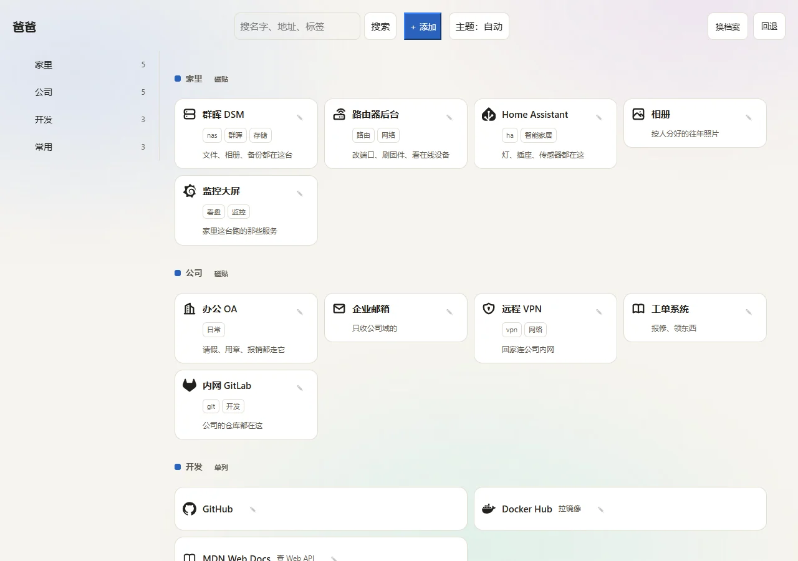

# launchbay

> English | [简体中文](README.zh.md)

> Your everyday pages — open it, click, done.

[](LICENSE) [](https://github.com/rockbenben/365opensource) [](https://github.com/rockbenben/launchbay/actions/workflows/ci.yml)

[`docker compose up -d`](https://github.com/rockbenben/launchbay#快速开始) → open http://localhost:7600 in your browser · image ≈ 20MB (13MB when I actually built it)



Put the addresses you can never remember onto one page: the NAS admin panel, the router admin, the company OA, the monitoring dashboard, the sites you keep going back to.
Make it your browser home page, and from then on every time you open the browser it is that — **one click, no waiting for it to spin.**

It runs on a machine of your own: a home NAS, a Raspberry Pi, a soft router, or one box on the company intranet. Your data never leaves your LAN.

## The three things you'll actually care about

- **Opening it doesn't wait.** The whole page is one HTML file; bookmarks and the icons they use are drawn straight into the page — no images to download, no waiting for a script to finish before anything shows. Most things in this category need a script before they will show you a link at all; the purely static, script-free kind really is fast, but it doesn't even have an edit screen, so you hand-edit a config file. Measured: on this machine, 25 bookmarks, first paint LCP 77ms, CLS 0.00, first paint 7.4 KB gzipped (31.4 KB raw); the target I settled on is LAN first-paint LCP < 300ms, and that one you can only measure in a real browser on a real network — I have still not measured a cold start on an actual NAS (see "Limits"). If the server is temporarily down, the copy in your browser cache still opens.
- **One each, nobody else sees it.** One page per person, and you type a 4–6 digit PIN to get in. Sharing one computer doesn't mix people up — **and the admin can't see yours either**: they can create profiles, delete them, set your PIN for you, but they cannot read what is on your page. That isn't done by hiding things in the frontend; the server keeps them apart: an admin key that tries to read somebody else's bookmarks is refused outright (403). To be straight about it, this is not "protecting you from them" in the cryptographic sense — an admin who sets your PIN knows that PIN, and anyone on the LAN can edit a cookie and be somebody else. What I mean is that there is **no route at all** for them to read your bookmarks. The PIN is **optional**, though — tick "No PIN" and that profile opens with one click, for a TV in the living room or a tablet nobody watches. Then it is open to **everyone on the LAN**, which is exactly what the tick says it does; that one page stops being private, the rest are unchanged.
- **If you break it, you can go back.** Every bulk change takes a backup first; the "Revert" button in the top bar shows you what every older version looked like (how many bookmarks, which groups), and you recognise it and click once to go back — **the current version is saved first too**, so a revert done by mistake can itself be reverted. History is kept, not erased, and **that line has a screen in the top bar**: "Change history" says line by line who touched this profile, when, through what (the page, an AI, the extension, the command line), and to which entry. It does not record what things now look like — the audit line never held content, and this page shouldn't turn into a second copy of your bookmarks. A backup is just an ordinary folder on disk; copying the whole thing is the whole backup.

## What this covers

| Aspect | Whether it works for you |
|---|---|
| How you run it | `docker compose up -d`, or run the static binary directly (amd64 / arm64) |
| Where it runs | A home NAS, a Raspberry Pi, a soft router, or one box on the company intranet |
| Who uses it | One person, a family, or a small team that doesn't want to install a pile of things — one profile each, and the admin handles accounts, not content |
| Browsers | Any modern browser, **and with JavaScript switched off every bookmark is still visible and clickable** |
| What you install | Nothing besides Docker itself: zero third-party libraries, zero database, no node needed at build time |
| Where the data is | One ordinary directory, `data/`; a backup = copying the whole directory |
| Interface language | Chinese and English. **Pick it while you set things up**, afterwards only the admin can change it, and it takes effect machine-wide immediately |

## What it can do

- **Grouped properly, quick to search**: bookmarks are filed under groups, and the top bar searches names, addresses and tags directly — type and press Enter and results are there (no JavaScript at any point); with scripts on, press `/` to jump to the search box, or use the `⌘/Ctrl K` panel
- **Tabbed preference panel**: click "Settings" in the top bar to open the preferences sheet, categorized into Appearance (theme, view, layout, page name, custom background), Revert & History, and Groups management; works seamlessly as zero-JS static page or interactive floating modal
- **Featured bookmark banners**: promote frequently visited groups into an enlarged top banner ("feature"), displaying prominent cards with large icons and clean hostnames
- **Vast icon library & resolution**: built-in offline library of 6,000+ Tabler and Simple Icons with instant search and live preview, alongside automatic Favicon caching via Resolve
- **Brought in from your browser**: upload the bookmarks file Chrome / Edge / Firefox exported; you get a reconciliation report first — which entry got in, which did not, and why, every one named; nothing is written to disk until you have read it and agreed
- **See it, save it on the spot**: drag the bookmarklet into your bookmarks bar; one click on any site brings the address back here; you still press save once before it is really written
- **Bulk actions & drag-and-drop**: long press or keyboard shortcuts to enter multi-select mode; batch tag, move between groups, or delete entries at once; effortless reordering with clear drop-indicator hints
- **Icons work offline too**: two icon indexes (tabler + simple-icons) gzipped into the binary, so installing needs no network and nothing at runtime asks a third party just to draw an icon
- **Scripts and AI can do it for you**: a REST interface plus profile-scoped tokens, so a browser extension, a command line and automation scripts each get their own key; a token that steps outside its scope and writes somebody else's profile gets a 403, not the write

## Quick start

```bash
git clone https://github.com/rockbenben/launchbay
cd launchbay
docker compose up -d
```

Three commands, no `.env`, nothing to install Go for, the image is simply pulled. **All you have to fill in is one admin key** (the
`LAUNCHBAY_ADMIN_TOKEN` line in compose carries a default you can use as it stands, so this round works), the image is `:latest`, and the
**first** `up` pulls the most recent release — a machine that is already running has to `docker compose pull`
first (why is under "Where the image comes from" below).

> ### ⚠ The first thing to do: change that default key
>
> compose has `LAUNCHBAY_ADMIN_TOKEN` set to `launchbay123` — **that is a published default,
> it is right there in the source**. Anyone on the same LAN who knows the name can create profiles, delete profiles, and **change your PIN**
> (change it and you can no longer get into your own profile — the bookmarks are still on disk but out of reach). **Open `docker-compose.yml`,
> put your own there, then `docker compose up -d`.**
>
> It cannot read anybody's bookmarks (that would need the profile's own PIN, and only the owner of a profile knows it), so the worst
> case is somebody locking you out of your own place, not seeing what you saved. This machine was designed for LAN use in the first place
> (see "Limits" below). Putting your own there is one line:
>
> ```yaml
> LAUNCHBAY_ADMIN_TOKEN: "your-own-admin-key"
> ```
>
> ```bash
> docker compose up -d
> ```

Opening http://localhost:7600 takes you into the **one-time profile setup page**: give the first profile a name and set a 4–6 digit PIN. **There are no default credentials** — there is no `admin/admin` to try; whatever name and digits you type are yours. This page is only live while not a single profile exists on disk, and it closes for good once you are done — so "has this machine ever had a profile" is itself a fact worth protecting, and cannot be used by an anonymous visitor to count how many people live in your house.

**The PIN is optional, but "no PIN" is a separate tick, not an empty box.** Leave it empty and press Create and you get "PIN must be 4–6 digits" back; tick **No PIN** and the profile is created open to the whole LAN. That is on purpose — the expensive mistake here is typing three digits and hitting enter without noticing, which would quietly publish one person's bookmarks to the house. A profile created without a PIN shows no PIN box at all on the selection page — the card displays the profile's name and service icon, and clicking Enter opens the dashboard directly. You can set one later (`POST /api/v1/profiles/self/pin`, no old PIN needed while it still has none), and you can take it away again by submitting that empty.

What gets created is **the first person's bookmark page, not an admin**. The thing that manages the machine is the `LAUNCHBAY_ADMIN_TOKEN` from compose: open `/admin`, type it once, and the server hands out a cookie that belongs to the admin identity alone (30 days); after that the admin page is yours.

On the same page there is an **Interface language** dropdown (中文 / English) — **pick it here while you are setting things up**; typing the PIN and hitting Create straight away tends to skip past it. It takes effect immediately, and afterwards only the admin can change it from the admin page (it belongs to the whole machine, not to any profile).

### Where the image comes from

compose only **pulls** the published image; building is CI's job: push main or tag `v*`, and
`.github/workflows/docker.yml` builds and pushes both amd64 and arm64 to Docker Hub and GHCR.
Anyone using the machine does not need to install Go, and does not need to read the `Dockerfile`.

The image tag is `:latest`. On the **first** `up` the machine has no such image, so it goes to the registry and pulls the most recent
release; a machine that is already running already has it locally, and `up` does not go back and ask the registry, so you have to
**`docker compose pull` first** to get the new one.

Releasing rides on a **git tag**: tag a `v0.1.0`, push it, and the pipeline builds and pushes four tags —
`0.1.0`, `0.1`, `0` and `latest`. There is no second version number in this repo to keep in step — `image:` uses `:latest`, so it takes
no part in releasing, and the version comes only from the tag.

Would rather not clone — pull the published image directly (both amd64 and arm64 are built, same name on Docker Hub and GHCR):

```bash
docker run -d --name launchbay -p 7600:7600 \
  -v launchbay-data:/data -e LAUNCHBAY_DATA_DIR=/data \
  -e LAUNCHBAY_ADMIN_TOKEN="your-own-admin-key" \
  -e LAUNCHBAY_WRITE_TOKENS="ai-dad:your-own-key:dad" -e TZ=Asia/Shanghai \
  --health-cmd "/launchbay healthcheck" --health-interval 30s \
  ghcr.io/rockbenben/launchbay:latest
```

Tokens split across **two variables**, one required and one optional:

| Variable | Required? | What it covers |
|---|---|---|
| `LAUNCHBAY_ADMIN_TOKEN` | **Required**, a bare key. The default `launchbay123` is public, so **swap it for your own as shown above** | The account layer: creating profiles, deleting them, setting somebody else's PIN, disabling/enabling, cross-profile status and the audit trail. **Accounts only** — hitting `/api/v1/data`, `/api/v1/batch` or `/api/v1/export` is a 403 across the board; it cannot read anybody's bookmarks |
| `LAUNCHBAY_WRITE_TOKENS` | **Optional**, left empty by default | Profile-scoped write tokens, `name:secret:profile`. **Only three things want it**: the browser extension, the command line (`revert` / `import-bookmarks`), and AI or automation scripts |

> **Why no tokens by default?** The bookmark page, the admin page, revert and import all ride on the session cookie; not one
> token is needed. And those three things have to be installed by a person on purpose anyway. Making everyone who does not need a
> token fill one in, and then leaving it as the default, would hand every single machine a free key that can write the
> `dad` profile (`dad` being the most common profile id). If you want the extension or AI, fill in that line in compose
> and then `docker compose up -d`:
>
> ```yaml
> LAUNCHBAY_WRITE_TOKENS: "name:key-you-pick:profile id"
> ```

The browser side gets into the admin page with `LAUNCHBAY_ADMIN_TOKEN`: open `/admin`, type it once, and you get an admin cookie (30 days). **A profile itself has no "is it an admin" attribute** — every profile that gets created is just one person's bookmark page.

> **The profile id is derived from the name and is not necessarily `dad`** (this is only about `LAUNCHBAY_WRITE_TOKENS`). Creating a profile asks only
> for a name and a PIN; the id comes from the name: if there are ASCII alphanumerics in it, that slug is what you get (`Dad` → `dad`, `nas box` → `nas-box`),
> and **a Chinese name turns into nothing usable, so it always falls into the `home` / `home-2` base-name sequence**. So after creating the first profile with a
> Chinese name, the `…:dad` scope in your token matches no profile at all, and you get a 403 when you use it.
> Two ways to fix it: change the token's scope to the real profile id (recommended), or give the first profile an ASCII name.

The host port defaults to 7600; on Windows the whole 7532–7631 range is held by Hyper-V for dynamic reservation, so if you land on one of them, prefix the command line with `LAUNCHBAY_HOST_PORT=7601 docker compose up -d` (the port inside the container does not move).

The project name and the container name are both hardcoded in compose (`launchbay`), so those `docker compose …`
commands do not care which directory you cloned into, and `docker logs launchbay`, `docker exec launchbay …` work as written.

### Browser extension (optional)

`extension/` holds a Chrome / Edge extension (Manifest V3: right-click the current page to save it into the profile you named, or import every tab of the current window at once). It is not in the released image; install it yourself.

**Get a token before installing**: the extension cannot read the session cookie — it goes through REST — so it needs a profile-scoped token. Go back up, fill in `LAUNCHBAY_WRITE_TOKENS`, run `docker compose up -d`, and only then install the extension.

1. Open `chrome://extensions`, turn on **Developer mode** in the top right
2. Click **Load unpacked**, pick the `extension/` directory from the repo
3. Click the extension icon for its settings page and fill in three things:
   - **This machine's address** — `http://10.0.0.3:7600`, **with no trailing slash**
   - **Default profile id** — the one the token beside it is scoped to (see the note above about how the id is derived from the name)
   - **The token itself** — the secret you put into `LAUNCHBAY_WRITE_TOKENS` (`name:secret:profile`; only the `secret` part goes after `Bearer`, not the whole string)
4. Click **Try this machine** (the button says 试一下这台机器 on the page) to check

A 403 from that "Try this machine" button is not a broken network; it means **the token and the profile do not match**: it reads the default profile once, and a 403 means this token is scoped to a different profile — change the profile id at the end of `LAUNCHBAY_WRITE_TOKENS` so it lines up with the profile you actually have, then `docker compose up -d` to restart.

Once it is installed: right-click any page → save to launchbay; the settings page can also **import your whole browser bookmark tree** (only the first click asks you for the bookmarks permission, which is set to optional request — someone who installed this only for the right-click save will never see that prompt; and before anything is imported you get a per-entry reconciliation report).

> On install Chrome warns "Read and change your data on all sites": the extension needs that to answer a right-click on any
> site, which is exactly what it is for. Everything it asks for is `contextMenus` / `storage` / `tabs` / `notifications`,
> with `bookmarks` as the one optional-request item.
> The token lives only in `chrome.storage.local` on that computer, **never in sync, never in the cloud**; that is also why this
> settings page has no export-config button. Switching profile means switching token, and if one machine leaks you only revoke that one.
> Firefox is unverified — `extension/` was written against Chrome / Edge.

### Permissions on the data directory

By default the data lands in `./data`, next to `docker-compose.yml`, and inside the container it is always `/data`. To put it somewhere else, change
the `volumes` line in compose — the usual one on a NAS:

```yaml
    volumes:
      - /volume1/docker/launchbay:/data
```

On Windows, if you write an absolute path, the colon in `D:` fights the separator; use the long syntax instead
(splitting `source` / `target` into two fields leaves nothing ambiguous):

```yaml
    volumes:
      - type: bind
        source: D:/launchbay-data
        target: /data
```

The container runs as **uid 65534**, while that directory on the NAS is root-owned by default — once it is mounted, creating profiles,
importing and writing bookmarks all fail. **Hand it to that user from the host** (using the default `./data` below):

```bash
sudo chown -R 65534:65534 ./data
```

Don't get around it with `sudo docker run` or `--user root` (that is the same as letting the service write every file in your
house as **root**). This one is not a guess: the probe creates and deletes a temporary file in the data directory on every
health check, and when the permissions are wrong `docker ps` shows **unhealthy** outright, with the line in the container log
telling you that same chown command. The page side says the same thing — the create-profile form answers with "The data directory is not writable — this program has no permission there. Hand that directory to the user running it (uid 65534 in the container) and try again." If you run the binary directly instead of a container, swap the uid in that sentence for your own system user.

## How to use it

| What you want to do | Where |
|---|---|
| Adjust page appearance, view, navigation layout, background, and group styles | "Settings" in the top bar, or `POST /prefs` and `POST /prefs/background` |
| Create a profile, delete one, set somebody's PIN, disable someone | "Admin" in the top bar, or `POST /api/v1/profiles` (`{"id","title","nopass":true}` creates one with no PIN) |
| Have AI or a script change bookmarks | `POST /api/v1/batch`, with `expectedRev` so a write does not overwrite |
| Rescue a broken profile (`profile.json` will not read) | `POST /api/v1/profiles/rebuild`, or `launchbay profile rebuild --id <slug> --title <name> (--pin <4-6 digits> \| --nopass)` |
| Count clicks (who is clicking which bookmarks) | `POST /api/v1/usage` — writes only the current profile, and does not take part in the revision number |
| Save a URL and get its title and icon back | `POST /api/v1/resolve` — writes no bookmarks, only fills the cache |
| Change this machine's interface language | "Interface language" on the admin page, or pick it while creating the first profile |
| See what every change actually was | `GET /api/v1/history` (records actions and paths only, never content) |

**The complete endpoint list, request body shapes and error codes are in [AGENTS.md](AGENTS.md)** — that is the authoritative contract written for AI,
every field name checked against the route table one by one, so changing one makes a test go red; which is why there is no second copy of it here in the README.

The "opening it doesn't wait" line above is not an adjective: bookmarks and the icons they use are written straight into the HTML by the server, so the page does not have to run a script before it can show you a link. **Zero JavaScript is the floor, not the ceiling**: search is a form, creating a profile and setting a PIN are native form submissions, and with JavaScript off every bookmark is still visible and clickable — a test assertion guards that. On top of it sits one layer of enhancement (only there when JavaScript is on): the add sheet, editing a title or address in place, drag reordering, the ⌘K palette, working offline. The two do not conflict: **when the enhancement layer breaks, you fall back to the zero-JS route, and that route is always there.**

## Limits

- **LAN use only, and there is no HTTPS.** The bookmark contents sit on disk as plain JSON. Before putting it on the public internet, put a TLS reverse proxy in front of it yourself
- **One profile with a broken `profile.json` locks that profile.** If the bookmarks are broken, `revert` or a snapshot brings them back; if the profile file is broken, neither of those saves you and the way out is `POST /api/v1/profiles/rebuild` (or `launchbay profile rebuild`) — it rewrites that one file only and does not touch a single byte of the bookmarks, snapshots or history
- **Icon fetching has a cooldown**: once an origin has failed, it is not fetched again for 24 hours; the rate limit is there so that nobody can use this machine as a probing springboard
- **No shared list**: you cannot "share one bookmark with the whole family", and you cannot publish a page. Each keeping their own really is each keeping their own
- **Not yet signed off on a real NAS.** All three acceptance rounds ran on Windows + Docker Desktop. The permissions and port-conflict sections above come from real use, but I kept no measurements from them; the LAN LCP < 300ms target, cold-start LCP on real hardware, scroll frame rate at 1,000 bookmarks and offline cache-hit latency — none of those four has been measured yet
- **Global settings and bookmark data are cleanly separated.** Footer note text can be set directly in `bookmarks.json`; third-party widgets like weather and clocks are outside launchbay's core purpose and intentionally avoided to keep zero runtime bloat. To modify bookmark content, use `POST /api/v1/batch` (full specs in [AGENTS.md](AGENTS.md))
- **English covers the screen, not the sentences scripts read.** The error `detail` on `POST /api/v1/*`, the reason a field failed validation, and the per-entry reconciliation report at import time are all still Chinese. The reason is that a caller wants **text that is stable and comparable**, not prose that changes along with somebody else's interface language; the report reads more like an analysis result than interface chrome. Bookmark titles, group names and URLs are content you wrote yourself, so they are not translated either
- **Language is per machine, not per person.** When a family shares one navigation stand, one person's language should not be decided by another person's profile — so it lives in `data/settings.json` (not in `profile.json`), and only the admin can change it. That is a deliberate cost: an admin changing the language hits everyone immediately, and the admin's own language may well not be the same as the family's
- **Tokens are empty by default, which means the extension and the command line are off by default.** Leave `LAUNCHBAY_WRITE_TOKENS` empty and this machine has exactly one route — typing a PIN in the browser. Bookmarks, admin, revert and import all work fine; the browser extension, `launchbay revert` and AI scripts get a 401 across the board. This is deliberate: so that people who do not need one do not have to fill one in, at the price that people who do want one have to go and add a line to compose first. The admin's `LAUNCHBAY_ADMIN_TOKEN` is the other way round and is required — without it the service simply refuses to start

## About the 365 Open Source Plan

Project **#042** of the [365 Open Source Plan](https://github.com/rockbenben/365opensource) — one person + AI, 300+ open-source projects in a year.

[Submit your idea →](https://365.aishort.top/) · [Discord](https://discord.gg/PZTQfJ4GjX) · [Telegram](https://t.me/aishort_top)
