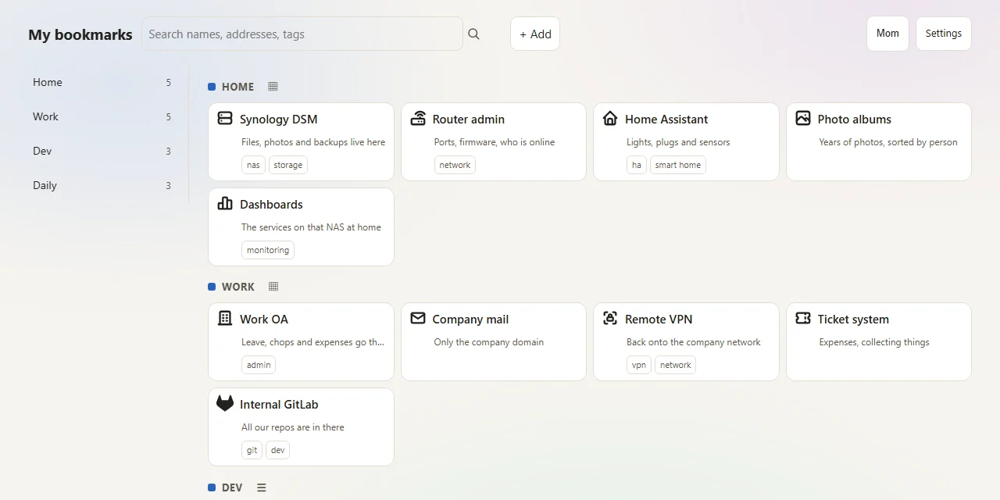

# launchbay

> Every bookmark you forgot you saved, on one page — self-hosted, no sign-up, works offline.

[](LICENSE) [](https://github.com/rockbenben/365opensource) [](https://github.com/rockbenben/launchbay/actions/workflows/ci.yml)

[`docker compose up -d`](https://github.com/rockbenben/launchbay#quick-start) → open **http://\<this machine's address\>:7600** · [Releases](https://github.com/rockbenben/launchbay/releases)

> English | [简体中文](README.zh.md)



> Open it from any device on your LAN, not from `localhost` — `localhost` only means "this device", so typing it on your phone opens the phone. Use the NAS's LAN address or hostname (`http://10.0.0.5:7600`), or `http://localhost:7600` if you are sitting at the machine itself.

Put the addresses you can never remember onto one page: the NAS admin panel, the router admin, the company OA, the monitoring dashboard, the sites you keep going back to. Make it your browser home page, and from then on every time you open the browser it is that — **one click, no waiting for it to spin.**

It runs on a machine of your own: a home NAS, a Raspberry Pi, a soft router, or one box on the company intranet. Your data never leaves your LAN.

## Why this one, and not another bookmark tool

Plenty of tools do "save it, then get to it fast". Side by side, they differ on four things: **whose server holds the data, how a family shares it, whether it still works offline, and whether you can organise it by dragging**.

| Compared on | The browser's own bookmarks page | A cloud bookmark service | A self-hosted single-user bookmark manager | A shared NAS landing page | launchbay |
|---|---|---|---|---|---|
| Where the data is | The browser's own profile directory (it follows your browser account) | **The vendor's servers** | Your own machine | Your own machine | Your own machine |
| One per person | Via the browser's profiles | Per account | Usually one person | One page for the whole house | **One per person, kept apart on the server** |
| Do you register | Yes | Yes | No | No | No |
| Offline | The bookmarks are still there (local) | **Doesn't work** | Works | Works | **Works** (cache + an offline queue) |
| How fast it opens | Open the manager, then click a folder | Depends on the network and the vendor | Depends on the machine | Depends on the machine | **One server-rendered page**: links show before any script runs |
| Organising by dragging | The bookmarks bar and folders take drags, but it is a **folder tree**, not one laid-out page | Mostly not | Some do | Mostly not | **Drop it and it is saved, drag to reorder, drag across groups** |

No account, no third-party script, no telemetry. Apart from fetching a site's favicon once when you want its icon (a failed origin cools down for 24 hours), it talks to no outside service — **your bookmarks have never been through somebody else's server.**

**If you are just one person, the browser's own bookmarks page is probably enough** — it follows your account, syncs across devices, and an extension does the rest. launchbay is not here to replace that; it trades it for the three things below:

## The three things you'll actually care about

- **Opening it doesn't wait.** The whole page is one HTML file; bookmarks and the icons they use are drawn straight into the page — no images to download, no waiting for a script to finish before anything shows. A purely static page is fast too, but it has no edit screen; a script-driven dashboard has one, but nothing shows until the script runs. This one keeps both.

  The budget test prints the current byte counts on every run, so they are not copied here. The target is LAN first-paint LCP < 300ms, which you can only measure in a real browser on a real network — a cold start on an actual NAS has still not been measured (see "Limits").

- **One each, nobody else sees it.** One page per person, and you type a 4–6 digit PIN to get in. Sharing one computer doesn't mix people up — **and the admin can't see yours either**: they can create profiles, delete them, set your PIN for you, but they cannot read what is on your page. That isn't done by hiding things in the frontend; the server keeps them apart: an admin key that tries to read somebody else's bookmarks is refused outright (403).

  To be straight about it, this is not "protecting you from them" in the cryptographic sense — an admin who sets your PIN knows that PIN, and anyone on the LAN can edit a cookie and be somebody else. What I mean is that there is **no route at all** for them to read your bookmarks.

  The PIN is **optional**, though — tick "No PIN" and that profile opens with one click, for a TV in the living room or a tablet nobody watches. Then it is open to **everyone on the LAN**, which is exactly what the tick says it does; that one page stops being private, the rest are unchanged.
- **If you break it, you can go back.** Every bulk change takes a backup first; the "Revert" button under "Backup & history" in the Settings panel shows you what every older version looked like (how many bookmarks, which groups), and you recognise it and click once to go back — **the current version is saved first too**, so a revert done by mistake can itself be reverted.

  History is kept, not erased, and **that line has a screen of its own**: "Change history" (in the same panel) says line by line who touched this profile, when, through what (the page, an AI, the extension, the command line), and to which entry. It does not record what things now look like — the audit line never held content, and this page shouldn't turn into a second copy of your bookmarks. The whole state is just an ordinary folder on disk; copying it is the whole backup.

## What this covers

| Aspect | Whether it works for you |
|---|---|
| How you run it | `docker compose up -d`, or run the static binary directly (amd64 / arm64) |
| Where it runs | A home NAS, a Raspberry Pi, a soft router, or one box on the company intranet |
| Who uses it | One person, a family, or a small team that doesn't want to install a pile of things — one profile each, and the admin handles accounts, not content |
| Browsers | Any modern browser, **and with JavaScript switched off every bookmark is still visible and clickable** |
| What you install | Nothing besides Docker itself: zero third-party libraries, zero database, no node needed at build time |
| Where the data is | One ordinary directory, `data/`; a backup = copying the whole directory |
| Interface language | Chinese and English. **Pick it while you set things up** (that is the machine-wide default), afterwards **everyone picks their own in their own panel** — the admin changing the default only reaches the people who have not picked one |

## What it can do

**Saving and tidying**

- **Drop it and it is saved**: drag a link — from the bookmarks bar, from the address bar, **from another tab** — onto a group and it goes into that group. **No question, no dialog**: you dragged an address onto a group, so the drop *is* the answer, and asking again would split one finished action into two
- **Drag to reorder**: a new position inside a group, across groups, or onto a group title to append to the end. Long press or a keyboard shortcut enters multi-select, then one action tags, moves or deletes a batch
- **See it, save it on the spot**: drag the bookmarklet into your bookmarks bar; one click on any site brings the address back here; you still press save once before it is really written
- **Brought in from your browser**: upload the bookmarks file Chrome / Edge / Firefox exported; you get a reconciliation report — which entry got in, which did not, and why, every one named. It opens with a plain-language summary (which groups get what, which entries were skipped), with the full report below. **The web page's main button imports right away and skips that screen** ("Import now"); pick "Show what this would import" to read the report first. The command line prints the report and writes in the same run — `--dry-run` stops at the report
- **Take a whole profile with you**: export one file with the bookmarks **and** how that page looks (theme, layout, view, second line, page name, language), then import it back on another machine.

  The PIN, the profile's identity and the background image stay out of it — a door key, an identity and a file that lives on that one machine are not yours to hand over. The same from the command line: `launchbay backup --profile <id> --out <file>` / `launchbay restore --profile <id> <file>`

**Finding it**

- **Grouped properly, quick to search**: bookmarks are filed under groups, and the top bar searches names, addresses, notes and tags directly — type and press Enter and results are there (no JavaScript at any point); with scripts on, press `/` to jump to the search box, or use the `⌘/Ctrl K` panel
- **Featured bookmark banners**: promote frequently visited groups into an enlarged top banner ("feature"), displaying prominent cards with large icons and clean hostnames
- **10,000+ icons, offline**: Tabler and Simple Icons are gzipped into the binary, so search and preview work with no network; a site's favicon is fetched once when you add it, then served from the local cache

**The page itself**

- **Tabbed preference panel**: click **Settings** in the top bar. One sheet holds this page's look and language (theme, page name, view, second line, navigation, background, how a bookmark opens), the group list, backup and history, and **My PIN** — where you lock or unlock **your own** profile, no admin needed.
- **Works when the network is down**: the last page you saw is cached in your browser, so a server that is temporarily down does not take the page away with it; bookmarks you add while offline or while the machine cannot be reached go into a queue. When the browser comes back online they replay; if the machine itself was down, press **Send now** in the queue.
- **Scripts and AI can do it for you**: a REST interface plus profile-scoped tokens, so a browser extension, a command line and automation scripts each get their own key; a token that steps outside its scope and writes somebody else's profile gets a 403, not the write

## Quick start

```bash
git clone https://github.com/rockbenben/launchbay
cd launchbay
docker compose up -d
```

Three commands, no `.env`, no Go toolchain — the image is simply pulled. The only thing to configure is the admin key: compose ships a default, so this round works as it stands. The image is `:latest`, and the **first** `up` pulls the most recent release; a machine that is already running has to `docker compose pull` first (why is under "Where the image comes from" below).

> **Change the default admin key first.** compose ships `launchbay123` — a published default, right there in the source. Anyone on your LAN who knows it can create or delete profiles and reset PINs (they still cannot read bookmarks). Put your own in `LAUNCHBAY_ADMIN_TOKEN` and run `docker compose up -d` again:
>
> ```yaml
> LAUNCHBAY_ADMIN_TOKEN: "your-own-admin-key"
> ```

Opening it takes you into the **one-time profile setup page**: give the first profile a name and set a 4–6 digit PIN. **There are no default profile credentials** — there is no `admin/admin` to try; whatever name and digits you type are yours. This page is only live while not a single profile exists on disk, and it closes for good once you are done — so "has this machine ever had a profile" is itself a fact worth protecting, and cannot be used by an anonymous visitor to count how many people live in your house.

**The PIN is optional, but "no PIN" is a separate tick, not an empty box.** Leave it empty and press Create and you get "A PIN is 4 to 6 digits" back; tick **No PIN** and the profile is created open to the whole LAN. That is on purpose — the expensive mistake here is typing three digits and hitting enter without noticing, which would quietly publish one person's bookmarks to the house. A profile created without a PIN shows no PIN box at all on the selection page — the card displays the profile's name and service icon, and clicking Enter opens the dashboard directly. You can set one later — **in the "My PIN" tab of your own panel** (or `POST /api/v1/profiles/self/pin`), no old PIN needed while it still has none — and you can take it away again by leaving the New PIN field empty and saving.

What gets created is **the first person's bookmark page, not an admin**. The thing that manages the machine is the `LAUNCHBAY_ADMIN_TOKEN` from compose: open `/admin`, type it once, and the server hands out a cookie that belongs to the admin identity alone (30 days); after that the admin page is yours.

**Later people do not have to wait for the admin**: next to the cards on the selection page there is a collapsed **"New one for yourself"** — open it, give it a name and a PIN, and it is created (`POST /new`; the machine one is `POST /api/v1/profiles/new`). It needs **no credential at all**, so any device on the LAN can create one — the selection page grows a card, and the admin can delete it again at any time. What gets created is an **empty** profile that belongs to its own PIN; it grants nobody a look at anyone else's bookmarks. The name takes up to 60 characters, and **do not reuse someone else's name** — two cards with the same name cannot be told apart.

**Deleting a profile is the one thing on this machine you cannot get back**, so it asks for one thing more than the rest: **the machine key itself**. Pressing Delete leads to the confirmation page (it spells out how many bookmarks and snapshots go away), and you have to **type `LAUNCHBAY_ADMIN_TOKEN` once more** before it actually deletes. The command-line path (`DELETE /api/v1/profiles`) is the same — an admin cookie alone gets you a 403. The snapshots go with the profile, so reverting cannot save it.

On the same page there is an **Interface language** dropdown (中文 / English) — **pick it here while you are setting things up**; typing the PIN and hitting Create straight away tends to skip past it. It takes effect immediately: it sets the **machine-wide default**, and afterwards everyone can pick their own in **their own panel** (what the admin sets on the admin page is still the default, and only reaches the people who have not picked one).

## Admin key and tokens

Tokens split across **two variables**, one required and one optional:

| Variable | Required? | What it covers |
|---|---|---|
| `LAUNCHBAY_ADMIN_TOKEN` | **Required**, a bare key. The default `launchbay123` is public, so **swap it for your own as shown above** | The account layer: creating profiles, deleting them, setting somebody else's PIN, disabling/enabling, cross-profile status and the audit trail. **Accounts only** — hitting `/api/v1/data`, `/api/v1/batch` or `/api/v1/export` is a 403 across the board; it cannot read anybody's bookmarks |
| `LAUNCHBAY_WRITE_TOKENS` | **Optional**, left empty by default | Profile-scoped write tokens, `name:secret:profile`. **Only three things want it**: the browser extension, the command line (`revert` / `import-bookmarks` / `backup` / `restore`), and AI or automation scripts |

> **Why no tokens by default?** The bookmark page, the admin page, revert and import all ride on the session cookie; not one token is needed. And those three things have to be installed by a person on purpose anyway. Making everyone who does not need a token fill one in, and then leaving it as the default, would hand every single machine a free key that can write the `dad` profile (`dad` being the most common profile id). If you want the extension or AI, fill in that line in compose and then `docker compose up -d`:
> 
> ```yaml
> LAUNCHBAY_WRITE_TOKENS: "name:key-you-pick:profile id"
> ```

**A profile itself has no "is it an admin" attribute** — every profile that gets created is just one person's bookmark page.

What the admin page does is account-level only: **create a profile**, **add or change any profile's PIN** (including the one you are signed into — changing your own PIN from your own page still needs the old one), **disable/enable**, **delete**, plus each profile's item count, version and last change. The table also marks **which profiles still have no PIN** (an unlocked profile is open to anyone on your LAN).

> **The profile id is derived from the name and is not necessarily `dad`** (this is only about `LAUNCHBAY_WRITE_TOKENS`). Creating a profile asks only for a name and a PIN; the id comes from the name: if there are ASCII alphanumerics in it, that slug is what you get (`Dad` → `dad`, `nas box` → `nas-box`), and **a Chinese name turns into nothing usable, so it always falls into the `home` / `home-2` base-name sequence**. So after creating the first profile with a Chinese name, the `…:dad` scope in your token matches no profile at all, and you get a 403 when you use it. Two ways to fix it: change the token's scope to the real profile id (recommended), or give the first profile an ASCII name.

The host port defaults to 7600. Some Windows machines have Hyper-V holding a block of ports (7532–7631 on the machine this was tested on); if `up` fails with a port error, prefix the command with a free port outside that block, for example `LAUNCHBAY_HOST_PORT=8901 docker compose up -d` (the port inside the container does not move).

The project name and the container name are both hardcoded in compose (`launchbay`), so those `docker compose …` commands do not care which directory you cloned into, and `docker logs launchbay`, `docker exec launchbay …` work as written.

### Browser extension (optional)

`extension/` holds a Chrome / Edge extension (Manifest V3: right-click the current page to save it into the profile you named, or import every tab of the current window at once). It is not in the released image; install it yourself.

**Get a token before installing**: the extension cannot read the session cookie — it goes through REST — so it needs a profile-scoped token. Go back up, fill in `LAUNCHBAY_WRITE_TOKENS`, run `docker compose up -d`, and only then install the extension.

1. Open `chrome://extensions`, turn on **Developer mode** in the top right
2. Click **Load unpacked**, pick the `extension/` directory from the repo
3. Open its settings page (right-click the extension icon → **Options**, or **Details** → **Extension options** on its card in `chrome://extensions`), and fill in three things:
   - **This machine's address** — `http://10.0.0.3:7600`, **with no trailing slash**
   - **Default profile id** — the one the token beside it is scoped to (see the note above about how the id is derived from the name)
   - **The token itself** — the secret you put into `LAUNCHBAY_WRITE_TOKENS` (`name:secret:profile`; only the `secret` part goes after `Bearer`, not the whole string)
4. Click **Test this machine** to check

A 403 from **Test this machine** is not a broken network; it means **the token and the profile do not match**: it reads the default profile once, and a 403 means this token is scoped to a different profile — change the profile id at the end of `LAUNCHBAY_WRITE_TOKENS` so it lines up with the profile you actually have, then `docker compose up -d` to restart.

Once it is installed: right-click any page → save to launchbay; the settings page can also **import your whole browser bookmark tree** (only the first click asks you for the bookmarks permission, which is set to optional request — someone who installed this only for the right-click save will never see that prompt; and before anything is imported you get a per-entry reconciliation report).

**An import only goes into an empty profile** — that is the rule on all three routes (the web page, the extension, `import-bookmarks` on the command line). An import brings the browser's whole set in; it does not add on top of what is already there. So if the target profile already has bookmarks, the write is refused before it starts — the extension's API answers 422, the web page shows a "blocked" notice, the command line stops with exit code 1 — and not one byte on disk changes — use an empty profile, or clear that one out yourself first. If you would rather not clear it, save things one at a time; the right-click save has no such limit.

> On install Chrome warns "Read and change your data on all sites": that comes from the `http://*/*` and `https://*/*` host permissions, which it needs to answer a right-click on any site. Its other permissions are `contextMenus` / `storage` / `tabs` / `notifications`, with `bookmarks` as the one optional-request item. The token lives only in `chrome.storage.local` on that computer, **never in sync, never in the cloud**; that is also why this settings page has no export-config button. Switching profile means switching token, and if one machine leaks you only revoke that one. Firefox is unverified — `extension/` was written against Chrome / Edge.

### Permissions on the data directory

By default the data lands in `./data`, next to `docker-compose.yml`, and inside the container it is always `/data`. To put it somewhere else, change the `volumes` line in compose — the usual one on a NAS:

```yaml
    volumes:
      - /volume1/docker/launchbay:/data
```

On Windows, if you write an absolute path, the colon in `D:` fights the separator; use the long syntax instead (splitting `source` / `target` into two fields leaves nothing ambiguous):

```yaml
    volumes:
      - type: bind
        source: D:/launchbay-data
        target: /data
```

The container runs as **uid 65534**, while that directory on the NAS is root-owned by default — once it is mounted, creating profiles, importing and writing bookmarks all fail. **Hand it to that user from the host** (using the default `./data` below):

```bash
sudo chown -R 65534:65534 ./data
```

Don't get around it with `sudo docker run` or `--user root` (that is the same as letting the service write every file in your house as **root**). This one is not a guess: the probe creates and deletes a temporary file in the data directory on every health check, and when the permissions are wrong `docker ps` shows **unhealthy** outright, with the line in the container log telling you that same chown command. The page side says the same thing — the create-profile form answers with "The data directory is not writable — this program has no permission there. Hand that directory to the user running it (uid 65534 in the container) and try again." If you run the binary directly instead of a container, swap the uid in that sentence for your own system user.

## How to use it

| What you want to do | Where |
|---|---|
| Adjust page appearance, view, navigation layout, background, group styles, and how a bookmark opens | "Settings" in the top bar, or `POST /prefs`, `POST /prefs/background`, `POST /prefs/group` and `POST /prefs/tabs` |
| Change your own PIN | "My PIN" in your own Settings panel, or `POST /prefs/pin` / `POST /api/v1/profiles/self/pin` (the old PIN is required only while one is set) |
| Create a profile, delete one, set somebody's PIN, disable someone | "Manage this machine" on the selection page (always shown there) or open `/admin`; the profile top bar only carries the link after an admin login. For the machine path, use `POST /api/v1/profiles` (`{"id","title","nopass":true}` creates one with no PIN); from the command line, `launchbay profile create --id <slug> --title <name>` (needs the admin key). **Deleting asks for the machine key once more** (the `key` field on the page; the command-line path only accepts `Authorization: Bearer <LAUNCHBAY_ADMIN_TOKEN>`) |
| Create one more for yourself (no admin needed) | The collapsed "New one for yourself" on the selection page, or `POST /api/v1/profiles/new` (no credential; the id is derived from the name and cannot be declared) |
| Clean up bookmark names that are really addresses | `launchbay profile fix-names --profile <id>` (add `--dry-run` to see what it would change first) — it rewrites names by a rule, so it is a command-line action, not a button |
| Have AI or a script change bookmarks | `POST /api/v1/batch`, with `expectedRev` so a write does not overwrite |
| Rescue a broken profile (`profile.json` will not read) | `POST /api/v1/profiles/rebuild`, or `launchbay profile rebuild --id <slug> --title <name> (--pin <4-6 digits> \| --nopass)` |
| Count clicks (who is clicking which bookmarks) | `POST /api/v1/usage` — writes only the current profile, and does not take part in the revision number |
| Save a URL and get its title and icon back | `POST /api/v1/resolve` — writes no bookmarks, only fills the cache |
| See what every change actually was | `GET /api/v1/history` (records actions and paths only, never content) |
| Export or import a whole profile — bookmarks **and** how the page looks | `GET /api/v1/backup` / `POST /api/v1/restore`, `launchbay backup --profile <id> --out <file>` / `launchbay restore --profile <id> <file>`, or "Backup & history" in the Settings panel |

**Export and import** take one whole profile — the bookmarks plus how that page looks (theme, layout, view, second line, page name, language) — into a single file, and read it back. Three things are deliberately **not** in that file: the **PIN** (exporting it would be printing the key on paper), the profile's **identity** (its id, title and created date belong to the machine it lives on), and the **background image** (that one is a file on the machine, not a string — a backup carrying it would restore a picture that is not there). A backup that carries bookmarks only goes into an **empty** profile, because importing is "bring this one in", not "add on top of what is already there"; a backup that carries only settings can be imported any time. Settings written this way do not move the revision counter and do not appear in "Revert": they are desk preferences, not bookmark data, exactly like the Settings panel.

**The complete endpoint list, request body shapes and error codes are in [AGENTS.md](AGENTS.md)** — that is the authoritative contract written for AI, every field name checked against the route table one by one, so changing one makes a test go red; which is why there is no second copy of it here in the README.

**If you drive it from the command line**, two things are worth knowing: results and reports go to **stdout**, failures go to **stderr** — so `launchbay import-bookmarks … > plan.log` gives you the report — **and the same run writes the bookmarks** (add `--dry-run` for the report and the ops without committing) — and `2> err.log` gives you the reason when it goes wrong — and every failure quotes the server's own error code in brackets (`[rev-conflict]`, `[ops-invalid]`) rather than paraphrasing it, so a script can branch on the code. `--help` and a subcommand's `-h` both exit 0; a usage error exits 2; everything else exits 1.

Two more things about the command line, both of which you only learn by hitting them: `launchbay revert --to 0` is refused as a usage error, because rev 0 may well be the snapshot your profile was born with and the command line will not guess that you meant it — the error message prints the exact `curl` that does it. And `launchbay import-bookmarks` takes the file as a **positional argument**, not a flag: `launchbay import-bookmarks --profile <id> <bookmarks.html>`. It needs a token scoped to that profile, like every other write.

The "opening it doesn't wait" line above is not an adjective: bookmarks and the icons they use are written straight into the HTML by the server, so the page does not have to run a script before it can show you a link. **Zero JavaScript is the floor, not the ceiling**: search is a form, creating a profile and setting a PIN are native form submissions, and with JavaScript off every bookmark is still visible and clickable — a test assertion guards that. On top of it sits one layer of enhancement (only there when JavaScript is on): the add sheet, editing a title or address in place, drag reordering, the ⌘K palette, working offline. The two do not conflict: **when the enhancement layer breaks, you fall back to the zero-JS route, and that route is always there.**

## Where the image comes from

compose only **pulls** the published image; building is CI's job: tag a `v*` (or dispatch that workflow by hand), and `.github/workflows/docker.yml` builds and pushes both amd64 and arm64 to Docker Hub and GHCR. Anyone using the machine does not need to install Go, and does not need to read the `Dockerfile`.

The image tag is `:latest`. On the **first** `up` the machine has no such image, so it goes to the registry and pulls the most recent release; a machine that is already running already has it locally, and `up` does not go back and ask the registry, so you have to **`docker compose pull` first** to get the new one.

Releasing rides on a **git tag**: tag a `v0.1.0`, push it, and the pipeline builds and pushes five images — the three version tags `0.1.0`, `0.1` and `0`, plus `latest` and one tagged with the commit's short sha. The **image's** version comes only from the tag — `image:` uses `:latest`, so it takes no part in releasing.

Would rather not clone — pull the published image directly (both amd64 and arm64 are built; on GHCR it is `ghcr.io/rockbenben/launchbay`, on Docker Hub it is `rockben/launchbay`):

```bash
docker run -d --name launchbay -p 7600:7600 \
  -v launchbay-data:/data -e LAUNCHBAY_DATA_DIR=/data \
  -e LAUNCHBAY_ADMIN_TOKEN="your-own-admin-key" \
  -e LAUNCHBAY_WRITE_TOKENS="ai-dad:your-own-key:dad" -e TZ=Asia/Shanghai \
  --health-cmd "/launchbay healthcheck" --health-interval 30s \
  ghcr.io/rockbenben/launchbay:latest
```

## Limits

- **LAN use only, and there is no HTTPS.** The bookmark contents sit on disk as plain JSON. Before putting it on the public internet, put a TLS reverse proxy in front of it yourself
- **One profile with a broken `profile.json` locks that profile.** If the bookmarks are broken, `revert` or a snapshot brings them back; if the profile file is broken, neither of those saves you and the way out is `POST /api/v1/profiles/rebuild` (or `launchbay profile rebuild`) — it rewrites that one file only and does not touch a single byte of the bookmarks, snapshots or history
- **Icon fetching has a cooldown**: once an origin has failed, it is not fetched again for 24 hours; the rate limit is there so that nobody can use this machine as a probing springboard
- **No shared list**: you cannot "share one bookmark with the whole family", and you cannot publish a page. Each keeping their own really is each keeping their own
- **Not yet signed off on a real NAS.** All three acceptance rounds ran on Windows + Docker Desktop. The permissions and port-conflict sections above come from real use, but I kept no measurements from them; the LAN LCP < 300ms target, cold-start LCP on real hardware, scroll frame rate at 1,000 bookmarks and offline cache-hit latency — none of those four has been measured yet
- **No weather or clock widgets.** They are outside what this page is for, and leaving them out is part of the zero-runtime-bloat trade. Footer text and bookmark content are written through `POST /api/v1/batch`; the files on disk belong to the server, not to a text editor (full specs in [AGENTS.md](AGENTS.md))
- **English covers the screen, not the sentences scripts read.** The error `detail` on `POST /api/v1/*`, the reason a field failed validation, and the per-entry reconciliation report **as read by a script** (the API and CLI, which do not send `Accept-Language`) are all still Chinese; the import report on the web page follows the page language. The reason is that a caller wants **text that is stable and comparable**, not prose that changes along with somebody else's interface language; the report reads more like an analysis result than interface chrome. Bookmark titles, group names and URLs are content you wrote yourself, so they are not translated either
- **Tokens are empty by default, which means the extension and the command line are off by default.** Leave `LAUNCHBAY_WRITE_TOKENS` empty and this machine has exactly one route — typing a PIN in the browser. Bookmarks, admin, revert and import all work fine; the browser extension and AI scripts get a 401 across the board, while `launchbay revert` stops locally with a configuration error (exit 1). This is deliberate: so that people who do not need one do not have to fill one in, at the price that people who do want one have to go and add a line to compose first. The admin's `LAUNCHBAY_ADMIN_TOKEN` is the other way round and is required — without it the service simply refuses to start

## About the 365 Open Source Plan

Project **#042** of the [365 Open Source Plan](https://github.com/rockbenben/365opensource) — one person + AI, 300+ open-source projects in a year.

[Submit your idea →](https://365.aishort.top/) · [Discord](https://discord.gg/PZTQfJ4GjX) · [Telegram](https://t.me/aishort_top)
