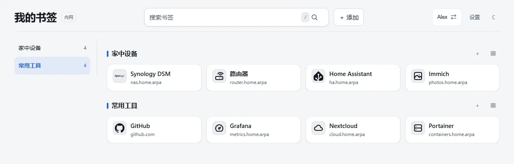

# launchbay

> 把 NAS、路由器和浏览器书签放在同一页。Docker 自托管。

[](LICENSE) [](https://github.com/rockbenben/365opensource)

[▶ 快速开始](#快速开始) · [Docker 镜像](https://github.com/rockbenben/launchbay/pkgs/container/launchbay) · [docker-compose.yml](https://raw.githubusercontent.com/rockbenben/launchbay/refs/heads/main/docker-compose.yml)

[English](README.md) · **简体中文** · [繁體中文](docs/i18n/README.zh-Hant.md) · [日本語](docs/i18n/README.ja.md) · [한국어](docs/i18n/README.ko.md) · [Español](docs/i18n/README.es.md) · [Português](docs/i18n/README.pt.md) · [Français](docs/i18n/README.fr.md) · [Deutsch](docs/i18n/README.de.md) · [Italiano](docs/i18n/README.it.md) · [Русский](docs/i18n/README.ru.md) · [العربية](docs/i18n/README.ar.md) · [हिन्दी](docs/i18n/README.hi.md) · [বাংলা](docs/i18n/README.bn.md) · [ไทย](docs/i18n/README.th.md) · [Türkçe](docs/i18n/README.tr.md) · [Tiếng Việt](docs/i18n/README.vi.md) · [Bahasa Indonesia](docs/i18n/README.id.md)



把 launchbay 设为浏览器主页，常用网站和设备都能从这一页打开。一家人可以共用一台服务器，各有自己的书签档案和 PIN。

## 支持范围

| 方面 | 认不认你的 |
|---|---|
| 怎么跑 | Linux amd64 和 arm64 的 Docker 镜像，也可自行构建独立程序 |
| 跑在哪 | 家里 NAS、树莓派、软路由，或公司内网的一台机器 |
| 谁在用 | 一个人、一家人，或一个不想装一堆东西的小团队；每人一份，管理员管账号不管内容 |
| 浏览器 | 任意现代浏览器；关掉 JavaScript，全部书签照样看得见、点得动 |
| 要装什么 | 安装 Docker Compose 即可运行镜像。数据存为文件。 |
| 数据在哪 | 一个普通目录 `data/`，备份就是整目录拷走 |
| 界面语言 | 18 种界面语言，见上方语言导航。每个档案可单独设置。 |

## 它能做什么

**存进来与整理**

- **拖进来就存**：从书签栏、地址栏或另一个标签页把链接拖到某一组上，不弹窗——落点就是答案。
- **拖着排**：组内换位、跨组搬、拖到组标题追加。长按或快捷键进多选，一次打标签、移动或删除。
- **看到就存**：把 bookmarklet 拖进书签栏，任何网页一点就把地址带回来，再按一次保存才落库。
- **从浏览器导入**：传 Chrome / Edge / Firefox 导出的 HTML，给你逐条对账报告——进了哪些、没进哪些、为什么。网页上可以直接导入，也可以先看报告；命令行同一趟就写，加 `--dry-run` 只停在报告。
- **整份搬走**：一个文件装下书签**和**这一页的样子（主题、排法、视图、第二行、页面名、语言、地址模式）。PIN、档案身份、背景图刻意不放进去。

**找得到**

- **分组与搜索**：顶栏搜名字、地址、说明、标签，回车由服务端出结果，不需要 JavaScript；开着脚本时按 `/` 或 `⌘/Ctrl K`。
- **常用大卡**：把高频分组设为「大卡」，在页面顶部聚合成大卡片。
- **一万多个图标，离线可用**：Tabler 与 Simple Icons 压缩后嵌进二进制；网站图标从本机缓存加载，可在添加或编辑书签时手动刷新。

**在家与外出**

- **一条书签，两套地址**：填主地址和选填的外网地址。「自动」按你打开导航台的地址选；「设置 → 书签地址」可以按当前浏览器手动覆盖。搜索与复制用当前生效的地址；没填外网地址的继续用主地址。反向代理要保留原始 `Host`。

**这一页本身**

- **一个面板**：顶栏「设置」里集中了这一页的样子与语言、分组列表、备份与历史，以及「我的 PIN」——给自己上锁或撤锁，不用找管理员。
- **断网也能点**：最近一页缓存在浏览器里；离线时，或机器连不上时，加的书签先排队，浏览器恢复联网后自动重放，机器本身没起来就点「补进去」。
- **脚本和 AI 有自己的钥匙**：REST 接口加按档案作用域的令牌，扩展、命令行、自动化各用各的；越界写别人的档案一律 403。
- 在「设置 → 备份与历史」中恢复以前的书签版本。

## 快速开始

```bash
git clone https://github.com/rockbenben/launchbay
cd launchbay
```

> [!IMPORTANT]
> 启动前，在 `docker-compose.yml` 的 `environment` 中设置自己的 `LAUNCHBAY_ADMIN_TOKEN`。局域网内知道默认密钥的人可以创建或删除档案，也可以重设 PIN。

在 Linux 或 NAS 上部署时，先准备数据目录。

```bash
mkdir -p ./data
sudo chown 65534:65534 ./data
```

```bash
docker compose up -d
```

在宿主机打开 [http://localhost:7600](http://localhost:7600)，或在同一局域网的其他设备打开 `http://<内网 IP>:7600`。创建档案并设置 4 到 6 位 PIN，进入档案后点「添加」，保存第一条书签。

更新已有安装时，先运行 `docker compose pull`，再运行 `docker compose up -d`。

选择「不设 PIN」后，局域网内能访问本站的人可直接进入该档案。打开 `/admin` 并输入管理密钥，即可管理档案。

### 管理密钥与令牌

| 变量 | 要不要填 | 管到哪 |
|---|---|---|
| `LAUNCHBAY_ADMIN_TOKEN` | **必填**，一把裸 key | 只管账号：建档、删档、给任意档案设 PIN、停用/启用、跨档案状态与历史。所有内容端点（`/api/v1/data`、`/batch`、`/export` 等）一律 403——读不到书签 |
| `LAUNCHBAY_WRITE_TOKENS` | 选填，默认留空 | 档案作用域写令牌 `名字:密钥:档案`。只有浏览器扩展、命令行（`revert` / `import-bookmarks` / `backup` / `restore` / `profile fix-names`）与 AI 或脚本要它 |

> **为什么默认留空？** 书签页、管理页、回退、导入全走会话 cookie，一个令牌都不需要；需要令牌的那三样本来就要人主动去装。留一个默认值，等于给每台机器白送一把能写 `dad` 那一份的钥匙（`dad` 是最常见的档案 id）。

档案本身没有「是不是管理员」这个属性。管理页显示账号层面的动作，以及每份档案的条目数、版本、最近改动、有没有设 PIN。

> **档案 id 从名字派生，不一定叫 `dad`。** 名字里的 ASCII 字母数字会变成 slug（`Dad` → `dad`、`nas box` → `nas-box`）；中文名转不出可用的 slug，一律落到 `home` / `home-2` 序列。作用域写 `…:dad` 的令牌于是对不上任何档案，打过去是 403——把令牌作用域改成实际 id（推荐），或第一份档案就用 ASCII 名字。

宿主端口默认 7600。有些 Windows 机器上 Hyper-V 占着一块端口（实测 7532–7631）；`up` 报端口被占时，换一个块外的空闲端口：`LAUNCHBAY_HOST_PORT=8901 docker compose up -d`（容器内端口不动）。项目名与容器名都写死成 `launchbay`，所以 `docker logs launchbay`、`docker exec launchbay …` 跟 clone 到哪个目录无关。

### 浏览器扩展（可选）

`extension/` 是一个 Chrome / Edge 扩展（Manifest V3）：右键把当前页面存进指定档案，或一次收藏当前窗口的所有标签页。它不在镜像里，要自己装。

扩展读不到会话 cookie，所以需要一个档案作用域的令牌。先填 `LAUNCHBAY_WRITE_TOKENS`、重启，然后：

1. 打开 `chrome://extensions`，右上角开**开发者模式**
2. 点**加载已解压的扩展程序**，选 `extension/`
3. 打开扩展的选项页，填这台机器的地址（不带结尾斜杠）、默认档案 id、令牌里那段密钥
4. 点**测试连接**

测试失败时，扩展会说明是档案 ID 与令牌不匹配、档案已停用，还是误填了管理密钥。

装好之后：任意网页右键就能存；选项页还能把整棵浏览器书签树导进来，第一次用才问「读书签」权限。三条导入通路（网页、扩展、命令行）都**只进空档案**——导入是整份替换，不是往上叠加。Chrome 会警告「读取和更改您在所有网站上的数据」，那来自扩展响应右键所需的 `http://*/*` 与 `https://*/*`；令牌只存在 `chrome.storage.local`，不进同步。Firefox 未验证。

### 数据目录的权限

数据默认落在 `docker-compose.yml` 同目录的 `./data`，容器里永远是 `/data`。想放别处就改 `volumes`：

```yaml
    volumes:
      - /volume1/docker/launchbay:/data
```

Windows 上写绝对路径，`D:` 的冒号会和分隔符打架，改用长语法：

```yaml
    volumes:
      - type: bind
        source: D:/launchbay-data
        target: /data
```

容器以 **uid 65534** 运行，而宿主机上那个目录通常归 root——建档、导入、写书签会全部失败。在宿主机上把它交给这个用户：

```bash
sudo chown -R 65534:65534 ./data
```

别用 `--user root` 绕过：那等于让服务以 root 身份写你家每一个文件。体检每次都会在数据目录里建删一个探针文件，权限不对时 `docker ps` 直接显示 **unhealthy**，日志里也会打出同一句 chown。建档页说的是同一句话（容器里是 `uid 65534`；直接跑二进制就换成你自己的系统用户）。

## 怎么用

| 你要做 | 去哪 |
|---|---|
| 改这一页的样子、视图、分组、背景、地址模式与点开方式 | 顶栏「设置」，或 `POST /prefs`、`/prefs/background`、`/prefs/group`、`/prefs/tabs` |
| 改自己这一份的 PIN | 自己面板的「我的 PIN」，或 `POST /prefs/pin` / `POST /api/v1/profiles/self/pin` |
| 建档、删档、给别人设 PIN、停用某个人 | `/admin`（或选择页底部的管理链接）。删档会再要一次 key；账号层面命令行只有 `profile create` 与 `profile rebuild` 两条 |
| 给自己再建一份 | 选单页折叠的「新建档案」，或 `POST /api/v1/profiles/new`（免凭证） |
| 收拾「名字就是地址」的条目 | `launchbay profile fix-names --profile <id>`（先加 `--dry-run`） |
| 让 AI 或脚本改书签 | `POST /api/v1/batch`，带 `expectedRev` |
| 救坏档 | `POST /api/v1/profiles/rebuild`，或 `launchbay profile rebuild` |
| 看改动都发生过什么 | `GET /api/v1/history`（只记动作与路径，不记内容） |
| 导出或导入一整份档案 | `GET /api/v1/backup` / `POST /api/v1/restore`、`launchbay backup` / `restore`，或设置里的「备份与历史」 |

其他机器通路：`POST /api/v1/usage` 记点击，`POST /api/v1/resolve` 把 URL 变成标题与图标，`GET /api/v1/status` 是管理员的跨档案汇总。

备份不含 PIN、档案身份与背景图。带书签的备份只进空档案；只带设置的随时能导。导入在档案锁内核对版本号，撞上并发就回 409 `[rev-conflict]` 与 `currentRev`。这样写进去的设置不碰版本号，也不进「回退」。

**完整的端点、请求体与错误码见 [AGENTS.md](AGENTS.md)**——给 AI 读的权威契约，字段名逐个对过路由表，改一处会有测试红。这里不复述第二份。

**命令行的习惯**：结果走 stdout，失败走 stderr，失败信息带着服务端错误码（`[rev-conflict]`、`[ops-invalid]`）。`import-bookmarks` 的文件是位置参数，打报告和写入是同一趟（`--dry-run` 只停在报告）；备份与导出直接流式读完整响应，超过 4 MiB 也没问题。`--help` 与 `-h` 退 0，用法错误退 2，其余失败退 1。`revert --to 0` 会被当用法错误拒掉，并打印那条能用的 `curl`。

**零 JavaScript 是底线，不是上限。** 搜索是表单，建档与设 PIN 是原生表单提交，关掉脚本全部书签照样看得见、点得动，站内还有「跳到正文」的跳链。在此之上只有一层增强：添加浮层、就地编辑、拖拽排序、⌘K 面板与离线支持；增强层坏了，零 JS 那条路一直在。

## 限制

- **只在局域网内用，没有 HTTPS。** 书签内容是明文 JSON 躺在磁盘上；放到公网前，自己加一层 TLS 反代。
- **一个档案的坏 `profile.json` 会锁住那一份。** `revert` 救不了它；`POST /api/v1/profiles/rebuild`（或 `launchbay profile rebuild`）只重写那一个文件，书签、快照、历史一个字节都不碰。
- **抓图标有冷却**：获取失败后，普通请求会等 24 小时再试。点「重新获取网站图标」可立即重试。
- **没有共享清单**：不能把一条书签共享给全家，也不能公开一页。各存各的就是各存各的。
- **还没在 NAS 真机上验收过。** 三轮验收都跑在 Windows + Docker Desktop；局域网 LCP 目标、真机冷启动、1,000 条书签的滚动帧率、离线缓存命中延迟，都还没测。
- **不内置天气、时钟这类挂件。** 它们不在这一页的定位里。页脚文字与书签内容都走 `POST /api/v1/batch`；盘上的文件归服务端管。
- **界面语言只覆盖界面，不覆盖给脚本读的句子。** API 的 `detail`、字段校验原因、给脚本读的导入报告仍是中文（网页上那一屏跟页面语言走）。调用方要的是稳定可对照的文本；书签标题、分组名、网址是内容，同样不翻。
- **令牌默认空着**，所以扩展与命令行默认不可用，要用了再加；管理员那把 `LAUNCHBAY_ADMIN_TOKEN` 反过来是必填的，缺了服务起不来。

## 镜像从哪来

compose 只管拉已发布的镜像，构建是 CI 的事。打一个 `v*`（或手动 dispatch），`.github/workflows/docker.yml` 会构建 amd64 与 arm64，推到 Docker Hub 与 GHCR。发布标签是 `<version>`、`<major>.<minor>`、`<major>`，加上 `latest` 与 commit 短 sha；镜像版本只来自 git tag。

不想 clone 也行，直接拉镜像：

```bash
docker run -d --name launchbay -p 7600:7600 \
  -v launchbay-data:/data -e LAUNCHBAY_DATA_DIR=/data \
  -e LAUNCHBAY_ADMIN_TOKEN="换成你自己的管理密钥" \
  --health-cmd "/launchbay healthcheck" --health-interval 30s \
  ghcr.io/rockbenben/launchbay:latest
```

## 关于 365 开源计划

[365 开源计划](https://github.com/rockbenben/365opensource) 的第 **#042** 个项目——一个人 + AI，一年 300+ 个开源项目。

[提交你的需求 →](https://365.aishort.top/) · [Discord](https://discord.gg/PZTQfJ4GjX) · [Telegram](https://t.me/aishort_top)
