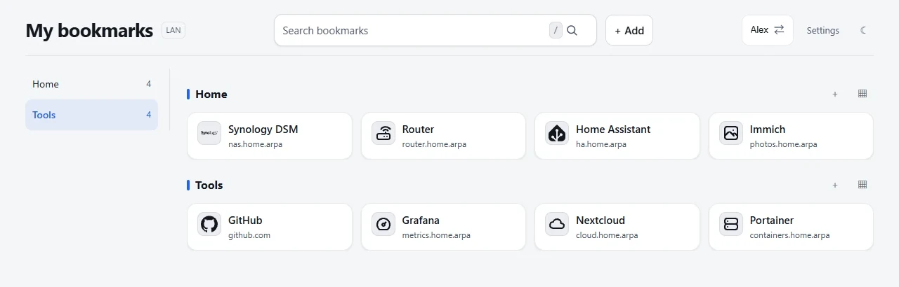

# launchbay

> كل إشارة مرجعية نسيت أنك حفظتها، في صفحة واحدة — استضافة ذاتية، تعمل دون اتصال، دون تسجيل.

[](../../LICENSE) [](https://github.com/rockbenben/365opensource) [](https://github.com/rockbenben/launchbay/actions/workflows/ci.yml)

[▶ البدء السريع](#البدء-السريع) · [⬇ الإصدارات](https://github.com/rockbenben/launchbay/releases)

[English](../../README.md) · [简体中文](../../README.zh.md) · [繁體中文](README.zh-Hant.md) · [日本語](README.ja.md) · [한국어](README.ko.md) · [Español](README.es.md) · [Português](README.pt.md) · [Français](README.fr.md) · [Deutsch](README.de.md) · [Italiano](README.it.md) · [Русский](README.ru.md) · **العربية** · [हिन्दी](README.hi.md) · [বাংলা](README.bn.md) · [ไทย](README.th.md) · [Türkçe](README.tr.md) · [Tiếng Việt](README.vi.md) · [Bahasa Indonesia](README.id.md)



اجمع العناوين التي لا يمكنك حفظها أبداً في صفحة واحدة: لوحة تحكم NAS، والموجّه (الراوتر)، ونظام إدارة الشركة، ولوحة المراقبة. اجعلها صفحة المتصفح الرئيسية — **نقرة واحدة، دون انتظار.**

يعمل التطبيق على جهازك الخاص — خادم NAS منزلي، أو Raspberry Pi، أو موجه برمجي، أو جهاز على شبكة الشركة الداخلية — بحيث لا تصل إشاراتك المرجعية إلى خادم أي جهة أخرى.

## لماذا launchbay

تختلف معظم أدوات الإشارات المرجعية في أربعة أمور رئيسية: أين تُحفظ البيانات، وكيف يتشاركها أفراد المنزل، وهل تعمل دون اتصال، وهل يمكن تنظيمها بالسحب والإفلات.

| وجه المقارنة | إشارات المتصفح المدمجة | خدمات الإشارات المرجعية السحابية | launchbay |
|---|---|---|---|
| أين تُحفظ البيانات | في ملف تعريف المتصفح، تتبع حسابك | على خوادم الشركة المزودة | **على جهازك الخاص** |
| ملف مستقل لكل شخص | عبر ملفات تعريف المتصفح | لكل حساب | **ملف مستقل لكل فرد، مفصولة على الخادم** |
| دون اتصال بالإنترنت | محلياً فقط | لا تعمل | **ذاكرة تخزين مؤقت + قائمة انتظار دون اتصال** |
| التنظيم بالسحب والإفلات | شجرة مجلدات، وليست صفحة منظمة | غالباً لا تدعم | **أفلت للحفظ، واسحب لإعادة الترتيب** |
| من يمكنه القراءة أيضاً | حساب المتصفح الخاص بك | الشركة المزودة | **لا أحد عبر التطبيق** |

دون حسابات، ودون نصوص برمجية خارجية، ودون جمع بيانات عن بُعد (Telemetry). الطلبات الخارجية الوحيدة هي جلب الصفحة التي تضيفها (لاستخراج عنوانها) والرمز المفضل (favicon) الخاص بها؛ وتتوقف محاولات جلب الأيقونة الفاشلة مؤقتاً لمدة 24 ساعة.

**إذا كنت شخصاً واحداً فقط، فقد تكون صفحة إشارات المتصفح كافية.** يقدم launchbay مقابل ذلك ثلاث ميزات حاسمة:

- **الفتح لا يتطلب انتظاراً.** الصفحة تُنشأ على الخادم مسبقاً (Server-rendered): الإشارات المرجعية وأيقوناتها موجودة في كود HTML قبل تشغيل أي نص برمجي. الهدف هو زمن طلاء أول محتوى (LCP) على الشبكة المحلية أقل من 300 مللي ثانية؛ ولم يُقاس البدء البارد على NAS حقيقي بعد (انظر [الحدود](#الحدود)).
- **ملف خاص بكل شخص، ولا يراه أحد سواه.** يمكن أن يكون لكل ملف تعريف رمز PIN خاص به من 4 إلى 6 أرقام. يستطيع المشرف إنشاء الملفات وحذفها وإعادة تعيين رمز PIN، ولكن جميع نقاط النهاية الخاصة بالمحتوى ترفض مفتاح المشرف برمز 403 — **لا يوجد مسار** يقود إلى إشاراتك المرجعية. هذا ليس تشفيراً ضد المشرف أو الشبكة المحلية (يمكن لأي شخص على الشبكة المحلية تعديل ملف تعريف الارتباط)؛ بل هو فصل تام بين الملفات على مستوى الخادم.
- **أي خطأ يمكن التراجع عنه.** يُؤخذ لقطة سريعة (Snapshot) تلقائياً قبل أي تعديل جماعي. تُظهر ميزة الاستعادة عدد الإشارات المرجعية والمجموعات في كل إصدار سابق، وتحفظ الإصدار الحالي قبل الاستعادة — بحيث يمكن التراجع حتى عن الاستعادة الخاطئة. السجل محفوظ دائماً ولا يُمسح أبداً: يوضح كل سطر من قام بالتعديل، ومتى، وعبر أي وسيلة (الصفحة، أو الذكاء الاصطناعي، أو الإضافة، أو CLI)، وأي عنصر عُدّل — دون تسجيل المحتوى نفسه.

## ما يغطيه

| الجانب | هل يناسبك |
|---|---|
| طريقة التشغيل | `docker compose up -d`، أو ملف تنفيذي ثابت (amd64 / arm64) |
| أين يعمل | خادم NAS منزلي، أو Raspberry Pi، أو موجه برمجي، أو جهاز على شبكة الشركة الداخلية |
| من يستخدمه | شخص واحد، أو عائلة، أو فريق صغير — ملف تعريف مستقل لكل شخص؛ يدير المشرف الحسابات فقط ولا يتدخل في المحتوى |
| المتصفحات | أي متصفح حديث؛ حتى مع تعطيل JavaScript، تظل جميع الإشارات مرئية وقابلة للنقر |
| متطلبات التثبيت | Docker فقط: لا مكتبات خارجية، ولا قواعد بيانات، ولا حاجة لـ Node أثناء البناء |
| أين توجد البيانات | في مجلد عادي واحد `data/`؛ النسخ الاحتياطي مجرد نسخ لهذا المجلد |
| لغة الواجهة | 4 لغات للواجهة (الصينية المبسطة، الصينية التقليدية، الإنجليزية، العربية باتجاه RTL)؛ تُحدد اللغة الافتراضية للجهاز أثناء الإعداد، ثم يختار كل ملف تعريفه الخاص |

## ما يمكنه فعله

**الحفظ والترتيب**

- **أفلت ليتم الحفظ**: اسحب الرابط من شريط الإشارات أو شريط العناوين أو من تبويب آخر وأفلته فوق المجموعة. لا توجد نوافذ تأكيد — الإفلات هو الإجراء المطلوب.
- **السحب لإعادة الترتيب** داخل المجموعة، أو بين المجموعات، أو فوق عنوان المجموعة للإضافة في نهايتها. الضغط المطول أو الاختصار يبدأ التحديد المتعدد، ثم يمكنك إضافة الوسوم أو النقل أو الحذف دفعة واحدة.
- **الحفظ من أي صفحة**: اسحب البوكماركليت (bookmarklet) إلى شريط الإشارات؛ نقرة واحدة تجلب العنوان، وضغطة أخرى تحفظه.
- **الاستيراد من متصفحك**: ارفع ملف الإشارات المرجعية بتنسيق HTML المُصدّر من Chrome / Edge / Firefox واحصل على تقرير مفصل لكل عنصر — ما تم إدخاله، وما لم يدخل، ولماذا. يمكن لصفحة الويب الاستيراد فوراً أو عرض التقرير أولاً؛ ويكتب سطر الأوامر (CLI) البيانات مباشرة ما لم تستخدم الخيار `--dry-run`.
- **اصطحب ملفك الشخصي بالكامل**: ملف واحد يحتوي على الإشارات المرجعية **ومظهر** الصفحة (السمة، والتخطيط، وطريقة العرض، والسطر الثاني، واسم الصفحة، واللغة، ووضع العنوان). تم استبعاد رمز PIN وهوية الملف الشخصي وصورة الخلفية عمداً.

**البحث والوصول**

- **المجموعات والبحث**: يبحث الشريط العلوي في الأسماء والعناوين والملاحظات والوسوم؛ اضغط Enter وسيجيب الخادم مباشرة دون الحاجة إلى JavaScript. مع تفعيل النصوص البرمجية، اضغط `/` أو استخدم لوحة الأوامر `⌘/Ctrl K`.
- **المجموعات المميزة**: ثبّت المجموعات الأكثر استخداماً في شريط علوي من البطاقات الكبيرة.
- **أكثر من 10,000 أيقونة دون اتصال**: حزمتا Tabler و Simple Icons مدمجتان ومضغوطتان داخل الملف التنفيذي؛ وتُجلب أيقونة الموقع المفضلة مرة واحدة وتُقدّم لاحقاً من الذاكرة المؤقتة المحلية.

**في المنزل وخارجه**

- **عنوانان لكل إشارة مرجعية**: حدد عنواناً داخلياً رئيسياً وعنوان WAN خارجياً اختيارياً. يتبع الوضع "تلقائي" العنوان الذي فتحت منه launchbay؛ ويسمح مسار «الإعدادات ← عناوين الإشارات المرجعية» بتجاوز ذلك لهذا المتصفح. يستخدم البحث والنسخ العنوان النشط، وتحتفظ الإشارات التي ليس لها عنوان WAN بعنوانها الأساسي. احرص على تمرير ترويسة `Host` الأصلية خلف أي وكيل عكسي (Reverse Proxy).

**الصفحة نفسها**

- **لوحة إعدادات واحدة**: الشريط العلوي ← الإعدادات. تجمع مظهر الصفحة ولغتها، وقائمة المجموعات، والنسخ الاحتياطي والسجل، وقسم **رقم التعريف الشخصي الخاص بي** — لقفل ملفك الشخصي أو فتحه دون الحاجة إلى المشرف.
- **يعمل دون اتصال**: تُخزن آخر صفحة مؤقتاً، وتوضع الإشارات المضافة أثناء انقطاع الاتصال — أو توقف الجهاز — في قائمة الانتظار وتُرسل تلقائياً فور عودة الاتصال؛ اضغط **Send now** إذا كان الخادم نفسه متوقفاً.
- **مفاتيح مخصصة للسكربتات والذكاء الاصطناعي**: واجهة برمجة تطبيقات REST مع رموز مميزة مقتصرة على ملف تعريف محدد للإضافات وأدوات CLI والتشغيل الآلي. أي رمز يحاول تجاوز ملفه التعريفي يقابل برفض 403.

## البدء السريع

```bash
git clone https://github.com/rockbenben/launchbay
cd launchbay
docker compose up -d
```

لا حاجة لملف `.env` ولا أدوات Go — يتم سحب الصورة الجاهزة مباشرة.

افتح **http://<عنوان_هذا_الجهاز_على_الشبكة_المحلية>:7600** من أي جهاز على الشبكة المحلية — **وليس `localhost`**، لأنها تعني "هذا الجهاز" وستحاول فتح المتصفح على الهاتف نفسه الذي كتبت منه. إذا كنت تجلس أمام الجهاز نفسه، فإن `http://localhost:7600` تعمل بشكل طبيعي.

الصورة المستخدمة هي `:latest`؛ وأول أمر `up` يسحب أحدث إصدار. يحتفظ الجهاز الذي يعمل مسبقاً بصورته المحلية، لذا شغّل `docker compose pull` أولاً للتحديث.

> **غيّر مفتاح المشرف الافتراضي أولاً.** يأتي ملف compose بمفتاح افتراضي عام هو `launchbay123`. يمكن لأي شخص على شبكتك المحلية يعرفه إنشاء الملفات أو حذفها وإعادة تعيين رموز PIN (لا يزال عاجزاً عن قراءة الإشارات المرجعية). ضع مفتاحك الخاص في `LAUNCHBAY_ADMIN_TOKEN` وشغّل `docker compose up -d` مجدداً:
>
> ```yaml
> LAUNCHBAY_ADMIN_TOKEN: "your-own-admin-key"
> ```

يأخذك الفتح لأول مرة إلى صفحة الإعداد لمرة واحدة: حدد اسم أول ملف تعريف ورمز PIN من 4 إلى 6 أرقام. لا توجد بيانات اعتماد افتراضية، وتُغلق صفحة الإعداد نهائياً بمجرد وجود أي ملف تعريف.

**خيار "لا يوجد رقم تعريف شخصي" هو تحديد منفصل وليس ترك الحقل فارغاً.** ترك حقل PIN فارغاً يُرفض فوراً؛ وتحديد **لا يوجد رقم تعريف شخصي** ينشئ ملفاً مفتوحاً لكل من في الشبكة المحلية. هذا أمر مقصود تماماً — فالخطأ المكلف هو كتابة ثلاثة أرقام والضغط على Enter دون قصد، مما كان سينشر إشارات المستخدم الشخصية لجميع أفراد المنزل بصمت. الملف الشخصي الخالي من رمز PIN لا يُظهر حقل إدخال PIN في صفحة الاختيار. يمكنك إضافة أو إزالة الرمز لاحقاً عبر **رقم التعريف الشخصي الخاص بي**؛ وتتطلب إزالته إدخال الرمز القديم فقط عندما يكون هناك رمز محدد مسبقاً.

أول ملف شخصي **ليس مشرفاً**. تُدار الماكينة عبر `LAUNCHBAY_ADMIN_TOKEN`: افتح مسار `/admin`، واكتب المفتاح مرة واحدة، وستحصل على ملف تعريف ارتباط يخص هوية المشرف وحدها (صالح لمدة 30 يوماً).

**المستخدمون الجدد لا ينتظرون المشرف.** تحتوي صفحة الاختيار على قسم مطوي بعنوان **"جديدة لنفسك"**: افتحه واكتب اسماً ورمز PIN، وسيتم إنشاء الملف فوراً (`POST /new`؛ ومسار الواجهة البرمجية هو `POST /api/v1/profiles/new`). لا يتطلب أي صلاحيات، لذا يمكن لأي جهاز على الشبكة إنشاء ملفه؛ وستظهر البطاقة فوراً، ويمكن للمشرف حذفها في أي وقت. ينشئ هذا الإجراء ملفاً **فارغاً** محمياً برمز PIN الخاص به ولا يمنح أي حق للوصول إلى إشارات الآخرين. تقبل الأسماء حتى 60 حرفاً، وتكرار اسم شخص آخر يجعل البطاقتين متطابقتين في الشكل.

**حذف الملف الشخصي هو الإجراء الوحيد الذي لا رجعة فيه**، لذا يطلب مفتاح الماكينة مرة أخرى: توضح صفحة التأكيد عدد الإشارات المرجعية واللقطات التي ستُحذف، ثم تكتب `LAUNCHBAY_ADMIN_TOKEN` مرة ثانية. يقبل المسار البرمجي (`DELETE /api/v1/profiles`) هذا المفتاح فقط؛ ومحاولة الحذف بملف تعريف ارتباط المشرف وحده تُرفض برمز 403. تُحذف اللقطات والخلفيات الخاصة مع الملف الشخصي، لذا لا يمكن لميزة الاستعادة إنقاذه.

تحتوي نفس الصفحة على قائمة منسدلة باسم **اللغة الافتراضية**؛ اخترها أثناء الإعداد. تحدد هذه القائمة **اللغة الافتراضية على مستوى الماكينة**؛ وبعد ذلك يمكن لكل مستخدم اختيار لغته في لوحته الخاصة، ولا يؤثر تغيير المشرف إلا على من لم يحدد لغة بعد.

### مفتاح المشرف والرموز المميزة

| المتغير | هل هو مطلوب؟ | ما يغطيه |
|---|---|---|
| `LAUNCHBAY_ADMIN_TOKEN` | **مطلوب**، مفتاح مباشر | الحسابات فقط: إنشاء/حذف الملفات، تعيين أي PIN، التعطيل/التفعيل، عرض الحالة والسجل لجميع الملفات. تجيب جميع نقاط نهاية المحتوى (`/api/v1/data`، `/batch`، `/export`، …) برمز 403 — لا يمكنه قراءة الإشارات المرجعية |
| `LAUNCHBAY_WRITE_TOKENS` | اختياري، فارغ افتراضياً | رموز كتابة محددة النطاق بملف معين، بتنسيق `name:secret:profile`. تحتاج إليها إضافة المتصفح، وأداة CLI (`revert` / `import-bookmarks` / `backup` / `restore` / `profile fix-names`)، والذكاء الاصطناعي أو السكربتات |

> **لماذا يكون فارغاً افتراضياً؟** صفحة الإشارات المرجعية، ولوحة المشرف، والاستعادة والاستيراد تعتمد جميعها على ملف تعريف ارتباط الجلسة؛ ولا حاجة لأي رمز مميز. أما الأدوات الثلاث التي تحتاجه فيجري تثبيتها عن قصد. وكان توفير قيمة افتراضية سيمنح كل جهاز مفتاحاً مجانياً قادراً على الكتابة في ملف `dad` (وهو المعرّف الأكثر شيوعاً).

لا يحمل الملف الشخصي خاصية "هل هو مشرف". تعرض صفحة المشرف الإجراءات على مستوى الحساب بالإضافة إلى عدد العناصر لكل ملف، وإصداره، وآخر تعديل عليه، وما إذا كان لا يزال **دون رمز PIN**.

> **يُشتق معرّف الملف الشخصي (ID) من اسمه، وليس بالضرورة أن يكون `dad`.** تتحول الحروف والأرقام اللاتينية إلى slug (`Dad` ← `dad`، `nas box` ← `nas-box`)؛ أما الأسماء المكتوبة بلغات أخرى غير اللاتينية فليس لها تمثيل مباشر وتدخل في تسلسل `home` / `home-2`. في هذه الحالة، فإن الرمز المحدد نطاقه بـ `…:dad` لن يطابق أي ملف وسيواجه بالرمز 403 — قم بتغيير نطاق الرمز ليطابق المعرّف الحقيقي (موصى به)، أو سمِّ أول ملف بحروف لاتينية.

المنفذ الافتراضي للجهاز المضيف هو 7600. في بعض أجهزة Windows، يحجز Hyper-V مجموعة منافذ (7532–7631 على الجهاز الذي تم الاختبار عليه)؛ إذا فشل أمر `up`، فاختر منفذاً شاغراً خارجه: `LAUNCHBAY_HOST_PORT=8901 docker compose up -d` (منفذ الحاوية الداخلي لا يتغير). تم تثبيت اسم المشروع والحاوية ليكون `launchbay`، لذا تعمل الأوامر `docker logs launchbay` و `docker exec launchbay …` بصرف النظر عن اسم المجلد المنسوخ.

### ملحق المتصفح (اختياري)

المجلد `extension/` يحتوي على إضافة لمتصفحي Chrome / Edge (وفق Manifest V3): انقر بزر الماوس الأيمن على الصفحة الحالية لحفظها في ملف شخصي محدد، أو احفظ جميع علامات التبويب في النافذة دفعة واحدة. الإضافة ليست مدمجة في الصورة، بل تُثبت يدوياً.

تحتاج الإضافة إلى رمز مميز مقيد بنطاق الملف الشخصي لأنها لا تستطيع قراءة ملف تعريف ارتباط الجلسة. املأ متغير `LAUNCHBAY_WRITE_TOKENS`، ثم أعد التشغيل، ثم:

1. افتح `chrome://extensions`، وفعّل **وضع مطوّر البرامج (Developer mode)**
2. اضغط **تحميل حزمة غير مضغوطة (Load unpacked)**، واختر المجلد `extension/`
3. افتح خيارات الإضافة وأدخل عنوان الخادم (دون شرطة مائلة في النهاية)، ومعرّف الملف الشخصي الافتراضي، والمفتاح السري من الرمز
4. اضغط **اختبار هذا الجهاز**

الحصول على خطأ 403 في الاختبار ليس فشلاً في الشبكة: بل يعني أن الرمز ومعرّف الملف الشخصي غير متطابقين. صحح النطاق في `LAUNCHBAY_WRITE_TOKENS`، وأعد التشغيل، ثم اختبر ثانية.

بمجرد التثبيت: انقر بزر الماوس الأيمن على أي صفحة ← حفظ؛ كما يمكن لصفحة الخيارات استيراد شجرة الإشارات المرجعية بالكامل، مع طلب إذن الوصول إلى الإشارات عند الاستخدام الأول فقط. يتجه الاستيراد إلى ملف شخصي **فارغ** فقط عبر المسارات الثلاثة (الويب، الإضافة، CLI) — فهو يستبدل إشارات الملف بدلاً من الإضافة إليها. يُظهر Chrome تحذيراً نصه "قراءة بياناتك وتغييرها على جميع المواقع" لأن الإضافة تحتاج إلى صلاحيات `http://*/*` و `https://*/*` للاستجابة للنقر الأيمن؛ ويبقى الرمز مخزناً محلياً في `chrome.storage.local` ولا يُزامن أبداً. لم يتم التحقق من دعم Firefox.

### أذونات دليل البيانات

تُحفظ البيانات في `./data` بجانب ملف `docker-compose.yml`، وتكون دائماً `/data` داخل الحاوية. لنقلها، عدّل سطر `volumes`:

```yaml
    volumes:
      - /volume1/docker/launchbay:/data
```

في Windows، يتعارض المسار المطلق المحتوي على نقطتين مثل `D:` مع الفاصل؛ استخدم الصيغة التفصيلية:

```yaml
    volumes:
      - type: bind
        source: D:/launchbay-data
        target: /data
```

تعمل الحاوية بالمستخدم **uid 65534**، بينما يكون المجلد على المضيف مملوكاً عادةً لـ root — مما يؤدي إلى فشل إنشاء الملفات والاستيراد والكتابة. امنح الصلاحية لذلك المستخدم على المضيف:

```bash
sudo chown -R 65534:65534 ./data
```

لا تتجاوز ذلك باستخدام `--user root`: لأن ذلك يسمح للخدمة بكتابة وتعديل أي ملف في جهازك بصلاحيات root الكاملة. ينشئ فحص الصحة (healthcheck) ملف اختبار ويحذفه مع كل فحص، لذا تظهر الصلاحيات الخاطئة على أنها **unhealthy** في أمر `docker ps`، ويطبع السجل أمر chown نفسه. تذكر صفحة الإعداد الأمر ذاته (`uid 65534` في الحاوية؛ ومستخدمك الحالي إذا شغّلت الملف التنفيذي مباشرة).

## كيفية الاستخدام

| ما تريده | أين تجده |
|---|---|
| تغيير مظهر الصفحة، أو طريقة العرض، أو المجموعات، أو الخلفية، أو وضع العنوان، أو كيفية فتح الإشارة | الإعدادات في الشريط العلوي، أو `POST /prefs`، `/prefs/background`، `/prefs/group`، `/prefs/tabs` |
| تغيير رمز PIN الخاص بك | «رقم التعريف الشخصي الخاص بي» في لوحتك الخاصة، أو `POST /prefs/pin` / `POST /api/v1/profiles/self/pin` |
| إنشاء ملف أو حذفه، تعيين PIN لشخص، تعطيل ملف | مسار `/admin` (أو الرابط أسفل صفحة الاختيار). يطلب الحذف المفتاح مجدداً؛ وتقتصر أداة CLI في إدارة الملفات على `profile create` و `profile rebuild` |
| إنشاء ملف إضافي لنفسك | خيار «جديدة لنفسك» المطوي في صفحة الاختيار، أو `POST /api/v1/profiles/new` (دون بيانات اعتماد) |
| تنظيف العناوين التي تتطابق أسماؤها مع روابطها | `launchbay profile fix-names --profile <id>` (أضف `--dry-run` أولاً) |
| السماح للذكاء الاصطناعي أو السكربتات بتعديل الإشارات | `POST /api/v1/batch` مع تمرير `expectedRev` |
| استعادة ملف شخصي معطوب | `POST /api/v1/profiles/rebuild`، أو عبر `launchbay profile rebuild` |
| معرفة تفاصيل كل تغيير حدث | `GET /api/v1/history` (الإجراءات والمسارات فقط، دون المحتوى) |
| نسخ ملف شخصي بالكامل أو نقله | `GET /api/v1/backup` / `POST /api/v1/restore`، أو `launchbay backup` / `restore`، أو خيار النسخ الاحتياطي والسجل في الإعدادات |

مسارات برمجية أخرى: مسار `POST /api/v1/usage` لحساب النقرات، ومسار `POST /api/v1/resolve` لتحويل الرابط إلى عنوان وأيقونة، ومسار `GET /api/v1/status` لملخص المشرف لجميع الملفات.

تستثني النسخ الاحتياطية رمز PIN وهوية الملف وصورة الخلفية. النسخة الاحتياطية التي تتضمن إشارات مرجعية لا تدخل إلا في ملف شخصي فارغ؛ أما النسخة التي تحتوي على الإعدادات فقط فيمكن استيرادها في أي وقت. يتحقق الاستيراد من رقم المراجعة تحت قفل الملف الشخصي ويعيد رمز 409 `[rev-conflict]` مع `currentRev` عند حدوث تعارض متزامن. الإعدادات المكتوبة بهذه الطريقة لا ترفع رقم المراجعة ولا تظهر في سجل الاستعادة.

**القائمة الكاملة لنقاط النهاية ونصوص الطلبات ورموز الأخطاء موجودة في [AGENTS.md](../../AGENTS.md)** — وهو العقد المعتمد والموجه للذكاء الاصطناعي، ويتم التحقق منه مقابل جدول التوجيه عبر الاختبارات الآلية. ولم يُكرر هنا.

**عادات واجهة سطر الأوامر (CLI)**: تذهب النتائج إلى stdout، والأخطاء إلى stderr، ويقتبس كل خطأ رمز الخادم المقابل (`[rev-conflict]`, `[ops-invalid]`). يأخذ أمر `import-bookmarks` الملف كوسيط موضعي ويكتب البيانات في نفس الجولة التي يطبع فيها التقرير (يوقف الخيار `--dry-run` التنفيذ قبل الكتابة)؛ وتبث عمليات النسخ الاحتياطي والتصدير الاستجابة بالكامل، لذا لا توجد مشكلة مع الملفات التي تتجاوز 4 ميجابايت. تعيد الخيارات `--help` و `-h` الرمز 0، وأخطاء الاستخدام الرمز 2، والأعطال الأخرى الرمز 1. يُرفض أمر `revert --to 0` باعتباره خطأ استخدام ويطبع أمر `curl` الدقيق الذي يقوم بذلك.

**العمل دون JavaScript هو الأساس وليس الحد الأقصى.** البحث نموذج عادي، وإنشاء الملفات ورموز PIN إرسال نماذج أصيل، ومع إيقاف تشغيل البرمجيات النصية تظل جميع الإشارات مرئية وقابلة للنقر. تنقلك روابط التخطي المدمجة مباشرة إلى المحتوى. وفوق هذا الأساس، توجد طبقة تحسينات واحدة توفر نافذة الإضافة السريعة، والتعديل المباشر، والترتيب بالسحب، ولوحة ⌘K، والدعم دون اتصال؛ وإذا تعطلت هذه الطبقة، يظل المسار الخالي من JS متاحاً دائماً.

## الحدود

- **للشبكة المحلية فقط، دون HTTPS.** محتويات الإشارات المرجعية عبارة عن ملف JSON بسيط على القرص؛ ضع وكيلاً عكسياً يدعم TLS أمامه قبل إتاحته للخارج.
- **تلف ملف `profile.json` يقفل ذلك الملف الشخصي فقط.** لا يمكن لأمر `revert` إصلاحه؛ ويعيد أمر `POST /api/v1/profiles/rebuild` (أو `launchbay profile rebuild`) كتابة ذلك الملف فقط دون المساس بأي بايت من الإشارات المرجعية أو اللقطات أو السجل.
- **جلب الأيقونات يخضع لفترة تهدئة**: النطاق الذي يفشل جلبه لا يُعاد اختباره لمدة 24 ساعة. تمنع فترة التهدئة هذه تكرار فحص المواقع غير المتاحة بشكل متواصل.
- **لا توجد قائمة مشتركة**: لا يمكنك مشاركة إشارة مرجعية واحدة مع أفراد العائلة أو نشر صفحة للعامة. الفكرة الأساسية هي احتفاظ كل شخص بإشاراته المستقلة.
- **لم يتم اختباره على جهاز NAS حقيقي بعد.** أُجريت جميع جولات القبول على Windows + Docker Desktop؛ ولم يتم حتى الآن قياس زمن LCP المستهدف في الشبكة المحلية، أو زمن LCP عند الإقلاع البارد، أو معدل إطارات التمرير لـ 1,000 إشارة مرجعية، أو زمن استجابة الذاكرة المؤقتة دون اتصال.
- **لا توجد عناصر واجهة مستخدم (Widgets) للطقس أو الساعة.** فهي خارج نطاق الغرض من هذه الصفحة. يمر نص التذييل ومحتوى الإشارات المرجعية عبر `POST /api/v1/batch`؛ والملفات على القرص يديرها الخادم.
- **تغطي اللغات واجهة المستخدم وليس النصوص الموجهة للسكربتات.** نصوص `detail` لأخطاء الواجهة البرمجية، وأسباب التحقق من صحة الحقول، وتقرير الاستيراد المقروء برمجياً تظل باللغة الصينية (يتبع التقرير على صفحة الويب لغة الصفحة). يحتاج مطورو السكربتات نصوصاً ثابتة وقابلة للمقارنة؛ كما أن عناوين إشاراتك وأسماء المجموعات والروابط هي محتوى خاص بك ولا تُترجم أيضاً.
- **الرموز المميزة فارغة افتراضياً**، لذا تكون الإضافة و CLI معطلين حتى تضيف رمزاً؛ بينما مفتاح المشرف على العكس من ذلك تماماً ويُعد إلزامياً لبدء التشغيل.

## من أين تأتي الصورة

يسحب compose الصورة المنشورة فقط؛ أما البناء فمهمة التكامل المستمر (CI). عند وضع وسم `v*` (أو تشغيل سير العمل يدوياً)، يقوم `.github/workflows/docker.yml` ببناء نسخ amd64 و arm64 لكل من Docker Hub و GHCR. وسوم الإصدارات تكون بصيغة `<version>` و `<major>.<minor>` و `<major>` (حالياً `0.4.0` / `0.4` / `0`)، بالإضافة إلى `latest` ورمز sha الخاص بالالتزام؛ ويأتي إصدار الصورة حصراً من وسم git.

لتخطي استنساخ المستودع، اسحب الصورة وشغّلها مباشرة:

```bash
docker run -d --name launchbay -p 7600:7600 \
  -v launchbay-data:/data -e LAUNCHBAY_DATA_DIR=/data \
  -e LAUNCHBAY_ADMIN_TOKEN="your-own-admin-key" \
  -e LAUNCHBAY_WRITE_TOKENS="ai-dad:your-own-key:dad" -e TZ=Asia/Shanghai \
  --health-cmd "/launchbay healthcheck" --health-interval 30s \
  ghcr.io/rockbenben/launchbay:latest
```

## عن خطة 365 مفتوح المصدر

المشروع **#042** من [خطة 365 مفتوح المصدر](https://github.com/rockbenben/365opensource) — شخص واحد + ذكاء اصطناعي، أكثر من 300 مشروع مفتوح المصدر في عام واحد.

[شارك فكرتك ←](https://365.aishort.top/) · [Discord](https://discord.gg/PZTQfJ4GjX) · [Telegram](https://t.me/aishort_top)
