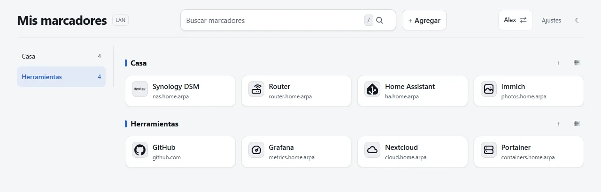

# launchbay

> Todos los marcadores que olvidaste haber guardado, en una sola página: autohospedado, sin conexión y sin registro.

[](../../LICENSE) [](https://github.com/rockbenben/365opensource)

[▶ Inicio rápido](#inicio-rápido) · [GHCR](https://github.com/rockbenben/launchbay/pkgs/container/launchbay) · [docker-compose.yml](https://raw.githubusercontent.com/rockbenben/launchbay/refs/heads/main/docker-compose.yml)

[English](../../README.md) · [简体中文](../../README.zh.md) · [繁體中文](README.zh-Hant.md) · [日本語](README.ja.md) · [한국어](README.ko.md) · **Español** · [Português](README.pt.md) · [Français](README.fr.md) · [Deutsch](README.de.md) · [Italiano](README.it.md) · [Русский](README.ru.md) · [العربية](README.ar.md) · [हिन्दी](README.hi.md) · [বাংলা](README.bn.md) · [ไทย](README.th.md) · [Türkçe](README.tr.md) · [Tiếng Việt](README.vi.md) · [Bahasa Indonesia](README.id.md)



Reúne en una sola página todas las direcciones que nunca logras recordar: el panel del NAS, el router, la intranet de la empresa, el cuadro de mando de monitorización. Conviértela en la página de inicio de tu navegador: **un clic, sin esperas ni pantallas de carga.**

Se ejecuta en tu propia máquina —un NAS doméstico, una Raspberry Pi, un router neutro o un servidor en la red local de la empresa—, de modo que tus marcadores nunca tocan los servidores de nadie más.

## Qué abarca

| Aspecto | Si se adapta a tu caso |
|---|---|
| Cómo se ejecuta | `docker compose up -d`, o el binario estático (amd64 / arm64) |
| Dónde se ejecuta | Un NAS doméstico, Raspberry Pi, router neutro o una máquina en la intranet |
| Quién lo utiliza | Una persona sola, una familia o un equipo pequeño: un perfil cada uno; el admin gestiona cuentas, no contenidos |
| Navegadores | Cualquier navegador moderno; con JavaScript desactivado, cada marcador sigue siendo visible y cliqueable |
| Qué necesitas instalar | Únicamente Docker: sin bibliotecas de terceros, sin base de datos, sin Node durante la compilación |
| Dónde están los datos | Un directorio convencional, `data/`; hacer una copia de seguridad es simplemente copiarlo |
| Idioma de la interfaz | 18 idiomas de interfaz, indicados arriba. Cada perfil puede elegir el suyo. |

## Qué puede hacer

**Guardar y organizar**

- **Soltar y listo**: arrastra un enlace desde la barra de marcadores, la barra de direcciones o desde otra pestaña directamente a un grupo. Sin cuadros de diálogo: soltarlo es la confirmación.
- **Arrastrar para reordenar**: dentro de un grupo, entre distintos grupos o sobre el título de un grupo para añadirlo al final. Una pulsación prolongada o un atajo activa la selección múltiple para etiquetar, mover o eliminar todo de una sola vez.
- **Guardar desde cualquier página**: arrastra el bookmarklet a tu barra de marcadores; un clic rescata la dirección y una pulsación más la guarda.
- **Importar desde el navegador**: sube el archivo de marcadores exportado por Chrome / Edge / Firefox y obtén un informe detallado entrada por entrada de qué se importó, qué no y por qué. La página web puede importar de inmediato o mostrar primero el informe; la CLI escribe en la misma ejecución salvo que indiques `--dry-run`.
- **Llevarte un perfil entero**: un solo archivo contiene los marcadores **y** la apariencia de la página (tema, disposición, vista, segunda línea, nombre de página, idioma, modo de direcciones). El PIN, la identidad del perfil y la imagen de fondo se excluyen deliberadamente.

**Buscar**

- **Grupos y búsqueda**: la barra superior busca por nombre, dirección, notas y etiquetas; pulsa Intro y el servidor responde sin necesidad de JavaScript. Con los scripts habilitados, pulsa `/` o usa la paleta `⌘/Ctrl K`.
- **Los grupos se muestran más grandes**: fija los grupos que más utilizas en una franja destacada de tarjetas grandes en la parte superior.
- **Más de 10.000 iconos sin conexión**: Tabler y Simple Icons vienen comprimidos en gzip dentro del binario; el favicon de un sitio web se obtiene una sola vez y se sirve desde la caché local.

**En casa y fuera**

- **Dos direcciones por marcador**: configura una dirección principal y una dirección WAN opcional. «Auto» sigue la dirección con la que abriste launchbay; Ajustes → Direcciones de marcadores permite cambiarla para el navegador actual. La búsqueda y el copiado usan la dirección activa, y los marcadores sin dirección WAN mantienen la principal. Si usas un proxy inverso, preserva la cabecera `Host` original.

**La propia página**

- **Un único panel de ajustes**: barra superior → Ajustes. Controla la apariencia y el idioma, la lista de grupos, copias de seguridad e historial, y **Mi PIN** (para bloquear o desbloquear tu perfil sin depender del administrador).
- **Funciona sin conexión**: la última página permanece en caché, y los marcadores añadidos sin conexión —o mientras la máquina está apagada— se ponen en cola y se sincronizan cuando el navegador recupera la conexión; pulsa **Enviar ahora** si el servidor estuvo temporalmente apagado.
- **Claves dedicadas para scripts e IA**: una API REST y tokens con alcance de perfil para la extensión, la CLI y la automatización. Un token que intente salir de su perfil recibirá un código 403.
- Restaura versiones anteriores de tus marcadores desde los ajustes de copia de seguridad e historial.

## Inicio rápido

```bash
git clone https://github.com/rockbenben/launchbay
cd launchbay
```

> [!IMPORTANT]
> Antes de arrancar, configura tu propio `LAUNCHBAY_ADMIN_TOKEN` en `docker-compose.yml`.

**Linux / NAS**

```bash
mkdir -p ./data
sudo chown 65534:65534 ./data
```

```bash
docker compose up -d
```

Sin archivo `.env` ni cadenas de compilación de Go: la imagen Docker se descarga directamente.

Abre **http://<dirección LAN de esta máquina>:7600** desde cualquier dispositivo de la red local —**no uses `localhost`**, pues significa «este dispositivo» y abriría el teléfono en el que lo estés tecleando. Si estás en la propia máquina física, `http://localhost:7600` funcionará correctamente.

La imagen utiliza la etiqueta `:latest`; el primer `up` descargará la versión más reciente. Si el contenedor ya se está ejecutando, conservará la imagen local; ejecuta primero `docker compose pull` para actualizarla.

Al abrirlo por primera vez verás la página de configuración inicial única: pon nombre al primer perfil y establece un PIN de 4 a 6 dígitos. No existen credenciales predeterminadas, y la página de configuración se cierra definitivamente una vez que existe algún perfil. Abre el perfil y guarda tu primer marcador.

**«Sin PIN» es una casilla separada, no un campo en blanco.** Dejar el PIN vacío será rechazado; marcar **Sin PIN** crea un perfil abierto para cualquier persona en la red local. Es deliberado: el error peligroso sería escribir tres dígitos y pulsar Intro por error, publicando inadvertidamente los marcadores personales ante toda la casa. Un perfil sin PIN no muestra cuadro de PIN en la página de selección. Podrás añadir o quitar este bloqueo más tarde en **Mi PIN**; quitarlo solo requiere el PIN anterior si había uno configurado.

El primer perfil **no es administrador**. La máquina se administra mediante `LAUNCHBAY_ADMIN_TOKEN`: entra en `/admin`, escribe la clave una vez y obtendrás una cookie exclusiva para la identidad de administrador (con 30 días de validez).

**Las personas posteriores no tienen que esperar al administrador.** La página de selección incluye la sección plegada **«Uno nuevo para ti»**: ábrela, indica un nombre y un PIN, y el perfil se creará al instante (`POST /new`; la ruta para máquinas es `POST /api/v1/profiles/new`). No requiere credenciales, por lo que cualquier dispositivo en la red local puede crear un perfil; la tarjeta aparecerá y el administrador podrá eliminarla cuando desee. Esto genera un perfil **vacío** sujeto a su propio PIN y no otorga acceso alguno a los marcadores de los demás. Los nombres aceptan hasta 60 caracteres; si se repite el nombre de otra persona, ambas tarjetas resultarán indistinguibles visualmente.

**Eliminar un perfil es la única acción irreversible**, por lo que vuelve a pedir la clave de la máquina: la página de confirmación detalla cuántos marcadores e instantáneas se perderán y deberás escribir `LAUNCHBAY_ADMIN_TOKEN` una vez más. La ruta de la API (`DELETE /api/v1/profiles`) solo admite esa clave en texto plano; una cookie de administrador por sí sola dará 403. Las instantáneas y los fondos privados se eliminan con el perfil, por lo que revertir no podrá recuperarlo.

En la misma página encontrarás el menú desplegable **Idioma predeterminado**, que puedes elegir durante la configuración inicial. Establece el **valor predeterminado para toda la máquina**; a partir de ahí cada persona podrá elegir el suyo en su propio panel, y los cambios del administrador solo afectarán a quienes no hayan elegido ninguno.

### Clave de administrador y tokens

| Variable | ¿Obligatoria? | Qué abarca |
|---|---|---|
| `LAUNCHBAY_ADMIN_TOKEN` | **Obligatoria**, una clave simple | Solo cuentas: crear/eliminar perfiles, cambiar PINs, habilitar/deshabilitar, estado e historial global. Todos los puntos finales de contenido (`/api/v1/data`, `/batch`, `/export`, …) responden 403: no pueden leer marcadores |
| `LAUNCHBAY_WRITE_TOKENS` | Opcional, vacía por defecto | Tokens de escritura con alcance de perfil, en formato `name:secret:profile` (nombre:secreto:perfil). Solo los necesitan la extensión de navegador, la CLI (`revert` / `import-bookmarks` / `backup` / `restore` / `profile fix-names`) y la IA o scripts |

> **¿Por qué está vacía por defecto?** La página de marcadores, el panel de administración, la reversión y la importación dependen de la cookie de sesión; no necesitan tokens. Las tres herramientas que sí los necesitan se configuran de forma deliberada. Incluir una clave por defecto otorgaría a cada instalación una clave pública capaz de escribir en el perfil `dad` (`dad` es el identificador más común).

Los perfiles carecen del atributo «es administrador». La página de administración muestra las acciones sobre cuentas junto con el número de elementos de cada perfil, la versión, la última modificación y si aún permanece **sin PIN**.

> **El identificador del perfil se deriva de su nombre y no siempre es `dad`.** Las letras y números ASCII se convierten en un slug (`Dad` → `dad`, `mi nas` → `mi-nas`); un nombre sin caracteres ASCII útiles pasa a la secuencia `home` / `home-2`. Un token con alcance a `…:dad` no coincidirá con ningún perfil y dará un 403: ajusta el alcance del token al id real (recomendado) o dale un nombre ASCII al primer perfil.

El puerto del host es el 7600 de forma predeterminada. En algunos equipos Windows, Hyper-V bloquea un rango de puertos (7532–7631 en la máquina donde se probó); si `up` falla, escoge un puerto libre fuera de dicho rango: `LAUNCHBAY_HOST_PORT=8901 docker compose up -d` (el puerto interno del contenedor no cambia). Los nombres del proyecto y del contenedor están fijados como `launchbay`, por lo que comandos como `docker logs launchbay` y `docker exec launchbay …` funcionan con independencia del directorio clonado.

### Extensión de navegador (opcional)

La carpeta `extension/` contiene una extensión para Chrome / Edge (Manifest V3): haz clic derecho en la página actual para guardarla en un perfil determinado, o guarda todas las pestañas de la ventana a la vez. No está dentro de la imagen; instálala manualmente.

Requiere un token con alcance de perfil porque no puede leer la cookie de sesión. Configura `LAUNCHBAY_WRITE_TOKENS`, reinicia y luego:

1. Entra en `chrome://extensions` y activa el **Modo de desarrollador**
2. Pulsa en **Cargar descomprimida** y selecciona la carpeta `extension/`
3. Abre las opciones de la extensión e introduce la dirección de la máquina (sin barra final), el ID del perfil predeterminado y el secreto del token
4. Pulsa en **Probar esta máquina**

Si la prueba devuelve un 403 no se trata de un fallo de red: significa que el token y el ID del perfil no coinciden. Corrige el alcance en `LAUNCHBAY_WRITE_TOKENS`, reinicia y vuelve a probar.

Una vez instalada: clic derecho en cualquier página → guardar; la página de opciones también puede importar todo el árbol de marcadores del navegador (el permiso de marcadores solo se solicita en el primer uso). La importación en cualquiera de las tres vías (web, extensión, CLI) solo se admite en un perfil **vacío**: reemplaza los marcadores del perfil en lugar de añadirse. Chrome advertirá «Leer y modificar tus datos en todos los sitios web» porque la extensión necesita `http://*/*` y `https://*/*` para interceptar el clic derecho; el token se almacena en `chrome.storage.local` y nunca se sincroniza. Firefox no ha sido verificado.

### Permisos del directorio de datos

Los datos se guardan en `./data`, junto a `docker-compose.yml`, y se montan siempre en `/data` dentro del contenedor. Para cambiar la ruta en el host, modifica la línea de `volumes`:

```yaml
    volumes:
      - /volume1/docker/launchbay:/data
```

En Windows, una ruta absoluta como `D:` genera conflictos con el separador de volúmenes; emplea la sintaxis completa:

```yaml
    volumes:
      - type: bind
        source: D:/launchbay-data
        target: /data
```

El contenedor se ejecuta con **uid 65534**, mientras que el directorio en el host suele pertenecer a root, por lo que la creación de perfiles, importaciones y escrituras fallarán. Concede los permisos a ese usuario en el host:

```bash
sudo chown -R 65534:65534 ./data
```

No eludas este paso ejecutando con `--user root`: eso permitiría que el servicio modifique cualquier archivo de tu máquina con permisos de root. La comprobación de salud (healthcheck) crea y borra un archivo de prueba en cada comprobación; unos permisos incorrectos provocarán el estado **unhealthy** en `docker ps`, y el registro mostrará la misma orden chown. La página de configuración inicial muestra la misma indicación (`uid 65534` en contenedor; tu propio usuario si ejecutas el binario directamente).

## Cómo usarlo

| Qué quieres hacer | Dónde |
|---|---|
| Cambiar el aspecto, vista, grupos, fondo, modo de direcciones o cómo se abren los marcadores | Ajustes en la barra superior, o `POST /prefs`, `/prefs/background`, `/prefs/group`, `/prefs/tabs` |
| Cambiar tu propio PIN | Mi PIN en tu propio panel, o `POST /prefs/pin` / `POST /api/v1/profiles/self/pin` |
| Crear o eliminar un perfil, fijar el PIN de un usuario, deshabilitar a alguien | `/admin` (o el enlace al pie de la página de selección). Al eliminar se pide la clave de nuevo; en la CLI la administración de perfiles solo abarca `profile create` y `profile rebuild` |
| Crear otro perfil para ti | La sección plegada «Uno nuevo para ti» en la página de selección, o `POST /api/v1/profiles/new` (sin credenciales) |
| Limpiar nombres que en realidad son direcciones URL | `launchbay profile fix-names --profile <id>` (añade primero `--dry-run`) |
| Permitir que una IA o un script modifique marcadores | `POST /api/v1/batch` con `expectedRev` |
| Recuperar un perfil dañado | `POST /api/v1/profiles/rebuild`, o `launchbay profile rebuild` |
| Ver el historial de todos los cambios | `GET /api/v1/history` (solo acciones y rutas, nunca los contenidos) |
| Respaldar o migrar un perfil entero | `GET /api/v1/backup` / `POST /api/v1/restore`, `launchbay backup` / `restore`, o Copia de seguridad e historial en Ajustes |

Otras rutas para máquinas: `POST /api/v1/usage` contabiliza clics, `POST /api/v1/resolve` convierte una URL en título e icono, y `GET /api/v1/status` ofrece el resumen global para el administrador.

Las copias de seguridad excluyen el PIN, la identidad del perfil y la imagen de fondo. Una copia que contenga marcadores solo se puede importar en un perfil vacío; una copia que solo contenga ajustes puede importarse en cualquiera. Las importaciones comprueban la revisión bajo el bloqueo de perfil y devuelven 409 `[rev-conflict]` con `currentRev` en caso de colisión. Los ajustes modificados de esta forma no incrementan la revisión ni figuran en Revertir.

**La lista completa de puntos finales, cuerpos de solicitud y códigos de error se encuentra en [AGENTS.md](../../AGENTS.md)**, el contrato canónico para agentes de IA contrastado mediante pruebas frente a la tabla de rutas. No se duplica aquí.

**Convenciones de la CLI**: los resultados van a stdout, los errores a stderr, y cada fallo cita el código emitido por el servidor (`[rev-conflict]`, `[ops-invalid]`). `import-bookmarks` recibe el archivo como argumento posicional y escribe en la misma ejecución en la que muestra el informe (`--dry-run` se detiene antes de escribir); las copias y exportaciones envían la respuesta completa en flujo, por lo que archivos de más de 4 MiB funcionan sin inconvenientes. `--help` y `-h` salen con código 0, los errores de sintaxis con 2 y otros fallos con 1. `revert --to 0` se rechaza como error de uso e imprime el comando `curl` exacto para realizarlo.

**Cero JavaScript es el punto de partida, no el límite.** La búsqueda es un formulario clásico, la creación de perfiles y los PINs son envíos POST de formularios nativos, y con los scripts apagados cada marcador sigue siendo visible y funcional. Los enlaces de salto integrados permiten ir directamente al contenido principal. Una sola capa de mejora progresiva añade la ventana de inserción, edición directa, ordenación por arrastre, la paleta ⌘K y soporte sin conexión; si dicha capa falla, la vía sin JavaScript permanece operativa.

## Limitaciones

- **Solo en red local, sin HTTPS.** El contenido de los marcadores reside en texto plano JSON en el disco; sitúa un proxy inverso con TLS por delante antes de exponerlo a Internet.
- **Un archivo `profile.json` dañado bloquea ese perfil.** `revert` no puede solucionarlo; `POST /api/v1/profiles/rebuild` (o `launchbay profile rebuild`) reescribe exclusivamente ese archivo sin tocar un solo byte de marcadores, instantáneas ni historial.
- **La descarga de iconos tiene un periodo de espera**: un origen que falle no se vuelve a intentar durante 24 horas. Este enfriamiento evita sondeos reiterados contra sitios caídos.
- **Sin listas compartidas**: no es posible compartir un marcador con la familia ni publicar una página abierta. El propósito central es que cada cual conserve lo suyo.
- **Aún no validado en un NAS real.** Todas las rondas de aceptación se ejecutaron en Windows + Docker Desktop; el objetivo de LCP en LAN, el LCP de arranque en frío, la fluidez de scroll con 1.000 marcadores y la latencia de caché sin conexión siguen pendientes de medición.
- **Sin widgets de reloj ni del tiempo.** Quedan fuera de lo que esta página pretende ser. El texto del pie y el contenido de los marcadores se gestionan con `POST /api/v1/batch`; los archivos en disco son administrados por el servidor.
- **Los idiomas de la interfaz cubren la interfaz, no los textos para scripts.** Los detalles de error de la API (`detail`), los motivos de validación de campos y el informe de importación leído por scripts permanecen en chino (el informe de la web sigue el idioma de la página). Las herramientas que consumen la API necesitan textos estables y comparables; tus propios títulos, nombres de grupos y URLs son contenido y tampoco se traducen.
- **Los tokens están vacíos por defecto**, de forma que la extensión y la CLI quedan desactivadas hasta que añadas uno; la clave de administrador funciona a la inversa y es obligatoria para arrancar.

## De dónde procede la imagen

compose únicamente descarga una imagen ya publicada; su construcción corresponde a la CI. Al asignar una etiqueta `v*` (o lanzar el flujo de trabajo manualmente), `.github/workflows/docker.yml` compila las imágenes amd64 y arm64 para Docker Hub y GHCR. Las etiquetas de publicación son `<version>`, `<major>.<minor>` y `<major>`, más `latest` y el sha del commit; la versión de la imagen procede exclusivamente de la etiqueta de git.

Para omitir la clonación, ejecuta la imagen directamente:

```bash
docker run -d --name launchbay -p 7600:7600 \
  -v launchbay-data:/data -e LAUNCHBAY_DATA_DIR=/data \
  -e LAUNCHBAY_ADMIN_TOKEN="tu-propia-clave-de-administrador" \
  --health-cmd "/launchbay healthcheck" --health-interval 30s \
  ghcr.io/rockbenben/launchbay:latest
```

## Sobre el Plan 365 de código abierto

Proyecto **#042** del [Plan 365 de código abierto](https://github.com/rockbenben/365opensource) — una persona + IA, más de 300 proyectos de código abierto en un año.

[Envía tu idea →](https://365.aishort.top/) · [Discord](https://discord.gg/PZTQfJ4GjX) · [Telegram](https://t.me/aishort_top)
