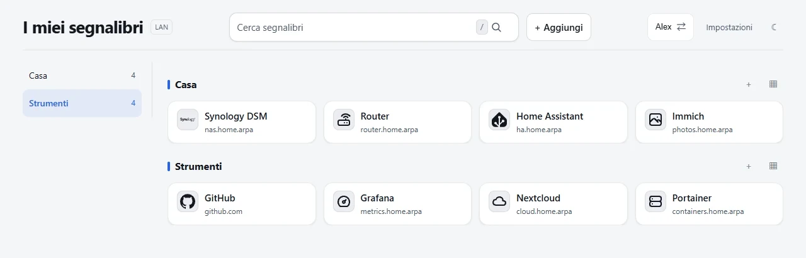

# launchbay

> Tutti i segnalibri che hai dimenticato di aver salvato, su una sola pagina — self-hosted, offline, senza registrazione.

[](../../LICENSE) [](https://github.com/rockbenben/365opensource)

[▶ Avvio rapido](#avvio-rapido) · [GHCR](https://github.com/rockbenben/launchbay/pkgs/container/launchbay) · [docker-compose.yml](https://raw.githubusercontent.com/rockbenben/launchbay/refs/heads/main/docker-compose.yml)

[English](../../README.md) · [简体中文](../../README.zh.md) · [繁體中文](README.zh-Hant.md) · [日本語](README.ja.md) · [한국어](README.ko.md) · [Español](README.es.md) · [Português](README.pt.md) · [Français](README.fr.md) · [Deutsch](README.de.md) · **Italiano** · [Русский](README.ru.md) · [العربية](README.ar.md) · [हिन्दी](README.hi.md) · [বাংলা](README.bn.md) · [ไทย](README.th.md) · [Türkçe](README.tr.md) · [Tiếng Việt](README.vi.md) · [Bahasa Indonesia](README.id.md)



Raccogli su una sola pagina tutti gli indirizzi che non riesci mai a ricordare: il pannello di gestione del NAS, il router, l'intranet aziendale, la dashboard di monitoraggio. Impostala come pagina iniziale del browser — **un clic, nessun caricamento.**

Viene eseguito sul tuo computer — un NAS domestico, un Raspberry Pi, un router dedicato o un server nella rete locale aziendale — in modo che i tuoi segnalibri non transitino mai sui server di terzi.

## Cosa comprende

| Aspetto | Se fa al caso tuo |
|---|---|
| Come eseguirlo | `docker compose up -d`, oppure il binario statico (amd64 / arm64) |
| Dove viene eseguito | Un NAS di casa, Raspberry Pi, router o una macchina nella rete intranet |
| Chi lo usa | Una persona sola, una famiglia o un piccolo team — un profilo ciascuno; l'amministratore gestisce gli account, non i contenuti |
| Browser | Qualsiasi browser moderno; anche con JavaScript disattivato, ogni segnalibro resta visibile e cliccabile |
| Cosa installare | Solo Docker: nessuna libreria di terze parti, nessun database, niente Node in fase di build |
| Dove risiedono i dati | Una normale cartella, `data/`; un backup consiste semplicemente nel copiarla |
| Lingua dell'interfaccia | 18 lingue dell’interfaccia, elencate sopra. Ogni profilo può scegliere la propria. |

## Cosa può fare

**Salvare e riordinare**

- **Rilascia ed è salvato**: trascina un link dalla barra dei segnalibri, dalla barra degli indirizzi o da un'altra scheda direttamente su un gruppo. Nessun modulo di dialogo — il rilascio è la conferma.
- **Trascina per riordinare**: all'interno di un gruppo, tra gruppi diversi o sul titolo di un gruppo per inserirlo in coda. Una pressione prolungata o una scorciatoia attiva la selezione multipla per etichettare, spostare o eliminare elementi in un unico passaggio.
- **Salva da qualsiasi pagina**: trascina il bookmarklet nella barra dei segnalibri; un clic recupera l'indirizzo, un altro lo salva.
- **Importa dal browser**: carica il file di segnalibri esportato da Chrome / Edge / Firefox e ottieni un resoconto voce per voce — cosa è stato inserito, cosa no e perché. La pagina web può importare subito o mostrare prima il resoconto; la CLI scrive nella stessa esecuzione a meno che non si indichi `--dry-run`.
- **Porta con te un intero profilo**: un unico file contiene i segnalibri **e** l'aspetto della pagina (tema, layout, vista, seconda riga, nome della pagina, lingua, modalità indirizzo). Il PIN, l'identità del profilo e l'immagine di sfondo sono deliberatamente esclusi.

**Cercare**

- **Gruppi e ricerca**: la barra superiore cerca per nome, indirizzo, note ed etichette; premi Invio e il server risponde senza necessità di JavaScript. Con gli script abilitati, premi `/` o richiama la tavolozza `⌘/Ctrl K`.
- **Gruppi visualizzati più grandi**: metti in risalto i gruppi usati più di frequente in una fascia di schede grandi nella parte superiore.
- **Oltre 10.000 icone offline**: Tabler e Simple Icons sono compresse con gzip direttamente nel file binario; la favicon di un sito viene recuperata una sola volta e poi servita dalla cache locale.

**A casa e fuori**

- **Due indirizzi per segnalibro**: imposta un indirizzo principale e un indirizzo WAN opzionale. La modalità «Auto» si adatta all'indirizzo con cui hai aperto launchbay; Impostazioni → Indirizzi dei segnalibri consente di ignorarla per il browser corrente. Ricerca e copia usano l'indirizzo attivo, mentre i segnalibri senza indirizzo WAN mantengono quello principale. Dietro un reverse proxy, preserva l'intestazione `Host` originale.

**La pagina stessa**

- **Un unico pannello delle impostazioni**: barra superiore → Impostazioni. Gestisce l'aspetto grafico e la lingua della pagina, l'elenco dei gruppi, backup e cronologia, nonché **Il mio PIN** — per bloccare o sbloccare il tuo profilo senza l'amministratore.
- **Funziona offline**: l'ultima pagina resta memorizzata nella cache, e i segnalibri aggiunti offline — o mentre il server è spento — restano in coda e vengono inviati automaticamente quando il browser si riconnette; premi **Invia ora** se il server è rimasto temporaneamente irraggiungibile.
- **Chiavi dedicate per script e IA**: un'API REST e token limitati al profilo per l'estensione, la CLI e le automazioni. Un token che tenta di operare fuori dal proprio profilo riceve un errore 403.
- Ripristina versioni precedenti dei segnalibri dalle impostazioni di backup e cronologia.

## Avvio rapido

```bash
git clone https://github.com/rockbenben/launchbay
cd launchbay
```

> [!IMPORTANT]
> Prima dell’avvio, imposta il tuo `LAUNCHBAY_ADMIN_TOKEN` in `docker-compose.yml`.

**Linux / NAS**

```bash
mkdir -p ./data
sudo chown 65534:65534 ./data
```

```bash
docker compose up -d
```

Nessun file `.env`, nessun ambiente Go da predisporre — l'immagine Docker viene semplicemente scaricata.

Apri **http://<indirizzo LAN di questa macchina>:7600** da qualsiasi dispositivo connesso alla rete locale — **non `localhost`**, che indicherebbe «questo dispositivo» e aprirebbe lo smartphone da cui stai digitando. Se ti trovi direttamente sulla macchina host, `http://localhost:7600` funzionerà correttamente.

L'immagine ha il tag `:latest`; il primo comando `up` scarica la versione più recente. Una macchina con il container già attivo mantiene l'immagine locale, quindi esegui prima `docker compose pull` per aggiornare.

Al primo accesso verrai indirizzato alla schermata di configurazione iniziale: assegna un nome al primo profilo e imposta un PIN di 4–6 cifre. Non esistono credenziali predefinite, e la pagina di configurazione si chiude per sempre non appena esiste un profilo. Apri il profilo e salva il primo segnalibro.

**«Nessun PIN» è una casella esplicita, non un campo lasciato vuoto.** Lasciare vuoto il PIN viene respinto; spuntare **Nessun PIN** crea un profilo accessibile a chiunque sulla LAN. È una scelta intenzionale: l'errore pericoloso consisterebbe nel digitare tre cifre e premere Invio per sbaglio, pubblicando inavvertitamente i segnalibri privati a tutta la casa. Un profilo senza PIN non mostra la casella di inserimento del PIN nella schermata di selezione. Potrai aggiungere o rimuovere il blocco in seguito in **Il mio PIN**; la rimozione richiede il vecchio PIN solo se ne era già presente uno.

Il primo profilo **non è un amministratore**. La macchina si gestisce mediante `LAUNCHBAY_ADMIN_TOKEN`: apri `/admin`, digita la chiave una volta e otterrai un cookie associato esclusivamente all'identità di amministratore (valido 30 giorni).

**Gli utenti successivi non devono attendere l'amministratore.** La schermata di selezione include la sezione comprimibile **«Uno nuovo per te»**: aprila, inserisci nome e PIN e il profilo sarà subito creato (`POST /new`; la rotta API corrispondente è `POST /api/v1/profiles/new`). Non richiede alcuna credenziale, permettendo a qualsiasi dispositivo sulla LAN di crearne uno; la scheda compare all'istante e l'amministratore può eliminarla in qualunque momento. In questo modo si crea un profilo **vuoto** protetto dal proprio PIN, che non concede alcun accesso ai segnalibri altrui. I nomi possono avere fino a 60 caratteri; riutilizzare il nome di qualcun altro renderà le due schede visivamente identiche.

**L'eliminazione di un profilo è l'unica operazione irreversibile**, motivo per cui richiede nuovamente la chiave della macchina: la schermata di conferma riassume quanti segnalibri e istantanee andranno persi, e occorre digitare `LAUNCHBAY_ADMIN_TOKEN` ancora una volta. La rotta API (`DELETE /api/v1/profiles`) accetta solo la chiave in chiaro; un cookie di amministratore da solo riceve un errore 403. Istantanee e sfondi privati vengono rimossi insieme al profilo, pertanto nessun ripristino potrà salvarlo.

La medesima pagina offre il menu a tendina **Lingua predefinita**, che puoi impostare durante la configurazione iniziale. Determina il **valore predefinito per l'intero sistema**; in seguito ciascuno potrà impostare la propria lingua nel rispettivo pannello, e le modifiche dell'amministratore avranno effetto solo su chi non ne ha scelta una.

### Chiave di amministrazione e token

| Variabile | Obbligatoria? | Cosa copre |
|---|---|---|
| `LAUNCHBAY_ADMIN_TOKEN` | **Obbligatoria**, una chiave semplice | Solo gestione account: crea/elimina profili, imposta PIN, abilita/disabilita, stato e cronologia globale. Ogni endpoint dei contenuti (`/api/v1/data`, `/batch`, `/export`, …) risponde 403 — non può leggere i segnalibri |
| `LAUNCHBAY_WRITE_TOKENS` | Opzionale, vuota per impostazione predefinita | Token di scrittura limitati al profilo, nel formato `name:secret:profile` (nome:segreto:profilo). Servono unicamente all'estensione del browser, alla CLI (`revert` / `import-bookmarks` / `backup` / `restore` / `profile fix-names`) e a script o IA |

> **Perché è vuota per impostazione predefinita?** La pagina dei segnalibri, l'amministrazione, il ripristino e l'importazione si basano sul cookie di sessione; non occorre alcun token. I tre strumenti che ne hanno bisogno vengono installati deliberatamente. Distribuire un token predefinito doterebbe ogni installazione di una chiave universale capace di scrivere nel profilo `dad` (`dad` è l'ID di profilo più comune).

Un profilo non possiede l'attributo «è amministratore». La schermata di amministrazione mostra le azioni a livello di account insieme al numero di elementi, alla versione, all'ultima modifica e all'eventuale assenza di **PIN**.

> **L'ID del profilo viene ricavato dal suo nome e non è necessariamente `dad`.** Lettere e cifre ASCII vengono convertite in uno slug (`Dad` → `dad`, `nas casa` → `nas-casa`); un nome privo di caratteri ASCII sfruttabili ricade nella sequenza `home` / `home-2`. Un token assegnato a `…:dad` non corrisponderà ad alcun profilo e riceverà un 403: adatta l'ambito del token all'ID effettivo (scelta consigliata) oppure assegna un nome ASCII al primo profilo.

La porta dell'host predefinita è la 7600. Su alcune macchine Windows, Hyper-V riserva un blocco di porte (7532–7631 sul computer di test); se il comando `up` fallisce, seleziona una porta libera all'esterno: `LAUNCHBAY_HOST_PORT=8901 docker compose up -d` (la porta interna del container resta invariata). I nomi del progetto e del container sono fissati come `launchbay`, quindi comandi come `docker logs launchbay` e `docker exec launchbay …` funzionano indipendentemente dal percorso in cui è stato clonato il repository.

### Estensione per browser (opzionale)

La cartella `extension/` contiene un'estensione per Chrome / Edge (Manifest V3): fai clic con il tasto destro sulla pagina attiva per salvarla in un determinato profilo, oppure salva tutte le schede della finestra in una volta sola. Non è inclusa nell'immagine Docker e va installata manualmente.

Necessita di un token limitato al profilo poiché non può accedere al cookie di sessione. Imposta `LAUNCHBAY_WRITE_TOKENS`, riavvia il servizio e procedi come segue:

1. Apri `chrome://extensions` e attiva la **Modalità sviluppatore**
2. Clicca su **Carica estensione non pacchettizzata** e seleziona la cartella `extension/`
3. Apri le opzioni dell'estensione e inserisci l'indirizzo della macchina (senza barra finale), l'ID del profilo predefinito e il segreto del token
4. Clicca su **Testa questa macchina**

Una risposta 403 durante il test non indica un guasto di rete: significa che il token e l'ID del profilo non corrispondono. Correggi l'ambito in `LAUNCHBAY_WRITE_TOKENS`, riavvia e ripeti il test.

Una volta installata: clic destro su qualsiasi pagina → salva; la schermata delle opzioni consente inoltre di importare l'intero albero dei segnalibri del browser (l'autorizzazione per i segnalibri viene richiesta solo al primo utilizzo). L'importazione su tutti e tre i canali (web, estensione, CLI) è consentita solo su un profilo **vuoto**: sostituisce i segnalibri del profilo anziché aggiungervisi. Chrome mostra l'avviso «Leggere e modificare i tuoi dati su tutti i siti» poiché l'estensione ha bisogno di `http://*/*` e `https://*/*` per intercettare il clic destro; il token rimane custodito in `chrome.storage.local` e non viene mai sincronizzato. Firefox non è stato verificato.

### Permessi della directory dei dati

I dati vengono salvati in `./data` accanto a `docker-compose.yml`, e all'interno del container corrispondono sempre a `/data`. Per spostarli, modifica la riga `volumes`:

```yaml
    volumes:
      - /volume1/docker/launchbay:/data
```

Su Windows, un percorso assoluto come `D:` entra in conflitto con il carattere separatore; utilizza la sintassi estesa:

```yaml
    volumes:
      - type: bind
        source: D:/launchbay-data
        target: /data
```

Il container viene eseguito con **uid 65534**, mentre la directory sull'host appartiene quasi sempre a root — la creazione dei profili, le importazioni e le scritture falliranno. Assegna la proprietà a tale utente sulla macchina host:

```bash
sudo chown -R 65534:65534 ./data
```

Non aggirare il problema impostando `--user root`: ciò consentirebbe al servizio di scrivere su qualsiasi file del sistema con i permessi di root. Il controllo di integrità (healthcheck) crea ed elimina un file sonda a ogni controllo; permessi errati si tradurranno nello stato **unhealthy** in `docker ps`, e il log mostrerà lo stesso comando chown. La pagina di configurazione iniziale fornisce la medesima indicazione (`uid 65534` in un container; il tuo utente locale se esegui il file binario direttamente).

## Come usarlo

| Cosa desideri fare | Dove trovarlo |
|---|---|
| Modificare l'aspetto grafico, la visualizzazione, i gruppi, lo sfondo, la modalità degli indirizzi o l'apertura dei segnalibri | Impostazioni nella barra superiore, oppure `POST /prefs`, `/prefs/background`, `/prefs/group`, `/prefs/tabs` |
| Cambiare il tuo PIN personale | Il mio PIN nel tuo pannello, oppure `POST /prefs/pin` / `POST /api/v1/profiles/self/pin` |
| Creare o eliminare un profilo, impostare il PIN di qualcuno, disabilitare un utente | `/admin` (o il link nel piè di pagina della selezione). L'eliminazione richiede nuovamente la chiave; nella CLI la gestione dei profili include solo `profile create` e `profile rebuild` |
| Creare un ulteriore profilo per te stesso | La sezione «Uno nuovo per te» nella schermata di selezione, oppure `POST /api/v1/profiles/new` (senza credenziali) |
| Pulire i nomi che sono in realtà semplici indirizzi web | `launchbay profile fix-names --profile <id>` (esegui prima con `--dry-run`) |
| Consentire all'IA o a uno script di modificare i segnalibri | `POST /api/v1/batch` indicando `expectedRev` |
| Recuperare un profilo danneggiato | `POST /api/v1/profiles/rebuild`, o `launchbay profile rebuild` |
| Consultare il dettaglio di ogni modifica | `GET /api/v1/history` (solo azioni e percorsi, mai i contenuti) |
| Eseguire il backup o migrare un intero profilo | `GET /api/v1/backup` / `POST /api/v1/restore`, `launchbay backup` / `restore`, o Backup e cronologia nelle Impostazioni |

Ulteriori rotte per le macchine: `POST /api/v1/usage` tiene il conteggio dei clic, `POST /api/v1/resolve` converte un URL in titolo e icona, e `GET /api/v1/status` offre il riepilogo complessivo per l'amministratore.

I backup escludono il PIN, l'identità del profilo e l'immagine di sfondo. Un backup comprensivo di segnalibri può essere importato solo in un profilo vuoto; un backup di sole impostazioni può essere importato ovunque. Le importazioni verificano la revisione sotto il blocco del profilo e restituiscono 409 `[rev-conflict]` con `currentRev` in caso di conflitto. Le impostazioni scritte in questo modo non incrementano la revisione e non compaiono in Ripristina.

**L'elenco completo di endpoint, corpi delle richieste e codici di errore è contenuto in [AGENTS.md](../../AGENTS.md)** — il contratto formale per agenti IA, allineato alla tabella delle rotte tramite suite di test. Non viene duplicato qui.

**Convenzioni della CLI**: i risultati normali vanno su stdout, gli errori su stderr e ogni fallimento cita il codice restituito dal server (`[rev-conflict]`, `[ops-invalid]`). `import-bookmarks` riceve il file come argomento posizionale ed esegue la scrittura nella medesima esecuzione in cui produce il resoconto (`--dry-run` si arresta prima della scrittura); backup ed esportazioni leggono l'intera risposta in streaming, gestendo senza problemi file di dimensioni superiori a 4 MiB. `--help` e `-h` terminano con codice 0, gli errori d'uso con 2 e gli altri errori con 1. Il comando `revert --to 0` viene rifiutato come errore d'uso e stampa l'esatto comando `curl` necessario a eseguirlo.

**Zero JavaScript rappresenta la base minima, non il traguardo massimo.** La ricerca è un modulo HTML standard, la creazione del profilo e l'inserimento del PIN sono normali chiamate form POST native, e anche con gli script disattivati ogni segnalibro resta visibile e cliccabile. Appositi link di salto integrati portano direttamente al contenuto principale. Un unico livello di miglioramento progressivo introduce la finestra modale di aggiunta, la modifica sul posto, l'ordinamento tramite trascinamento, la tavolozza ⌘K e il supporto offline; se tale livello dovesse fallire, il funzionamento senza JavaScript rimane sempre accessibile.

## Limiti

- **Solo su rete locale, niente HTTPS.** I contenuti dei segnalibri risiedono come file JSON in chiaro sul disco; interponi un reverse proxy con TLS prima di esporre il servizio a Internet.
- **Un file `profile.json` danneggiato blocca il rispettivo profilo.** L'opzione `revert` non è in grado di rimediare; `POST /api/v1/profiles/rebuild` (o `launchbay profile rebuild`) riscrive unicamente quel file senza toccare alcun byte di segnalibri, istantanee o cronologia.
- **Il recupero delle icone prevede un periodo di attesa**: un host non raggiungibile non viene ritentato per 24 ore. Questa pausa evita interrogazioni continue a vuoto verso siti non raggiungibili.
- **Nessun elenco condiviso**: non è possibile condividere un singolo segnalibro con tutta la famiglia né pubblicare una pagina online. L'obiettivo primario è che ciascuno mantenga separati i propri dati.
- **Non ancora validato su un NAS reale.** Tutte le sessioni di collaudo sono state eseguite su Windows + Docker Desktop; l'obiettivo LCP su LAN, l'LCP di avvio a freddo, la fluidità di scorrimento con 1.000 segnalibri e la latenza della cache offline restano ancora da misurare.
- **Niente widget di meteo o orologio.** Esulano dagli scopi di questa pagina. I testi di piè di pagina e i dati dei segnalibri passano attraverso `POST /api/v1/batch`; la gestione dei file su disco spetta al server.
- **Le lingue dell'interfaccia coprono l'interfaccia utente, non i testi destinati agli script.** I dettagli di errore dell'API (`detail`), le motivazioni di validazione dei campi e il resoconto d'importazione destinato agli script rimangono in cinese (il resoconto visualizzato nel browser segue invece la lingua della pagina). I client automatizzati necessitano di messaggi stabili e confrontabili; titoli di segnalibri, nomi dei gruppi e URL sono contenuti personali e non vengono a loro volta tradotti.
- **I token sono vuoti per impostazione predefinita**, rendendo disattivate l'estensione e la CLI finché non ne viene inserito uno; per la chiave amministratore vale l'opposto ed è obbligatoria per avviare il servizio.

## Da dove proviene l'immagine

compose scarica unicamente immagini già pubblicate; la compilazione è a carico della CI. Quando viene rilasciato un tag `v*` (o avviato manualmente il workflow), `.github/workflows/docker.yml` compila le versioni amd64 e arm64 per Docker Hub e GHCR. I tag di rilascio seguono lo schema `<version>`, `<major>.<minor>` e `<major>`, assieme a `latest` e allo sha del commit; la versione dell'immagine deriva unicamente dal tag Git.

Se preferisci non clonare il repository, puoi avviare direttamente l'immagine:

```bash
docker run -d --name launchbay -p 7600:7600 \
  -v launchbay-data:/data -e LAUNCHBAY_DATA_DIR=/data \
  -e LAUNCHBAY_ADMIN_TOKEN="la-tua-chiave-amministratore" \
  --health-cmd "/launchbay healthcheck" --health-interval 30s \
  ghcr.io/rockbenben/launchbay:latest
```

## Informazioni sul 365 Open Source Plan

Progetto **#042** del [365 Open Source Plan](https://github.com/rockbenben/365opensource) — una persona + l'IA, oltre 300 progetti open source in un anno.

[Proponi la tua idea →](https://365.aishort.top/) · [Discord](https://discord.gg/PZTQfJ4GjX) · [Telegram](https://t.me/aishort_top)
