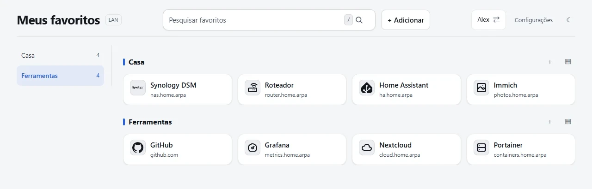

# launchbay

> Todos os favoritos que você esqueceu que salvou, em uma só página — auto-hospedado, offline e sem cadastro.

[](../../LICENSE) [](https://github.com/rockbenben/365opensource)

[▶ Início rápido](#início-rápido) · [GHCR](https://github.com/rockbenben/launchbay/pkgs/container/launchbay) · [docker-compose.yml](https://raw.githubusercontent.com/rockbenben/launchbay/refs/heads/main/docker-compose.yml)

[English](../../README.md) · [简体中文](../../README.zh.md) · [繁體中文](README.zh-Hant.md) · [日本語](README.ja.md) · [한국어](README.ko.md) · [Español](README.es.md) · **Português** · [Français](README.fr.md) · [Deutsch](README.de.md) · [Italiano](README.it.md) · [Русский](README.ru.md) · [العربية](README.ar.md) · [हिन्दी](README.hi.md) · [বাংলা](README.bn.md) · [ไทย](README.th.md) · [Türkçe](README.tr.md) · [Tiếng Việt](README.vi.md) · [Bahasa Indonesia](README.id.md)



Reúna em uma só página todos os endereços que você nunca consegue lembrar: o painel de administração do NAS, o roteador, a intranet da empresa, o dashboard de monitoramento. Transforme-a na página inicial do seu navegador — **um clique, sem tempo de espera.**

Executado no seu próprio computador — um NAS doméstico, Raspberry Pi, roteador dedicado ou um servidor na rede local da empresa —, de modo que seus favoritos nunca tocam nos servidores de terceiros.

## O que ele cobre

| Aspecto | Se atende às suas necessidades |
|---|---|
| Como executar | `docker compose up -d`, ou o binário estático (amd64 / arm64) |
| Onde roda | Um NAS caseiro, Raspberry Pi, roteador dedicado ou um servidor na intranet |
| Quem usa | Uma pessoa, uma família ou uma pequena equipe — um perfil para cada; o admin cuida das contas, não do conteúdo |
| Navegadores | Qualquer navegador moderno; mesmo com JavaScript desligado, cada favorito continua visível e clicável |
| O que você instala | Apenas o Docker: sem bibliotecas de terceiros, sem banco de dados, sem Node no momento do build |
| Onde os dados ficam | Um diretório comum, `data/`; fazer backup consiste em simplesmente copiá-lo |
| Idioma da interface | 18 idiomas de interface, listados acima. Cada perfil pode escolher o seu. |

## O que ele faz

**Salvar e organizar**

- **Solte e está salvo**: arraste um link da barra de favoritos, da barra de endereços ou de outra aba diretamente para um grupo. Sem janelas de diálogo — soltar já é a confirmação.
- **Arraste para reordenar**: dentro de um grupo, entre grupos diferentes ou solte sobre o título de um grupo para adicionar ao final. Um clique longo ou atalho inicia a seleção múltipla para marcar com tags, mover ou excluir de uma só vez.
- **Salve de qualquer página**: arraste o bookmarklet para a sua barra de favoritos; um clique recupera o endereço e outro toque salva.
- **Importe do seu navegador**: envie o arquivo de favoritos exportado pelo Chrome / Edge / Firefox e receba um relatório detalhado item a item — o que entrou, o que ficou de fora e o motivo. A interface web pode importar na hora ou exibir o relatório antes; a CLI aplica a gravação no mesmo comando, a não ser que você passe `--dry-run`.
- **Leve um perfil inteiro com você**: um único arquivo guarda os favoritos **e** a aparência da página (tema, layout, modo de visualização, segunda linha, nome da página, idioma, modo de endereço). O PIN, a identidade do perfil e a imagem de fundo são propositalmente excluídos.

**Localizar**

- **Grupos e busca**: a barra superior pesquisa nomes, endereços, notas e tags; pressione Enter e o servidor responde — sem precisar de JavaScript. Com scripts ativos, pressione `/` ou use a paleta `⌘/Ctrl K`.
- **Grupos mostrados maiores**: destaque os grupos que você mais usa em uma faixa superior com cartões em tamanho maior.
- **Mais de 10.000 ícones offline**: Tabler e Simple Icons vêm comprimidos em gzip no próprio executável; o favicon de um site é obtido apenas uma vez e passa a ser servido do cache local.

**Em casa e fora**

- **Dois endereços por favorito**: configure um endereço principal e um endereço WAN opcional. O modo «Auto» acompanha o endereço pelo qual você abriu o launchbay; Configurações → Endereços favoritos substitui a regra para o navegador em uso. A busca e a cópia utilizam o endereço ativo, e favoritos sem endereço WAN mantêm o endereço principal. Atrás de um proxy reverso, preserve o cabeçalho `Host` original.

**A própria página**

- **Painel único de configurações**: barra superior → Configurações. Reúne o visual e o idioma da página, a lista de grupos, backup e histórico, e **Meu PIN** — para travar ou destravar o seu perfil sem depender do administrador.
- **Funciona offline**: a última página visualizada fica salva em cache, e favoritos adicionados enquanto estiver sem rede — ou com o servidor desligado — entram na fila e são enviados automaticamente assim que o navegador se reconectar; clique em **Enviar agora** caso o servidor tenha ficado temporariamente indisponível.
- **Chaves próprias para scripts e IA**: uma API REST com tokens de escopo restrito por perfil para a extensão, a CLI e automações. Um token que tente atuar fora do seu próprio perfil receberá um código 403.
- Restaure versões anteriores dos favoritos pelas configurações de backup e histórico.

## Início rápido

```bash
git clone https://github.com/rockbenben/launchbay
cd launchbay
```

> [!IMPORTANT]
> Antes de iniciar, defina seu próprio `LAUNCHBAY_ADMIN_TOKEN` em `docker-compose.yml`.

**Linux / NAS**

```bash
mkdir -p ./data
sudo chown 65534:65534 ./data
```

```bash
docker compose up -d
```

Sem arquivo `.env`, sem compilar ferramentas em Go — a imagem Docker é simplesmente baixada.

Abra **http://<endereço LAN desta máquina>:7600** em qualquer dispositivo conectado à rede local — **não use `localhost`**, que significa «este dispositivo» e abriria o próprio celular onde você estiver digitando. Se estiver sentado diretamente em frente ao servidor, `http://localhost:7600` funciona perfeitamente.

A imagem usa a tag `:latest`; a primeira execução do comando `up` baixa o lançamento mais recente. Se a máquina já estiver rodando o contêiner, ela mantém a imagem local: execute primeiro `docker compose pull` para atualizar.

Ao abrir o endereço pela primeira vez, você entrará na página única de configuração inicial: defina o nome do primeiro perfil e um PIN de 4 a 6 dígitos. Não há credenciais padrão de fábrica, e essa página de instalação se fecha em definitivo assim que qualquer perfil for criado. Abra o perfil e salve seu primeiro favorito.

**«Sem PIN» é uma caixa de seleção explícita, não um campo deixado em branco.** Deixar o campo de PIN vazio é recusado; marcar **Sem PIN** cria um perfil aberto a qualquer pessoa na rede local. Isso é intencional: o erro grave seria digitar três dígitos e apertar Enter por acidente, liberando silenciosamente os favoritos da pessoa para toda a casa. Um perfil sem PIN não exibe caixa de PIN na tela de seleção. Você poderá colocar ou retirar essa trava mais tarde em **Meu PIN**; para retirar, o PIN antigo só é solicitado enquanto houver um ativo.

O primeiro perfil **não é administrador**. O servidor é gerenciado por meio de `LAUNCHBAY_ADMIN_TOKEN`: acesse `/admin`, digite a chave uma vez e você receberá um cookie exclusivo da identidade de administrador (válido por 30 dias).

**Novos usuários não precisam esperar pelo administrador.** A tela de seleção traz uma seção recolhida chamada **«Novo para você»**: abra-a, informe o nome e o PIN, e o perfil estará pronto (`POST /new`; a rota de API correspondente é `POST /api/v1/profiles/new`). Ela não exige credenciais, permitindo que qualquer aparelho na rede local crie um perfil; o cartão surge na tela e o administrador pode excluí-lo quando quiser. Isso cria um perfil **vazio** protegido pelo seu próprio PIN e não concede acesso aos favoritos de ninguém. Os nomes aceitam até 60 caracteres; usar o nome de outra pessoa tornará os dois cartões visualmente indistinguíveis.

**Excluir um perfil é a única ação irreversível**, por isso a chave do servidor é solicitada novamente: a tela de confirmação detalha quantos favoritos e instantâneos serão perdidos, e você deverá digitar `LAUNCHBAY_ADMIN_TOKEN` mais uma vez. A rota da API (`DELETE /api/v1/profiles`) só aceita essa chave em texto puro; um cookie de administrador isolado resultará em erro 403. Os instantâneos e imagens de fundo personalizadas são excluídos junto com o perfil, de modo que nem a reversão conseguirá recuperá-lo.

Essa mesma página traz o menu **Idioma padrão**, que você pode definir durante a configuração. Ele estabelece o **padrão para toda a máquina**; depois, cada pessoa pode escolher seu próprio idioma em seu painel, e as mudanças feitas pelo administrador só afetarão quem não tiver feito uma escolha explícita.

### Chave de administração e tokens

| Variável | Obrigatória? | O que ela cobre |
|---|---|---|
| `LAUNCHBAY_ADMIN_TOKEN` | **Obrigatória**, uma chave simples | Apenas contas: criar/excluir perfis, definir PINs, ativar/desativar, status e histórico global. Todos os endpoints de conteúdo (`/api/v1/data`, `/batch`, `/export`, …) respondem com 403 — não leem favoritos |
| `LAUNCHBAY_WRITE_TOKENS` | Opcional, vazia por padrão | Tokens de escrita com escopo restrito por perfil, no formato `name:secret:profile` (nome:segredo:perfil). Apenas a extensão de navegador, a CLI (`revert` / `import-bookmarks` / `backup` / `restore` / `profile fix-names`) e automações/IA precisam de um |

> **Por que vazia por padrão?** A página de favoritos, a administração, a reversão e a importação funcionam baseadas no cookie de sessão; nenhum token é exigido. As três ferramentas que precisam de token são instaladas por escolha própria. Fornecer uma chave padrão daria a toda máquina instalada uma credencial pública capaz de alterar o perfil `dad` (`dad` sendo o ID mais comum).

Um perfil não possui o atributo «é administrador». A página de administração mostra as ações de gerenciamento de conta, além da quantidade de itens de cada perfil, sua versão, data da última alteração e a indicação se continua **sem PIN**.

> **O ID do perfil é derivado do seu nome e não é necessariamente `dad`.** Letras e dígitos ASCII viram um slug (`Dad` → `dad`, `meu nas` → `meu-nas`); um nome sem caracteres ASCII utilizáveis recai na sequência `home` / `home-2`. Um token restrito a `…:dad` não corresponderá a nenhum perfil e receberá um código 403 — ajuste o escopo do token para o ID real (recomendado) ou use um nome em caracteres ASCII para o primeiro perfil.

A porta do host é 7600 por padrão. Em algumas máquinas com Windows, o Hyper-V reserva uma faixa de portas (7532–7631 no computador em que os testes foram feitos); se o comando `up` falhar, escolha uma porta livre fora dessa faixa: `LAUNCHBAY_HOST_PORT=8901 docker compose up -d` (a porta interna do contêiner não é alterada). Os nomes do projeto e do contêiner estão fixados como `launchbay`, portanto `docker logs launchbay` e `docker exec launchbay …` funcionam independentemente do diretório onde o repositório foi clonado.

### Extensão para navegador (opcional)

A pasta `extension/` contém uma extensão para Chrome / Edge (Manifest V3): clique com o botão direito na página atual para salvá-la em um perfil específico, ou salve todas as abas da janela de uma só vez. Ela não está inclusa na imagem do Docker e deve ser instalada manualmente.

Ela precisa de um token com escopo para o perfil desejado, pois não consegue ler o cookie de sessão. Preencha `LAUNCHBAY_WRITE_TOKENS`, reinicie o contêiner e execute os passos:

1. Acesse `chrome://extensions` e ative o **Modo do desenvolvedor**
2. Clique em **Carregar sem compactação** e aponte para a pasta `extension/`
3. Abra as opções da extensão e preencha o endereço da máquina (sem barra no final), o ID do perfil padrão e o segredo do token
4. Clique em **Testar esta máquina**

Receber um erro 403 no teste não é falha de conexão: significa que o token e o ID do perfil não coincidem. Corrija o escopo em `LAUNCHBAY_WRITE_TOKENS`, reinicie e tente novamente.

Após a instalação: clique com o botão direito em qualquer página → salvar; a tela de opções também permite importar toda a árvore de favoritos do navegador (a permissão de acesso aos favoritos só é solicitada no primeiro uso). A importação em qualquer uma das três vias (web, extensão, CLI) só é aceita em um perfil **vazio** — ela substitui integralmente os favoritos do perfil em vez de acrescentar novos. O Chrome exibirá o aviso «Ler e alterar seus dados em todos os sites» porque a extensão necessita de `http://*/*` e `https://*/*` para interceptar o clique com botão direito; o token permanece em `chrome.storage.local` e nunca é sincronizado. O suporte ao Firefox ainda não foi verificado.

### Permissões do diretório de dados

Os dados são salvos em `./data`, ao lado do arquivo `docker-compose.yml`, e dentro do contêiner correspondem sempre a `/data`. Para mudar o local na máquina de origem, edite a linha `volumes`:

```yaml
    volumes:
      - /volume1/docker/launchbay:/data
```

No Windows, um caminho absoluto como `D:` conflita com o caractere separador; utilize a sintaxe detalhada:

```yaml
    volumes:
      - type: bind
        source: D:/launchbay-data
        target: /data
```

O contêiner é executado sob o **uid 65534**, enquanto a pasta na máquina hospedeira frequentemente pertence ao usuário root — o que impede a criação de perfis, importações e gravações. Conceda as permissões a esse usuário no sistema hospedeiro:

```bash
sudo chown -R 65534:65534 ./data
```

Não contorne o problema utilizando `--user root`: isso daria ao serviço permissão para alterar qualquer arquivo da sua máquina como root. A verificação de integridade (healthcheck) cria e apaga um arquivo de teste a cada checagem; permissões incorretas farão o serviço constar como **unhealthy** no `docker ps`, e o log exibirá esse mesmo comando chown. A tela de instalação inicial traz o mesmo aviso (`uid 65534` em contêiner; seu usuário local caso execute o binário diretamente).

## Como usar

| O que você quer fazer | Onde encontrar |
|---|---|
| Mudar o visual, modo de exibição, grupos, plano de fundo, modo de endereços ou abertura dos favoritos | Configurações na barra superior, ou `POST /prefs`, `/prefs/background`, `/prefs/group`, `/prefs/tabs` |
| Alterar o seu próprio PIN | Meu PIN no seu próprio painel, ou `POST /prefs/pin` / `POST /api/v1/profiles/self/pin` |
| Criar ou excluir perfil, definir PIN de outro usuário, desativar alguém | `/admin` (ou o link no rodapé da seleção). Excluir solicita a chave de novo; na CLI o gerenciamento de perfis abrange apenas `profile create` e `profile rebuild` |
| Criar mais um perfil para você | A seção recolhida «Novo para você» na página de seleção, ou `POST /api/v1/profiles/new` (sem credenciais) |
| Limpar nomes de itens que na verdade são apenas URLs | `launchbay profile fix-names --profile <id>` (faça um teste com `--dry-run` antes) |
| Permitir que uma IA ou script altere favoritos | `POST /api/v1/batch` informando `expectedRev` |
| Recuperar um perfil corrompido | `POST /api/v1/profiles/rebuild`, ou `launchbay profile rebuild` |
| Ver o histórico completo de modificações | `GET /api/v1/history` (apenas ações e caminhos, nunca os conteúdos) |
| Fazer backup ou transferir um perfil inteiro | `GET /api/v1/backup` / `POST /api/v1/restore`, `launchbay backup` / `restore`, ou Backup e histórico em Configurações |

Outras rotas de automação: `POST /api/v1/usage` contabiliza cliques, `POST /api/v1/resolve` transforma uma URL em título e ícone, e `GET /api/v1/status` exibe o resumo geral de todos os perfis para o administrador.

Os backups excluem o PIN, a identidade do perfil e a imagem de fundo. Um backup contendo favoritos só pode ser restaurado em um perfil vazio; um backup contendo apenas configurações pode ser restaurado em qualquer um. As importações conferem o número de revisão sob a trava do perfil e respondem com o código 409 `[rev-conflict]` e `currentRev` em caso de concorrência. Configurações alteradas dessa forma não incrementam a revisão e não aparecem na função Reverter.

**A relação completa de endpoints, corpos de requisição e códigos de erro está documentada em [AGENTS.md](../../AGENTS.md)** — o contrato oficial para agentes de IA, validado contra a tabela de rotas por meio da suíte de testes. As informações não são duplicadas aqui.

**Padrões da CLI**: saídas regulares vão para o stdout, erros para o stderr, e cada falha cita o código fornecido pelo servidor (`[rev-conflict]`, `[ops-invalid]`). O comando `import-bookmarks` recebe o arquivo como argumento posicional e grava no mesmo processo em que exibe o relatório (`--dry-run` interrompe antes de gravar); backups e exportações transferem a resposta completa via streaming, lidando tranquilamente com arquivos acima de 4 MiB. `--help` e `-h` finalizam com código 0, erros de uso com 2 e outras falhas com 1. O comando `revert --to 0` é recusado como erro de sintaxe e exibe o comando `curl` exato para realizar a ação.

**Zero JavaScript é a linha de base, não o teto.** A pesquisa funciona com formulário HTML nativo, a criação de perfil e a digitação de PIN são chamadas POST normais, e com os scripts desligados todos os favoritos continuam visíveis e acessíveis. Links de atalho integrados saltam diretamente para o conteúdo principal. Uma única camada de aprimoramento progressivo acrescenta o painel de inserção, edição inline, ordenação por arrasto, a paleta ⌘K e o funcionamento offline; caso essa camada falhe, o uso sem JavaScript continua totalmente funcional.

## Limitações

- **Apenas rede local, sem HTTPS.** Os conteúdos dos favoritos ficam salvos como texto JSON simples no disco; posicione um proxy reverso com TLS na frente antes de disponibilizá-lo na internet.
- **Um arquivo `profile.json` corrompido bloqueia o respectivo perfil.** A opção `revert` não consegue corrigi-lo; `POST /api/v1/profiles/rebuild` (ou `launchbay profile rebuild`) reescreve exclusivamente esse arquivo sem alterar nenhum byte dos favoritos, instantâneos ou histórico.
- **A busca de ícones possui intervalo de espera**: um domínio que falhar não será consultado novamente durante 24 horas. Essa pausa de 24 horas evita consultas insistentes e inúteis a sites fora do ar.
- **Sem lista compartilhada**: não é possível compartilhar um favorito individual com a família nem publicar uma página publicamente. O objetivo central é justamente manter cada espaço isolado.
- **Ainda não validado em um NAS real.** Todas as etapas de validação foram executadas em Windows + Docker Desktop; a meta de LCP na rede local, o LCP na inicialização a frio, a taxa de quadros ao rolar 1.000 favoritos e o tempo de resposta com cache offline ainda precisam ser medidos.
- **Sem widgets de clima ou relógio.** Estão fora do propósito desta página. O texto do rodapé e os dados de favoritos passam por `POST /api/v1/batch`; os arquivos no disco são controlados pelo servidor.
- **Os idiomas da interface abrangem a interface, não as mensagens voltadas a scripts.** Detalhes de erro da API (`detail`), motivos de validação de campos e o relatório de importação lido por scripts continuam em chinês (o relatório exibido no navegador acompanha o idioma da página). Os serviços automatizados exigem textos estáveis e comparáveis; seus títulos de favoritos, nomes de grupos e URLs são conteúdos próprios e também não são traduzidos.
- **Os tokens vêm vazios por padrão**, de modo que a extensão e a CLI ficam desligadas até você cadastrar um; a chave de administrador funciona no sentido oposto e é obrigatória para iniciar.

## De onde vem a imagem

O compose somente baixa uma imagem já construída; a compilação é tarefa da CI. Ao criar uma tag `v*` (ou disparar o fluxo de trabalho manualmente), `.github/workflows/docker.yml` gera as imagens para amd64 e arm64 e publica no Docker Hub e GHCR. As tags de lançamento seguem `<version>`, `<major>.<minor>` e `<major>`, além de `latest` e do hash curto do commit; a versão da imagem é determinada exclusivamente pela tag do git.

Se preferir não clonar o repositório, execute a imagem diretamente:

```bash
docker run -d --name launchbay -p 7600:7600 \
  -v launchbay-data:/data -e LAUNCHBAY_DATA_DIR=/data \
  -e LAUNCHBAY_ADMIN_TOKEN="sua-propria-chave-de-admin" \
  --health-cmd "/launchbay healthcheck" --health-interval 30s \
  ghcr.io/rockbenben/launchbay:latest
```

## Sobre o Plano 365 Open Source

Projeto **#042** do [Plano 365 Open Source](https://github.com/rockbenben/365opensource) — uma pessoa + IA, mais de 300 projetos open-source em um ano.

[Envie sua ideia →](https://365.aishort.top/) · [Discord](https://discord.gg/PZTQfJ4GjX) · [Telegram](https://t.me/aishort_top)
