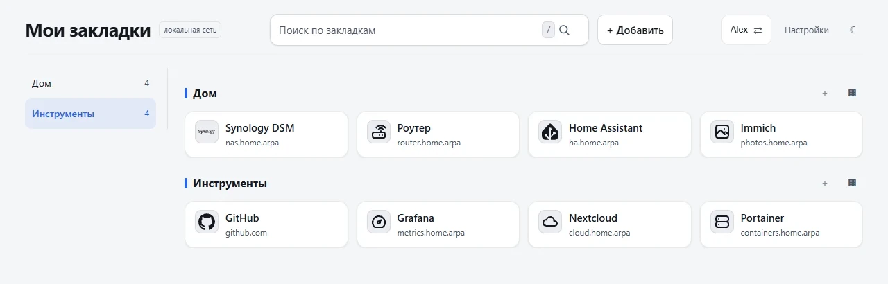

# launchbay

> Все закладки, о сохранении которых вы забыли, на одной странице — локальный хостинг, офлайн-режим, без регистрации.

[](../../LICENSE) [](https://github.com/rockbenben/365opensource)

[▶ Быстрый старт](#быстрый-старт) · [GHCR](https://github.com/rockbenben/launchbay/pkgs/container/launchbay) · [docker-compose.yml](https://raw.githubusercontent.com/rockbenben/launchbay/refs/heads/main/docker-compose.yml)

[English](../../README.md) · [简体中文](../../README.zh.md) · [繁體中文](README.zh-Hant.md) · [日本語](README.ja.md) · [한국어](README.ko.md) · [Español](README.es.md) · [Português](README.pt.md) · [Français](README.fr.md) · [Deutsch](README.de.md) · [Italiano](README.it.md) · **Русский** · [العربية](README.ar.md) · [हिन्दी](README.hi.md) · [বাংলা](README.bn.md) · [ไทย](README.th.md) · [Türkçe](README.tr.md) · [Tiếng Việt](README.vi.md) · [Bahasa Indonesia](README.id.md)



Соберите на одной странице адреса, которые вечно вылетают из головы: панель управления NAS, роутер, корпоративную систему, панель мониторинга. Сделайте её стартовой страницей браузера — **один клик, никакого ожидания.**

Она работает на вашей собственной машине — домашнем NAS, Raspberry Pi, программном маршрутизаторе или сервере во внутренней сети компании — ваши закладки никогда не попадут на чужой сервер.

## Что поддерживается

| Аспект | Подходит ли вам |
|---|---|
| Как запускать | `docker compose up -d` или статическим бинарником (amd64 / arm64) |
| Где запускать | Домашний NAS, Raspberry Pi, программный маршрутизатор или сервер в интранете |
| Для кого | Один человек, семья или небольшая команда — по профилю на каждого; администратор управляет аккаунтами, а не содержимым |
| Браузеры | Любой современный браузер; даже с выключенным JavaScript все закладки видны и открываются |
| Что нужно установить | Только Docker: никаких сторонних библиотек, никаких баз данных, никакого Node на этапе сборки |
| Где хранятся данные | В одном обычном каталоге `data/`; резервное копирование — это просто копирование папки |
| Язык интерфейса | 18 языков интерфейса перечислены выше. Язык можно выбрать отдельно для каждого профиля. |

## Возможности

**Сохранение и наведение порядка**

- **Бросил — и сохранено**: перетащите ссылку из панели закладок, адресной строки или другой вкладки прямо на группу. Никаких диалоговых окон — само перетаскивание уже подтверждение.
- **Перетаскивание для изменения порядка** внутри группы, между группами или на заголовок группы для добавления в конец. Долгое нажатие или горячая клавиша включает множественный выбор, после чего можно присвоить теги, переместить или удалить всё сразу.
- **Сохранение с любой страницы**: перетащите букмарклет на панель закладок; один клик подтягивает адрес, еще одно нажатие сохраняет.
- **Импорт из браузера**: загрузите HTML-файл закладок, экспортированный из Chrome / Edge / Firefox, и получите подробный отчет по каждой записи — что добавлено, что нет и по какой причине. На веб-странице можно импортировать сразу или сначала просмотреть отчет; CLI записывает изменения сразу, если не передан флаг `--dry-run`.
- **Профиль целиком с собой**: один файл содержит закладки **и** оформление страницы (тему, раскладку, вид, вторую строку, название страницы, язык, режим адреса). PIN-код, идентификатор профиля и фоновое изображение намеренно исключены.

**Поиск и навигация**

- **Группы и поиск**: верхняя панель ищет по названиям, адресам, заметкам и тегам; нажмите Enter, и сервер вернет ответ — JavaScript не требуется. При включенных скриптах нажмите `/` или палитру `⌘/Ctrl K`.
- **Избранные группы**: закрепите самые нужные группы в виде полосы крупных карточек вверху страницы.
- **Более 10 000 значков офлайн**: Tabler и Simple Icons упакованы в бинарник; favicon сайта загружается один раз и отдается из локального кэша.

**Дома и вне дома**

- **Два адреса на закладку**: укажите основной адрес и опциональный внешний (WAN). Режим «Авто» ориентируется на адрес, по которому открыт launchbay; Настройки → Адреса закладок позволяют переопределить это для текущего браузера. Поиск и копирование используют активный адрес, а закладки без WAN-адреса сохраняют основной. За обратным прокси обязательно сохраняйте исходный заголовок `Host`.

**Сама страница**

- **Единая панель настроек**: верхняя панель → Настройки. Здесь находятся оформление и язык страницы, список групп, резервное копирование и история, а также **Мой ПИН-код** — блокируйте или открывайте свой профиль без участия администратора.
- **Работа офлайн**: последняя открытая страница кэшируется, а закладки, добавленные офлайн (или пока машина выключена), встают в очередь и отправляются при восстановлении связи; нажмите **Send now**, если был недоступен сам сервер.
- **Свои ключи для скриптов и AI**: REST API и токены с областью действия профиля для расширения, CLI и автоматизации. Токен, попытавшийся выйти за пределы своего профиля, получает 403.
- Восстанавливайте предыдущие версии закладок в настройках резервного копирования и истории.

## Быстрый старт

```bash
git clone https://github.com/rockbenben/launchbay
cd launchbay
```

> [!IMPORTANT]
> Перед запуском задайте собственный `LAUNCHBAY_ADMIN_TOKEN` в `docker-compose.yml`.

**Linux / NAS**

```bash
mkdir -p ./data
sudo chown 65534:65534 ./data
```

```bash
docker compose up -d
```

Никаких `.env`, никакой цепочки сборки Go — образ просто скачивается.

Откройте **http://<IP-адрес_этой_машины_в_LAN>:7600** с любого устройства в локальной сети — **не `localhost`**, так как это означает «текущее устройство» и откроет браузер на том телефоне, где вы это ввели. Если вы сидите прямо за этой машиной, `http://localhost:7600` сработает.

Используется тег `:latest`; первая команда `up` загрузит самый свежий релиз. Если контейнер уже запущен, он сохраняет локальный образ, поэтому для обновления сначала выполните `docker compose pull`.

При первом открытии откроется страница первоначальной настройки: задайте имя первого профиля и 4–6-значный PIN-код. Учетных данных по умолчанию нет, и после создания любого профиля эта страница закрывается навсегда. Откройте профиль и добавьте первую закладку.

**«Без PIN-кода» — это отдельная галочка, а не пустое поле.** Оставить PIN пустым нельзя — запрос будет отклонен; установка галочки **Нет PIN-кода** создает профиль, доступный каждому в локальной сети. Это сделано намеренно: опасная ошибка — набрать три цифры и случайно нажать Enter, что молча открыло бы личные закладки всему дому. У профиля без PIN-кода на странице выбора поле ввода PIN не отображается. Вы можете установить или убрать его позже в разделе **Мой ПИН-код**; для удаления старый PIN требуется только тогда, когда он был установлен.

Первый созданный профиль — **не администратор**. Управление машиной осуществляется через `LAUNCHBAY_ADMIN_TOKEN`: откройте `/admin`, введите ключ один раз, и вы получите cookie, принадлежащий исключительно администратору (на 30 дней).

**Другим пользователям не нужно ждать администратора.** На странице выбора есть свернутый блок **«Новый для себя»**: раскройте его, укажите имя и PIN-код, и профиль готов (`POST /new`; маршрут для API: `POST /api/v1/profiles/new`). Никаких прав не требуется, создать профиль может любое устройство в локальной сети; карточка появится в списке, а администратор может удалить её в любой момент. Создается **пустой** профиль под своим PIN-кодом, не дающий доступа к чужим закладкам. Имена поддерживают до 60 символов, а повторение чужого имени сделает две карточки визуально неотличимыми.

**Удаление профиля — единственное необратимое действие**, поэтому оно запрашивает ключ машины повторно: страница подтверждения сообщает, сколько закладок и снимков будет удалено, и вы вводите `LAUNCHBAY_ADMIN_TOKEN` еще раз. Программный маршрут (`DELETE /api/v1/profiles`) принимает только этот ключ; cookie администратора вернет 403. Снимки и фоновые изображения удаляются вместе с профилем, откат здесь помочь не сможет.

На той же странице есть выпадающий список **Язык по умолчанию**; выберите его при настройке. Он задает **значение по умолчанию для всей машины**; в дальнейшем каждый сможет выбрать язык в своей панели настроек, а изменение администратора затронет только тех, кто еще не выбрал собственный язык.

### Ключ администратора и токены

| Переменная | Обязательна? | За что отвечает |
|---|---|---|
| `LAUNCHBAY_ADMIN_TOKEN` | **Обязательна**, прямой ключ | Только учетные записи: создание/удаление профилей, установка любого PIN-кода, отключение/включение, статус и история по всем профилям. Все эндпоинты содержимого (`/api/v1/data`, `/batch`, `/export`, …) возвращают 403 — читать закладки администратор не может |
| `LAUNCHBAY_WRITE_TOKENS` | Опциональна, по умолчанию пуста | Токены записи с областью действия профиля, `name:secret:profile`. Нужны только расширению браузера, CLI (`revert` / `import-bookmarks` / `backup` / `restore` / `profile fix-names`), AI или скриптам |

> **Почему по умолчанию пуста?** Страница закладок, панель администратора, откат и импорт работают через сессионные cookie; токен им не нужен. Три сценария, которым он требуется, настраиваются осознанно. Наличие токена по умолчанию дало бы на каждой машине готовый ключ для изменения профиля `dad` (самый частый ID профиля).

У профиля нет атрибута «является администратором». На странице администратора отображаются действия уровня учетных записей, а также количество элементов, версия, время последнего изменения и статус наличия PIN-кода для каждого профиля.

> **Идентификатор (ID) профиля образуется из его имени и не обязательно равен `dad`.** Символы ASCII и цифры превращаются в слаг (`Dad` → `dad`, `nas box` → `nas-box`); для нелатинских символов слага нет, поэтому они попадают в последовательность `home` / `home-2`. В таком случае токен с областью действия `…:dad` не найдет профиль и вернет 403 — укажите в области действия токена реальный ID (рекомендуется) или назовите первый профиль латиницей.

Порт хоста по умолчанию — 7600. На некоторых машинах с Windows служба Hyper-V резервирует диапазон портов (7532–7631 на тестовой машине); если запуск не удался, укажите свободный порт: `LAUNCHBAY_HOST_PORT=8901 docker compose up -d` (порт внутри контейнера не меняется). Имя проекта и контейнера зафиксировано как `launchbay`, поэтому `docker logs launchbay` и `docker exec launchbay …` работают независимо от имени каталога.

### Расширение для браузера (необязательно)

В папке `extension/` находится расширение для Chrome / Edge (Manifest V3): клик правой кнопкой мыши по текущей странице сохраняет её в выбранный профиль, либо можно сохранить все вкладки окна сразу. Расширение не включено в Docker-образ, его нужно установить вручную.

Ему требуется токен с областью действия профиля, так как расширение не имеет доступа к сессионным cookie. Заполните `LAUNCHBAY_WRITE_TOKENS`, перезапустите сервис, затем:

1. Откройте `chrome://extensions`, включите **Режим разработчика**
2. Нажмите **Загрузить распакованное расширение**, выберите папку `extension/`
3. В параметрах расширения укажите адрес сервера (без косой черты на конце), ID профиля по умолчанию и секретный ключ из токена
4. Нажмите **Проверить эту машину**

Ошибка 403 при проверке — это не сбой сети: это означает, что токен и ID профиля не совпадают. Исправьте область действия в `LAUNCHBAY_WRITE_TOKENS`, перезапустите и проверьте снова.

После установки: клик правой кнопкой по любой странице → сохранить; в настройках расширения также можно импортировать всё дерево закладок браузера (разрешение на доступ к закладкам запрашивается только при первом использовании). Импорт возможен только в **пустой** профиль во всех трех интерфейсах (веб, расширение, CLI) — он заменяет закладки профиля, а не дополняет их. Предупреждение Chrome «Просмотр и изменение ваших данных на всех сайтах» связано с тем, что расширению нужны разрешения `http://*/*` и `https://*/*` для обработки контекстного меню; токен хранится локально в `chrome.storage.local` и никуда не синхронизируется. В Firefox работа не проверялась.

### Права доступа к каталогу данных

Данные сохраняются в `./data` рядом с `docker-compose.yml` и внутри контейнера всегда монтируются как `/data`. Чтобы изменить расположение, отредактируйте строку `volumes`:

```yaml
    volumes:
      - /volume1/docker/launchbay:/data
```

В Windows абсолютный путь с двоеточием вроде `D:` конфликтует с разделителем; используйте расширенный синтаксис:

```yaml
    volumes:
      - type: bind
        source: D:/launchbay-data
        target: /data
```

Контейнер запускается под пользователем **uid 65534**, тогда как папка на хосте обычно принадлежит root — в результате создание профиля, импорт и запись завершаются ошибкой. Передайте права этому пользователю на хосте:

```bash
sudo chown -R 65534:65534 ./data
```

Не пытайтесь обойти это с помощью `--user root`: это позволит службе перезаписывать любые файлы на машине с правами суперпользователя. Проверка работоспособности (healthcheck) при каждом опросе создает и удаляет тестовый файл, поэтому неверные права сразу отображаются как **unhealthy** в `docker ps`, а в журнал выводится та же команда chown. Страница настройки выводит то же сообщение (`uid 65534` в контейнере; ваш текущий пользователь при прямом запуске бинарника).

## Использование

| Что требуется | Где сделать |
|---|---|
| Изменить внешний вид, режим отображения, группы, фон, режим адресов или способ открытия закладок | «Настройки» в верхней панели либо `POST /prefs`, `/prefs/background`, `/prefs/group`, `/prefs/tabs` |
| Изменить свой PIN-код | «Мой ПИН-код» в своей панели настроек либо `POST /prefs/pin` / `POST /api/v1/profiles/self/pin` |
| Создать или удалить профиль, изменить чей-то PIN, отключить профиль | `/admin` (или ссылка внизу страницы выбора). При удалении ключ запрашивается повторно; в CLI управление профилями ограничено `profile create` и `profile rebuild` |
| Создать еще один профиль для себя | Свернутый блок «Новый для себя» на странице выбора либо `POST /api/v1/profiles/new` (без авторизации) |
| Привести в порядок названия, представляющие собой адреса | `launchbay profile fix-names --profile <id>` (сначала проверьте с `--dry-run`) |
| Разрешить AI или скрипту изменять закладки | `POST /api/v1/batch` с указанием `expectedRev` |
| Восстановить поврежденный профиль | `POST /api/v1/profiles/rebuild` или `launchbay profile rebuild` |
| Посмотреть историю изменений | `GET /api/v1/history` (только действия и пути, без содержимого) |
| Сделать резервную копию или перенести профиль целиком | `GET /api/v1/backup` / `POST /api/v1/restore`, `launchbay backup` / `restore` или «Резервное копирование и история» в Настройках |

Другие программные маршруты: `POST /api/v1/usage` считает клики, `POST /api/v1/resolve` превращает URL в заголовок и значок, а `GET /api/v1/status` предоставляет сводку администратора по всем профилям.

Резервные копии не содержат PIN-код, идентификатор профиля и фоновое изображение. Бэкап с закладками можно восстановить только в пустой профиль; бэкап только с настройками можно применить куда угодно. При импорте проверяется версия под блокировкой профиля, и в случае конфликта параллельных изменений возвращается 409 `[rev-conflict]` со значением `currentRev`. Настройки, записанные таким образом, не меняют номер версии и не попадают в историю отката.

**Полный список эндпоинтов, тела запросов и коды ошибок описаны в [AGENTS.md](../../AGENTS.md)** — авторитетном контракте для AI, проверяемом тестами по таблице маршрутов. Здесь он не дублируется.

**Принципы работы CLI**: результаты выводятся в stdout, ошибки — в stderr, причем каждая ошибка содержит код ответа сервера (`[rev-conflict]`, `[ops-invalid]`). Команда `import-bookmarks` принимает файл позиционным аргументом и применяет изменения в том же проходе, в котором выводит отчет (флаг `--dry-run` останавливает выполнение до записи); резервное копирование и экспорт передают ответ потоком, поэтому файлы размером более 4 МиБ обрабатываются без проблем. Параметры `--help` и `-h` возвращают код 0, синтаксические ошибки — 2, прочие сбои — 1. Вызов `revert --to 0` отклоняется как ошибка использования и выводит точную команду `curl` для выполнения этого действия.

**Нулевой JavaScript — это фундамент, а не предел возможностей.** Поиск работает через форму, создание профиля и установка PIN-кода — это нативные POST-запросы форм; при выключенных скриптах все закладки остаются видимыми и доступными для клика. Встроенные ссылки перехода позволяют сразу перескочить к содержимому. Слой улучшений поверх этого добавляет всплывающую панель добавления, редактирование на месте, сортировку перетаскиванием, палитру ⌘K и работу офлайн; если что-то пойдет не так, базовый режим без JS продолжит работать.

## Ограничения

- **Только локальная сеть, без встроенного HTTPS.** Закладки лежат на диске в виде обычного JSON; перед публикацией во внешнюю сеть настройте перед сервисом обратный прокси-сервер с TLS.
- **Поврежденный `profile.json` блокирует только этот профиль.** Команда `revert` не сможет его исправить; `POST /api/v1/profiles/rebuild` (или `launchbay profile rebuild`) перезаписывает только этот поврежденный файл, не затрагивая ни единого байта закладок, снимков или истории.
- **Задержка повторной попытки загрузки значков**: при ошибке повторные запросы к тому же источнику блокируются на 24 часа. Этот 24-часовой период предотвращает постоянное сканирование недоступных сайтов.
- **Нет общего списка**: нельзя расшарить одну закладку на всю семью или опубликовать страницу. Смысл сервиса именно в том, чтобы у каждого было свое изолированное пространство.
- **Пока не протестировано на реальном NAS.** Все этапы приемочного тестирования проводились на Windows + Docker Desktop; целевой LCP в локальной сети, LCP при холодном старте, частота кадров прокрутки 1 000 закладок и задержка попадания в офлайн-кэш пока не замерялись.
- **Нет виджетов погоды или часов.** Они не соответствуют назначению этой страницы. Текст подвала и содержимое закладок передаются через `POST /api/v1/batch`; файлы принадлежат серверу.
- **Языки интерфейса не распространяются на системный текст для скриптов.** Поле `detail` ошибок API, причины непройденной валидации и отчет об импорте для скриптов остаются на китайском языке (на веб-странице отчет следует языку интерфейса). Автоматизированным клиентам нужны стабильные, сопоставимые строки; заголовки ваших закладок, имена групп и URL являются пользовательским контентом и также не переводятся.
- **Токены по умолчанию пусты**, поэтому расширение и CLI отключены, пока вы не добавите токен; ключ администратора, напротив, обязателен для запуска сервиса.

## Откуда берется образ

compose только скачивает опубликованный образ; сборка — задача CI. При создании тега `v*` (или ручном запуске рабочего процесса) `.github/workflows/docker.yml` собирает образы для amd64 и arm64 и публикует их в Docker Hub и GHCR. Теги релизов формируются как `<version>`, `<major>.<minor>` и `<major>`, плюс `latest` и короткий sha коммита; версия образа определяется исключительно git-тегом.

Если не хотите клонировать репозиторий, запустите контейнер напрямую:

```bash
docker run -d --name launchbay -p 7600:7600 \
  -v launchbay-data:/data -e LAUNCHBAY_DATA_DIR=/data \
  -e LAUNCHBAY_ADMIN_TOKEN="your-own-admin-key" \
  --health-cmd "/launchbay healthcheck" --health-interval 30s \
  ghcr.io/rockbenben/launchbay:latest
```

## О плане 365 Open Source

Проект **#042** из [плана 365 Open Source](https://github.com/rockbenben/365opensource) — один человек + ИИ, 300+ открытых проектов за год.

[Предложить свою идею →](https://365.aishort.top/) · [Discord](https://discord.gg/PZTQfJ4GjX) · [Telegram](https://t.me/aishort_top)
