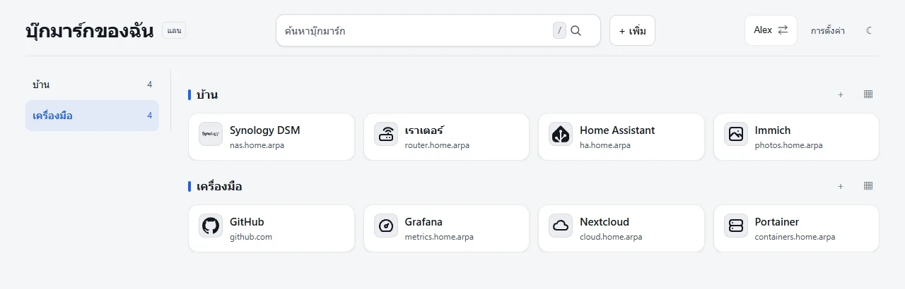

# launchbay

> ทุกบุ๊กมาร์กที่คุณเคยบันทึกไว้แล้วลืม รวมอยู่ในหน้าเดียว — โฮสต์เอง ใช้งานออฟไลน์ได้ ไม่ต้องลงทะเบียน

[](../../LICENSE) [](https://github.com/rockbenben/365opensource)

[▶ เริ่มต้นใช้งานด่วน](#เริ่มต้นใช้งานด่วน) · [GHCR](https://github.com/rockbenben/launchbay/pkgs/container/launchbay) · [docker-compose.yml](https://raw.githubusercontent.com/rockbenben/launchbay/refs/heads/main/docker-compose.yml)

[English](../../README.md) · [简体中文](../../README.zh.md) · [繁體中文](README.zh-Hant.md) · [日本語](README.ja.md) · [한국어](README.ko.md) · [Español](README.es.md) · [Português](README.pt.md) · [Français](README.fr.md) · [Deutsch](README.de.md) · [Italiano](README.it.md) · [Русский](README.ru.md) · [العربية](README.ar.md) · [हिन्दी](README.hi.md) · [বাংলা](README.bn.md) · **ไทย** · [Türkçe](README.tr.md) · [Tiếng Việt](README.vi.md) · [Bahasa Indonesia](README.id.md)



รวมที่อยู่ที่คุณไม่เคยจำได้ไว้ในหน้าเดียว: หน้าแอดมิน NAS, หน้าตั้งค่าเราเตอร์, ระบบภายในบริษัท, แดชบอร์ดตรวจสอบสถานะ ตั้งค่าให้เป็นหน้าแรกของเบราว์เซอร์ — **คลิกเดียวถึงทันที ไม่ต้องรอดาวน์โหลดหมุนวน**

รันบนเครื่องของคุณเอง — NAS ที่บ้าน, Raspberry Pi, เราเตอร์ซอฟต์แวร์ หรือเซิร์ฟเวอร์ในเครือข่ายภายใน — บุ๊กมาร์กของคุณจึงไม่เคยผ่านเซิร์ฟเวอร์ของผู้อื่น

## ขอบเขตการรองรับ

| ด้าน | ความสามารถในการรองรับ |
|---|---|
| วิธีการรัน | `docker compose up -d` หรือไบนารีสแตติก (amd64 / arm64) |
| สถานที่รัน | NAS ที่บ้าน, Raspberry Pi, เราเตอร์ซอฟต์แวร์ หรือคอมพิวเตอร์ในเครือข่ายภายใน |
| กลุ่มผู้ใช้ | คนเดียว ครอบครัว หรือทีมขนาดเล็ก — คนละหนึ่งโปรไฟล์; ผู้ดูแลระบบจัดการเฉพาะบัญชี ไม่ยุ่งเกี่ยวกับเนื้อหา |
| เบราว์เซอร์ | เบราว์เซอร์สมัยใหม่ทุกตัว; แม้ปิด JavaScript บุ๊กมาร์กทั้งหมดยังคงมองเห็นและคลิกเปิดได้ |
| สิ่งที่ต้องติดตั้ง | Docker เท่านั้น: ไม่มีไลบรารีภายนอก ไม่มีฐานข้อมูล ไม่ต้องใช้ Node ตอนบิลด์ |
| ตำแหน่งเก็บข้อมูล | ไดเรกทอรีปกติ `data/`; การสำรองข้อมูลคือการคัดลอกโฟลเดอร์นี้ทั้งโฟลเดอร์ |
| ภาษาของอินเทอร์เฟซ | รองรับ 18 ภาษาตามรายการด้านบน แต่ละโปรไฟล์เลือกภาษาเองได้ |

## ความสามารถของระบบ

**การบันทึกและการจัดระเบียบ**

- **ลากมาวางก็บันทึกทันที**: ลากลิงก์จากแถบบุ๊กมาร์ก แถบที่อยู่ หรือแท็บอื่นมาวางลงในกลุ่ม ไม่มีกล่องข้อความเด้งขึ้นมา — ตำแหน่งที่ปล่อยคือคำตอบ
- **ลากเพื่อจัดลำดับ**: ย้ายตำแหน่งภายในกลุ่ม ย้ายข้ามกลุ่ม หรือลากไปที่ชื่อกลุ่มเพื่อเพิ่มต่อท้าย กดค้างหรือใช้คีย์ลัดเพื่อเลือกหลายรายการ แล้วติดแท็ก ย้าย หรือลบได้พร้อมกันในคราวเดียว
- **บันทึกจากหน้าใดก็ได้**: ลาก bookmarklet ไปไว้ที่แถบบุ๊กมาร์กของคุณ คลิกครั้งเดียวเพื่อดึงที่อยู่กลับมา แล้วกดอีกครั้งเพื่อบันทึก
- **นำเข้าจากเบราว์เซอร์**: อัปโหลดไฟล์ HTML ที่ส่งออกจาก Chrome / Edge / Firefox เพื่อรับรายงานตรวจสอบทีละรายการ — รายการใดเข้าได้ รายการใดไม่ได้ และเพราะอะไร หน้าเว็บสามารถนำเข้าทันทีหรือดูรายงานก่อนได้; CLI จะเขียนข้อมูลทันทีในรอบเดียวกัน เว้นแต่คุณจะใส่คำสั่ง `--dry-run`
- **ย้ายโปรไฟล์ไปทั้งชุด**: ไฟล์เดียวเก็บทั้งบุ๊กมาร์ก**และ**หน้าตาของหน้านั้น (ธีม, เลย์เอาต์, มุมมอง, บรรทัดย่อย, ชื่อหน้า, ภาษา, โหมดที่อยู่) รหัส PIN ตัวตนของโปรไฟล์ และภาพพื้นหลังจะถูกคัดออกโดยเจตนา

**การค้นหา**

- **กลุ่มและการค้นหา**: แถบด้านบนค้นหาชื่อ ที่อยู่ บันทึก และแท็ก กด Enter เพื่อให้เซิร์ฟเวอร์ส่งคำตอบกลับมา — ไม่ต้องพึ่งพา JavaScript; เมื่อเปิดใช้งานสคริปต์ สามารถกด `/` หรือใช้จานคำสั่ง `⌘/Ctrl K`
- **กลุ่มแสดงขนาดใหญ่ขึ้น**: ตั้งค่ากลุ่มที่ใช้งานบ่อยให้เป็นการ์ดขนาดใหญ่ที่ด้านบนสุดของหน้า
- **ไอคอนมากกว่า 10,000 รายการ ใช้งานออฟไลน์ได้**: Tabler และ Simple Icons ถูกบีบอัด gzip ฝังไว้ในไฟล์ไบนารี; favicon ของเว็บไซต์จะถูกดึงมาหนึ่งครั้งแล้วให้บริการจากแคชในเครื่อง

**ที่บ้านและนอกบ้าน**

- **หนึ่งบุ๊กมาร์กมีสองที่อยู่**: ตั้งค่าที่อยู่หลักและที่อยู่ภายนอก (WAN) เพิ่มเติม โหมด "อัตโนมัติ" จะยึดตามที่อยู่ที่คุณใช้เปิด launchbay; เมนู "การตั้งค่า → บุ๊คมาร์คที่อยู่" สามารถแทนที่การตั้งค่าด้วยตนเองสำหรับเบราว์เซอร์ปัจจุบันได้ การค้นหาและการคัดลอกจะใช้ที่อยู่ที่มีผลใช้งานอยู่ และบุ๊กมาร์กที่ไม่มีที่อยู่ WAN จะยังคงใช้ที่อยู่หลัก หากอยู่หลัง Reverse Proxy ให้คงค่าส่วนหัว `Host` ดั้งเดิมไว้

**ตัวหน้าเว็บเอง**

- **แผงการตั้งค่าครบวงจร**: แถบด้านบน → การตั้งค่า รวบรวมหน้าตาและภาษาของหน้า รายการกลุ่ม การสำรองข้อมูลและประวัติ ตลอดจน **PIN ของฉัน** — ล็อกหรือปลดล็อกโปรไฟล์ของคุณเองได้โดยไม่ต้องผ่านผู้ดูแลระบบ
- **ทำงานได้แม้ออฟไลน์**: หน้าล่าสุดจะถูกแคชไว้ในเบราว์เซอร์; บุ๊กมาร์กที่เพิ่มขณะออฟไลน์ หรือขณะที่เครื่องแม่ข่ายปิดอยู่ จะเข้าคิวรอและส่งซ้ำโดยอัตโนมัติเมื่อเบราว์เซอร์เชื่อมต่อใหม่; กด **ส่งทันที** หากตัวเซิร์ฟเวอร์เพิ่งเปิดขึ้นมา
- **สคริปต์และ AI มีคีย์ของตัวเอง**: REST API พร้อมโทเค็นแบบจำกัดขอบเขตโปรไฟล์สำหรับส่วนขยายเบราว์เซอร์ CLI และระบบอัตโนมัติ โทเค็นที่ก้าวข้ามไปแตะโปรไฟล์อื่นจะถูกปฏิเสธด้วยรหัส 403
- กู้คืนบุ๊กมาร์กเวอร์ชันก่อนหน้าได้ในส่วนการสำรองข้อมูลและประวัติ

## เริ่มต้นใช้งานด่วน

```bash
git clone https://github.com/rockbenben/launchbay
cd launchbay
```

> [!IMPORTANT]
> ก่อนเริ่ม ให้กำหนด `LAUNCHBAY_ADMIN_TOKEN` ของคุณใน `docker-compose.yml`

**Linux / NAS**

```bash
mkdir -p ./data
sudo chown 65534:65534 ./data
```

```bash
docker compose up -d
```

ไม่ต้องมีไฟล์ `.env` ไม่ต้องติดตั้ง Go — อิมเมจจะถูกดึงมาโดยตรง

เปิด **http://<ที่อยู่ IP ภายในของเครื่องนี้>:7600** จากอุปกรณ์ใดก็ได้ในระบบ LAN — **อย่าใช้ `localhost`** เพราะมันหมายถึง "อุปกรณ์เครื่องนี้" และจะพยายามเปิดบนโทรศัพท์ที่คุณกำลังพิมพ์อยู่ หากนั่งอยู่หน้าเครื่องเซิร์ฟเวอร์นั้นเอง `http://localhost:7600` จะสามารถใช้งานได้

แท็กอิมเมจคือ `:latest`; คำสั่ง `up` ครั้งแรกจะดึงเวอร์ชันล่าสุดมา เครื่องที่รันอยู่แล้วจะยังคงใช้อิมเมจในเครื่อง ดังนั้นให้รัน `docker compose pull` ก่อนเพื่ออัปเดต

เมื่อเปิดขึ้นมาจะเข้าสู่หน้าตั้งค่าครั้งเดียว: ตั้งชื่อโปรไฟล์แรกและตั้งรหัส PIN 4–6 หลัก ไม่มีข้อมูลประจำตัวเริ่มต้น และหน้านี้จะปิดตัวลงอย่างถาวรทันทีที่มีโปรไฟล์ใด ๆ อยู่บนดิสก์ เปิดโปรไฟล์แล้วเพิ่มบุ๊กมาร์กรายการแรก

**"ไม่มี PIN" เป็นกล่องกาเครื่องหมายแยกต่างหาก ไม่ใช่การเว้นว่างช่องใส่รหัสไว้** การเว้นว่าง PIN จะถูกปฏิเสธ; การติ๊กเลือก **ไม่มี PIN** เท่านั้นจึงจะสร้างโปรไฟล์ที่เปิดให้ทุกคนใน LAN เข้าถึงได้ นี่เป็นการออกแบบโดยเจตนา — ความผิดพลาดร้ายแรงคือการพิมพ์ตัวเลขไม่ครบแล้วเผลอกด Enter ซึ่งจะทำให้บุ๊กมาร์กส่วนตัวเปิดเผยสู่ทุกคนในบ้านโดยไม่รู้ตัว โปรไฟล์ที่ไม่มี PIN จะไม่แสดงช่องใส่ PIN ในหน้าเลือกโปรไฟล์ คุณสามารถเพิ่มหรือถอดออกได้ในภายหลังที่เมนู **PIN ของฉัน**; การยกเลิกรหัสจะต้องป้อนรหัส PIN เดิมเฉพาะเมื่อโปรไฟล์นั้นมีรหัสผ่านอยู่แล้วเท่านั้น

โปรไฟล์แรก**ไม่ใช่ผู้ดูแลระบบ** การจัดการเครื่องจะใช้ `LAUNCHBAY_ADMIN_TOKEN`: เปิด `/admin` แล้วป้อนคีย์หนึ่งครั้ง คุณจะได้รับคุกกี้ที่เป็นของตัวตนผู้ดูแลระบบโดยเฉพาะ (อายุ 30 วัน)

**ผู้ใช้ที่มาทีหลังไม่ต้องรอผู้ดูแลระบบ** หน้าเลือกโปรไฟล์จะมีเมนูที่พับอยู่คือ **"ใหม่ให้กับตัวคุณเอง"**: เปิดออก กรอกชื่อและรหัส PIN ก็จะสร้างโปรไฟล์ได้ทันที (`POST /new`; เส้นทางคำสั่งของระบบคือ `POST /api/v1/profiles/new`) ไม่จำเป็นต้องใช้ข้อมูลรับรองใด ๆ อุปกรณ์ใดใน LAN ก็สร้างได้; การ์ดจะปรากฏขึ้น และผู้ดูแลระบบสามารถลบออกได้ตลอดเวลา มันจะสร้างโปรไฟล์ที่**ว่างเปล่า** ผูกกับรหัส PIN ของตัวเอง และไม่ให้สิทธิ์เข้าถึงบุ๊กมาร์กของผู้อื่น ชื่อรองรับได้สูงสุด 60 ตัวอักษร และการตั้งชื่อซ้ำกับคนอื่นจะทำให้การ์ดทั้งสองใบแยกความแตกต่างไม่ได้

**การลบโปรไฟล์เป็นการกระทำเดียวที่ไม่สามารถย้อนกลับได้** ระบบจึงถามยืนยันคีย์ของเครื่องอีกครั้ง: หน้าจอยืนยันจะระบุว่ามีบุ๊กมาร์กและสแนปชอตกี่รายการที่จะหายไป และคุณต้องป้อน `LAUNCHBAY_ADMIN_TOKEN` อีกครั้ง เส้นทางคำสั่งของระบบ (`DELETE /api/v1/profiles`) ยอมรับเฉพาะคีย์นี้เท่านั้น; การมีเฉพาะคุกกี้ผู้ดูแลระบบจะได้รับรหัส 403 สแนปชอตและภาพพื้นหลังส่วนตัวจะหายไปพร้อมกับโปรไฟล์ ดังนั้นการย้อนกลับจึงไม่สามารถช่วยกู้คืนได้

ในหน้าเดียวกันมีเมนูแบบเลื่อนลง **ภาษาของอินเทอร์เฟซ**; ให้เลือกขณะตั้งค่า นี่จะเป็นการกำหนด**ค่าเริ่มต้นสำหรับทั้งเครื่อง**; หลังจากนั้นทุกคนสามารถเลือกภาษาของตนเองได้ในแผงควบคุมส่วนตัว และการเปลี่ยนแปลงของผู้ดูแลระบบจะมีผลเฉพาะกับผู้ที่ยังไม่ได้เลือกภาษาเท่านั้น

### คีย์ผู้ดูแลระบบและโทเค็น

| ตัวแปร | จำเป็นหรือไม่ | ขอบเขตการควบคุม |
|---|---|---|
| `LAUNCHBAY_ADMIN_TOKEN` | **จำเป็น**, คีย์เดี่ยว | เฉพาะการจัดการบัญชี: สร้าง/ลบโปรไฟล์, ตั้งรหัส PIN ใด ๆ, ปิด/เปิดใช้งาน, ดูสถานะและประวัติข้ามโปรไฟล์ ทุกเอนด์พอยต์ของเนื้อหา (`/api/v1/data`, `/batch`, `/export`, …) จะตอบกลับด้วย 403 — ไม่สามารถอ่านบุ๊กมาร์กได้ |
| `LAUNCHBAY_WRITE_TOKENS` | ทางเลือก, เริ่มต้นเว้นว่างไว้ | โทเค็นการเขียนแบบจำกัดขอบเขตโปรไฟล์ (`name:secret:profile` คือ ชื่อ:รหัสลับ:โปรไฟล์) จำเป็นเฉพาะสำหรับส่วนขยายเบราว์เซอร์, CLI (`revert` / `import-bookmarks` / `backup` / `restore` / `profile fix-names`) และ AI หรือสคริปต์เท่านั้น |

> **เหตุใดจึงเว้นว่างไว้เป็นค่าเริ่มต้น?** หน้าบุ๊กมาร์ก หน้าผู้ดูแลระบบ การกู้คืน และการนำเข้า ล้วนทำงานผ่านเซสชันคุกกี้ จึงไม่จำเป็นต้องใช้โทเค็นเลย เครื่องมือสามอย่างที่ต้องใช้โทเค็นนั้นล้วนเป็นสิ่งที่ผู้ใช้ตั้งใจติดตั้งเอง การใส่ค่าเริ่มต้นมาให้จะเท่ากับเป็นการแจกคีย์ฟรีให้ทุกเครื่องสามารถเขียนลงโปรไฟล์ `dad` ได้ (เนื่องจาก `dad` เป็น ID โปรไฟล์ที่พบบ่อยที่สุด)

โปรไฟล์จะไม่มีแอตทริบิวต์ "เป็นผู้ดูแลระบบหรือไม่" หน้าการดูแลระบบจะแสดงการดำเนินการระดับบัญชี พร้อมด้วยจำนวนรายการ เวอร์ชัน การแก้ไขล่าสุดของแต่ละโปรไฟล์ และการที่โปรไฟล์นั้นยังคง**ไม่มี PIN** หรือไม่

> **ID ของโปรไฟล์ได้มาจากชื่อ และไม่จำเป็นต้องเป็น `dad` เสมอไป** ตัวอักษรและตัวเลข ASCII จะถูกแปลงเป็น slug (`Dad` → `dad`, `nas box` → `nas-box`); ส่วนชื่อภาษาไทยหรือภาษาอื่นที่ไม่ใช่ ASCII จะไม่มีตัวอักษรที่แปลงเป็น slug ได้ จึงจะตกไปอยู่ในลำดับ `home` / `home-2` โดยอัตโนมัติ เมื่อเป็นเช่นนั้น โทเค็นที่มีขอบเขตเป็น `…:dad` จะไม่ตรงกับโปรไฟล์ใดเลยและได้รับรหัส 403 — ให้แก้ไขขอบเขตของโทเค็นเป็น ID จริง (แนะนำ) หรือตั้งชื่อโปรไฟล์แรกด้วยอักษร ASCII

พอร์ตของโฮสต์มีค่าเริ่มต้นเป็น 7600 ในเครื่อง Windows บางเครื่อง Hyper-V อาจจองบล็อกพอร์ตไว้ (จากการทดสอบพบช่วง 7532–7631); หากคำสั่ง `up` ล้มเหลว ให้เลือกพอร์ตว่างที่อยู่นอกช่วงดังกล่าว: `LAUNCHBAY_HOST_PORT=8901 docker compose up -d` (พอร์ตภายในคอนเทนเนอร์จะไม่เปลี่ยน) ชื่อโปรเจกต์และชื่อคอนเทนเนอร์ถูกกำหนดตายตัวเป็น `launchbay` ดังนั้นคำสั่ง `docker logs launchbay` และ `docker exec launchbay …` จะทำงานได้เสมอไม่ว่าจะ clone ไปไว้ที่ไดเรกทอรีใด

### ส่วนขยายเบราว์เซอร์ (ทางเลือก)

`extension/` คือส่วนขยายสำหรับ Chrome / Edge (Manifest V3): คลิกขวาที่หน้าปัจจุบันเพื่อบันทึกลงในโปรไฟล์ที่ระบุ หรือบันทึกทุกแท็บในหน้าต่างพร้อมกันในคราวเดียว ไฟล์นี้ไม่ได้อยู่ในอิมเมจ คุณต้องติดตั้งด้วยตนเอง

ส่วนขยายไม่สามารถอ่านเซสชันคุกกี้ได้ จึงต้องใช้โทเค็นตามขอบเขตโปรไฟล์ ให้กรอก `LAUNCHBAY_WRITE_TOKENS` รีสตาร์ต แล้วดำเนินการดังนี้:

1. เปิด `chrome://extensions` และเปิด **โหมดนักพัฒนาซอฟต์แวร์** ที่มุมขวาบน
2. คลิก **โหลดที่คลายการบีบอัดแล้ว** แล้วเลือกไดเรกทอรี `extension/`
3. เปิดหน้าตัวเลือกของส่วนขยายแล้วกรอกที่อยู่ของเครื่อง (ไม่มีเครื่องหมายทับปิดท้าย) ID โปรไฟล์เริ่มต้น และรหัสลับจากโทเค็น
4. คลิก **ทดสอบเครื่องนี้**

หากผลการทดสอบตอบกลับด้วย 403 นั่นไม่ใช่ปัญหาเครือข่าย: หมายความว่าโทเค็นและ ID โปรไฟล์ไม่ตรงกัน ให้แก้ไขขอบเขตใน `LAUNCHBAY_WRITE_TOKENS` รีสตาร์ต แล้วทดสอบใหม่อีกครั้ง

เมื่อติดตั้งแล้ว: คลิกขวาที่หน้าใดก็ได้ → บันทึก; หน้าตัวเลือกยังสามารถนำเข้าแผนผังบุ๊กมาร์กของเบราว์เซอร์ทั้งหมดได้ โดยจะขอสิทธิ์เข้าถึงบุ๊กมาร์กในการใช้งานครั้งแรกเท่านั้น เส้นทางการนำเข้าทั้งสามทาง (เว็บ, ส่วนขยาย, CLI) จะ**นำเข้าได้เฉพาะในโปรไฟล์ที่ว่างเปล่าเท่านั้น** — การนำเข้าคือการแทนที่บุ๊กมาร์กทั้งหมดของโปรไฟล์ ไม่ใช่การเพิ่มทับ Chrome จะแจ้งเตือนว่า "อ่านและเปลี่ยนแปลงข้อมูลของคุณในทุกเว็บไซต์" เนื่องจากส่วนขยายจำเป็นต้องใช้ `http://*/*` และ `https://*/*` เพื่อรองรับการคลิกขวา; โทเค็นจะถูกเก็บไว้ใน `chrome.storage.local` เท่านั้นและไม่เคยถูกซิงค์ สำหรับ Firefox ยังไม่ผ่านการทดสอบ

### สิทธิ์ของไดเรกทอรีข้อมูล

ข้อมูลจะถูกเก็บไว้ใน `./data` ข้างไฟล์ `docker-compose.yml` และจะเป็น `/data` ภายในคอนเทนเนอร์เสมอ หากต้องการย้าย ให้แก้ไขบรรทัด `volumes`:

```yaml
    volumes:
      - /volume1/docker/launchbay:/data
```

บน Windows เส้นทางแบบสัมบูรณ์เช่น `D:` จะชนกับเครื่องหมายทวิภาค ให้ใช้ไวยากรณ์แบบยาว:

```yaml
    volumes:
      - type: bind
        source: D:/launchbay-data
        target: /data
```

คอนเทนเนอร์จะทำงานภายใต้ **uid 65534** ในขณะที่ไดเรกทอรีบนโฮสต์มักมี root เป็นเจ้าของ — ทำให้การสร้างโปรไฟล์ การนำเข้า และการเขียนข้อมูลล้มเหลว ให้มอบสิทธิ์แก่ผู้ใช้รายนั้นบนโฮสต์:

```bash
sudo chown -R 65534:65534 ./data
```

อย่าเลี่ยงปัญหาด้วยการใช้ `--user root`: นั่นจะทำให้บริการสามารถเขียนไฟล์ทุกไฟล์ในเครื่องของคุณได้ในฐานะ root การตรวจสุขภาพระบบจะสร้างและลบไฟล์ทดสอบในทุกการตรวจสอบ ดังนั้นสิทธิ์ที่ไม่ถูกต้องจะแสดงเป็น **unhealthy** ใน `docker ps` และในบันทึกจะพิมพ์คำสั่ง chown เดียวกันนี้ออกมา หน้าการตั้งค่าก็ระบุข้อความเดียวกันนี้ (`uid 65534` ในคอนเทนเนอร์; หรือผู้ใช้ของคุณเองหากคุณรันไบนารีโดยตรง)

## วิธีใช้งาน

| สิ่งที่คุณต้องการทำ | ตำแหน่งที่ทำ |
|---|---|
| เปลี่ยนหน้าตา มุมมอง กลุ่ม ภาพพื้นหลัง โหมดที่อยู่ หรือวิธีการเปิดบุ๊กมาร์ก | 'การตั้งค่า' บนแถบด้านบน หรือ `POST /prefs`, `/prefs/background`, `/prefs/group`, `/prefs/tabs` |
| เปลี่ยนรหัส PIN ของคุณเอง | 'PIN ของฉัน' ในแผงควบคุมของคุณเอง หรือ `POST /prefs/pin` / `POST /api/v1/profiles/self/pin` |
| สร้างหรือลบโปรไฟล์ ตั้งรหัส PIN ของผู้อื่น ปิดใช้งานบุคคล | `/admin` (หรือลิงก์ผู้ดูแลระบบที่ด้านล่างของหน้าเลือกโปรไฟล์) การลบจะต้องป้อนคีย์อีกครั้ง สำหรับ CLI ด้านการดูแลโปรไฟล์จะครอบคลุมเฉพาะ `profile create` และ `profile rebuild` |
| สร้างเพิ่มอีกหนึ่งโปรไฟล์สำหรับตัวคุณเอง | เมนูพับ 'ใหม่ให้กับตัวคุณเอง' ในหน้าเลือกโปรไฟล์ หรือ `POST /api/v1/profiles/new` (ไม่ต้องใช้ข้อมูลรับรอง) |
| จัดการรายการที่ 'ชื่อเป็นที่อยู่เว็บล้วน ๆ' | `launchbay profile fix-names --profile <id>` (ใส่ `--dry-run` ก่อน) |
| ให้ AI หรือสคริปต์ปรับปรุงบุ๊กมาร์ก | `POST /api/v1/batch` พร้อมระบุ `expectedRev` |
| กู้คืนโปรไฟล์ที่เสียหาย | `POST /api/v1/profiles/rebuild` หรือ `launchbay profile rebuild` |
| ดูประวัติการเปลี่ยนแปลงทั้งหมด | `GET /api/v1/history` (บันทึกเฉพาะการกระทำและเส้นทาง ไม่บันทึกเนื้อหา) |
| สำรองข้อมูลหรือย้ายโปรไฟล์ทั้งหมด | `GET /api/v1/backup` / `POST /api/v1/restore`, `launchbay backup` / `restore` หรือ การสำรองข้อมูลและประวัติ ใน การตั้งค่า |

เอนด์พอยต์อื่น ๆ ของระบบ: `POST /api/v1/usage` นับจำนวนคลิก, `POST /api/v1/resolve` แปลง URL เป็นชื่อเรื่องและไอคอน, และ `GET /api/v1/status` คือสรุปภาพรวมข้ามโปรไฟล์สำหรับผู้ดูแลระบบ

การสำรองข้อมูลจะไม่รวมรหัส PIN ตัวตนของโปรไฟล์ และภาพพื้นหลัง การสำรองข้อมูลที่มีบุ๊กมาร์กจะนำเข้าได้เฉพาะในโปรไฟล์ที่ว่างเปล่าเท่านั้น; ส่วนการสำรองข้อมูลที่มีเฉพาะการตั้งค่าสามารถนำเข้าที่ใดก็ได้ การนำเข้าจะตรวจสอบหมายเลขเวอร์ชันภายใต้การล็อกโปรไฟล์ และจะตอบกลับด้วย 409 `[rev-conflict]` พร้อม `currentRev` หากมีการแก้ไขพร้อมกัน การตั้งค่าที่เขียนด้วยวิธีนี้จะไม่เพิ่มหมายเลขเวอร์ชันและจะไม่แสดงในหน้า 'เปลี่ยนกลับ'

**รายการเอนด์พอยต์ เนื้อหาคำขอ และรหัสข้อผิดพลาดฉบับสมบูรณ์อยู่ใน [AGENTS.md](../../AGENTS.md)** — สัญญาข้อตกลงอย่างเป็นทางการสำหรับ AI ซึ่งผ่านการตรวจสอบความสอดคล้องกับตารางเส้นทางของระบบอย่างเข้มงวด จึงไม่ระบุซ้ำไว้ที่นี่

**รูปแบบการใช้งาน CLI**: ผลลัพธ์ที่สำเร็จจะส่งไปยัง stdout ความล้มเหลวจะส่งไปยัง stderr และทุกข้อผิดพลาดจะอ้างอิงรหัสของเซิร์ฟเวอร์ (`[rev-conflict]`, `[ops-invalid]`) คำสั่ง `import-bookmarks` จะรับไฟล์เป็นอาร์กิวเมนต์ตามตำแหน่งและทำการเขียนข้อมูลในรอบเดียวกับที่พิมพ์รายงาน (ใช้ `--dry-run` เพื่อหยุดก่อนเขียน); การสำรองข้อมูลและการส่งออกจะสตรีมการตอบกลับแบบเต็ม ดังนั้นไฟล์ที่มีขนาดเกิน 4 MiB จึงไม่มีปัญหา คำสั่ง `--help` และ `-h` จะออกจากโปรแกรมด้วยรหัส 0 ข้อผิดพลาดการใช้งานรหัส 2 และความล้มเหลวอื่น ๆ รหัส 1 คำสั่ง `revert --to 0` จะถูกปฏิเสธเป็นข้อผิดพลาดในการใช้งานและจะพิมพ์คำสั่ง `curl` ที่ถูกต้องออกมา

**Zero JavaScript คือมาตรฐานขั้นต่ำ ไม่ใช่เพดานสูงสุด** การค้นหาคือแบบฟอร์มปกติ การสร้างโปรไฟล์และการตั้งรหัส PIN คือการส่งแบบฟอร์มฟอร์แมตดั้งเดิม และแม้จะปิดการทำงานของสคริปต์ บุ๊กมาร์กทั้งหมดยังคงมองเห็นและคลิกได้ ลิงก์ข้ามในตัวช่วยให้กระโดดไปยังเนื้อหาได้ทันที เหนือสิ่งนี้มีเลเยอร์เพิ่มประสิทธิภาพหนึ่งชั้นที่ช่วยเพิ่มหน้าต่างบันทึก การแก้ไขในจุดนั้น การลากจัดลำดับ จานคำสั่ง ⌘K และการทำงานแบบออฟไลน์ หากเลเยอร์นี้เกิดปัญหา เส้นทางแบบไม่ต้องใช้ JS ก็ยังคงใช้งานได้เสมอ

## ข้อจำกัด

- **ใช้งานเฉพาะใน LAN เท่านั้น ไม่มี HTTPS** เนื้อหาบุ๊กมาร์กเป็นไฟล์ JSON ธรรมดาบนดิสก์; ให้ติดตั้ง Reverse Proxy ที่รองรับ TLS ไว้ข้างหน้าก่อนที่จะเปิดสู่เครือข่ายสาธารณะ
- **ไฟล์ `profile.json` ที่เสียหายจะล็อกโปรไฟล์นั้นไว้** คำสั่ง `revert` ไม่สามารถแก้ไขได้; ให้ใช้คำสั่ง `POST /api/v1/profiles/rebuild` (หรือ `launchbay profile rebuild`) ซึ่งจะเขียนใหม่เฉพาะไฟล์นั้น และไม่แตะต้องข้อมูลบุ๊กมาร์ก สแนปชอต หรือประวัติแม้แต่ไบต์เดียว
- **การพักคำขอดึงไอคอน**: โดเมนต้นทางที่ดึงข้อมูลล้มเหลวจะไม่ถูกลองใหม่เป็นเวลา 24 ชั่วโมง การพัก 24 ชั่วโมงนี้จะป้องกันไม่ให้มีการตรวจซ้ำเว็บไซต์ที่ล้มเหลวอย่างต่อเนื่อง
- **ไม่มีรายการที่แชร์ร่วมกัน**: คุณไม่สามารถแชร์บุ๊กมาร์กรายการใดรายการหนึ่งให้คนในบ้าน หรือเผยแพร่หน้าสู่สาธารณะได้ การที่แต่ละคนเก็บข้อมูลของตัวเองแยกจากกันอย่างสิ้นเชิงคือจุดประสงค์หลัก
- **ยังไม่ผ่านการทดสอบบน NAS จริง** การทดสอบรับรองทั้งหมดดำเนินการบน Windows + Docker Desktop; เป้าหมาย LCP ใน LAN, การเริ่มทำงานแบบ cold start บน NAS จริง, อัตราเฟรมการเลื่อนดูบุ๊กมาร์ก 1,000 รายการ และความเร็วในการดึงข้อมูลจากแคชออฟไลน์ ยังไม่ได้มีการวัดค่าจริง
- **ไม่มีวิดเจ็ตสภาพอากาศหรือนาฬิกา** สิ่งเหล่านี้อยู่นอกเหนือขอบเขตเป้าหมายของหน้านี้ ข้อความท้ายหน้าและเนื้อหาบุ๊กมาร์กจะจัดการผ่าน `POST /api/v1/batch`; ไฟล์ต่าง ๆ บนดิสก์เป็นของเซิร์ฟเวอร์
- **ภาษาของอินเทอร์เฟซครอบคลุมเฉพาะอินเทอร์เฟซ ไม่รวมข้อความสำหรับสคริปต์** รายละเอียดข้อผิดพลาด `detail` ของ API เหตุผลการตรวจสอบความถูกต้องของฟิลด์ และรายงานการนำเข้าที่อ่านโดยสคริปต์จะยังคงเป็นภาษาจีน (รายงานบนหน้าเว็บจะเป็นไปตามภาษาของหน้าเว็บ) เนื่องจากโปรแกรมที่เรียกใช้ต้องการข้อความที่คงที่และเปรียบเทียบได้; ส่วนชื่อบุ๊กมาร์ก ชื่อกลุ่ม และ URL เป็นเนื้อหาของคุณ จึงไม่มีการแปลเช่นกัน
- **โทเค็นเริ่มต้นจะว่างเปล่า** ดังนั้นส่วนขยายและ CLI จะยังใช้งานไม่ได้จนกว่าคุณจะเพิ่มโทเค็น; ในทางกลับกัน คีย์ผู้ดูแลระบบเป็นสิ่งจำเป็นสำหรับการเริ่มต้นระบบ

## อิมเมจมาจากที่ไหน

compose มีหน้าที่เพียงดึงอิมเมจที่เผยแพร่แล้วเท่านั้น การสร้างเป็นงานของ CI เมื่อแท็ก `v*` (หรือสั่งรันเวิร์กโฟลว์ด้วยตนเอง) ไฟล์ `.github/workflows/docker.yml` จะสร้างสำหรับ amd64 และ arm64 แล้วพุชไปยัง Docker Hub และ GHCR แท็กการเผยแพร่คือ `<version>`, `<major>.<minor>` และ `<major>` รวมทั้ง `latest` และ sha สั้นของคอมมิต; เวอร์ชันของอิมเมจได้มาจากแท็ก git เท่านั้น

หากต้องการข้ามการ clone คุณสามารถดึงอิมเมจมารันได้โดยตรง:

```bash
docker run -d --name launchbay -p 7600:7600 \
  -v launchbay-data:/data -e LAUNCHBAY_DATA_DIR=/data \
  -e LAUNCHBAY_ADMIN_TOKEN="คีย์ผู้ดูแลระบบของคุณเอง" \
  --health-cmd "/launchbay healthcheck" --health-interval 30s \
  ghcr.io/rockbenben/launchbay:latest
```

## เกี่ยวกับโครงการ 365 Open Source

โปรเจกต์ **#042** ของ[โครงการ 365 Open Source](https://github.com/rockbenben/365opensource) — หนึ่งคน + AI, มากกว่า 300 โปรเจกต์โอเพนซอร์สในหนึ่งปี

[ส่งไอเดียของคุณ →](https://365.aishort.top/) · [Discord](https://discord.gg/PZTQfJ4GjX) · [Telegram](https://t.me/aishort_top)
