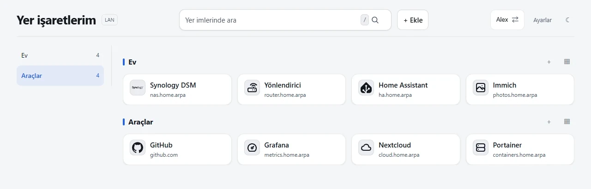

# launchbay

> Kaydettiğinizi unuttuğunuz her yer işareti tek bir sayfada — kendi sunucunuzda, çevrimdışı çalışır, kayıt gerektirmez.

[](../../LICENSE) [](https://github.com/rockbenben/365opensource)

[▶ Hızlı başlangıç](#hızlı-başlangıç) · [GHCR](https://github.com/rockbenben/launchbay/pkgs/container/launchbay) · [docker-compose.yml](https://raw.githubusercontent.com/rockbenben/launchbay/refs/heads/main/docker-compose.yml)

[English](../../README.md) · [简体中文](../../README.zh.md) · [繁體中文](README.zh-Hant.md) · [日本語](README.ja.md) · [한국어](README.ko.md) · [Español](README.es.md) · [Português](README.pt.md) · [Français](README.fr.md) · [Deutsch](README.de.md) · [Italiano](README.it.md) · [Русский](README.ru.md) · [العربية](README.ar.md) · [हिन्दी](README.hi.md) · [বাংলা](README.bn.md) · [ไทย](README.th.md) · **Türkçe** · [Tiếng Việt](README.vi.md) · [Bahasa Indonesia](README.id.md)



Asla aklınızda tutamadığınız adresleri tek bir sayfaya toplayın: NAS yönetim paneli, yönlendirici, şirket içi intranet, izleme panosu. Bunu tarayıcınızın ana sayfası yapın — **tek tık, bekleme yok.**

Kendi makinenizde çalışır — evdeki bir NAS, Raspberry Pi, yazılımsal yönlendirici veya şirket intranetindeki bir sunucu — böylece yer işaretleriniz asla başkasının sunucusuna gitmez.

## Neleri kapsar

| Alan | Sizin için uygun mu |
|---|---|
| Nasıl çalıştırılır | `docker compose up -d` veya statik ikili dosya (amd64 / arm64) |
| Nerede çalışır | Ev NAS'ı, Raspberry Pi, yazılımsal yönlendirici veya şirket intranetindeki bir makine |
| Kimler kullanır | Tek bir kişi, bir aile veya küçük bir ekip — herkese bir profil; yönetici hesapları yönetir, içeriğe karışmaz |
| Tarayıcılar | Tüm modern tarayıcılar; JavaScript kapalıyken bile tüm yer işaretleri görünür ve tıklanabilir durumdadır |
| Ne kurulur | Yalnızca Docker: üçüncü taraf kütüphane yok, veritabanı yok, derleme aşamasında Node yok |
| Veriler nerede durur | Sıradan bir dizinde, `data/`; yedekleme sadece bu dizini kopyalamaktan ibarettir |
| Arayüz dili | Arayüz, yukarıda listelenen 18 dili destekler. Her profil kendi dilini seçebilir. |

## Neler yapabilir

**Kaydetme ve düzenleme**

- **Bırakın ve kaydolsun**: yer imleri çubuğundan, adres çubuğundan veya başka bir sekmeden bir bağlantıyı bir grubun üzerine sürükleyin. İletişim kutusu yok — bırakmak yeterlidir.
- **Sıralamayı değiştirmek için sürükleyin**: grup içinde, gruplar arasında veya sona eklemek için bir grup başlığının üzerine sürükleyin. Uzun basma veya kısayol çoklu seçimi başlatır; ardından tek seferde etiketleyin, taşıyın veya silin.
- **Herhangi bir sayfadan kaydedin**: bookmarklet'i yer imleri çubuğunuza sürükleyin; tek tık adresi getirir, bir tık daha kaydeder.
- **Tarayıcınızdan içe aktarın**: Chrome / Edge / Firefox tarafından dışa aktarılan yer işareti dosyasını yükleyin ve her kayıt için ayrıntılı rapor alın — nelerin eklendiğini, nelerin eklenemediğini ve nedenini görün. Web sayfası doğrudan içe aktarabilir veya önce raporu gösterebilir; CLI, `--dry-run` bayrağı verilmediği sürece aynı çalıştırmada yazar.
- **Tüm profili yanınızda taşıyın**: tek bir dosya yer işaretlerini **ve** sayfanın görünümünü (tema, düzen, görünüm, ikinci satır, sayfa adı, dil, adres modu) barındırır. PIN, profil kimliği ve arka plan resmi bilinçli olarak hariç tutulur.

**Arama ve bulma**

- **Gruplar ve arama**: üst çubuk adlarda, adreslerde, notlarda ve etiketlerde arama yapar; Enter'a bastığınızda sunucu yanıt verir — JavaScript gerekmez. Betikler etkinken `/` tuşuna basın veya `⌘/Ctrl K` paletini kullanın.
- **Öne çıkan gruplar**: en çok kullandığınız grupları en üstte büyük kartlardan oluşan bir şeride yükseltin.
- **10.000+ simge, çevrimdışı**: Tabler ve Simple Icons ikili dosyaya sıkıştırılmıştır; bir sitenin favicon'u bir kez çekilir ve ardından yerel önbellekten sunulur.

**Evde ve dışarıda**

- **Yer işareti başına iki adres**: birincil ve isteğe bağlı bir WAN adresi ayarlayın. "Otomatik", launchbay'i açtığınız adresi takip eder; Ayarlar → Yer işareti adresleri bu tarayıcı için bunu geçersiz kılabilir. Arama ve kopyalama etkin adresi kullanır ve WAN adresi olmayan yer işaretleri birincil adresi korur. Ters proxy arkasında orijinal `Host` başlığını koruyun.

**Sayfanın kendisi**

- **Tek bir ayarlar paneli**: üst çubuk → Ayarlar. Sayfanın görünümünü ve dilini, grup listesini, yedekleme ve geçmişi ve **PIN'im** bölümünü barındırır — yöneticiden bağımsız olarak kendi profilinizi kilitleyin veya kilidini açın.
- **Çevrimdışı çalışır**: son sayfa önbelleğe alınır ve çevrimdışıyken — veya makine kapalıyken — eklenen yer işaretleri kuyruğa alınır ve tarayıcı yeniden bağlandığında iletilir; sunucunun kendisi kapalıysa **Send now** («Şimdi gönder») seçeneğine basın.
- **Betikler ve yapay zeka kendi anahtarlarına sahiptir**: uzantı, CLI ve otomasyon için bir REST API ve profil kapsamlı belirteçler. Kendi profilinin dışına çıkmaya çalışan bir belirteç 403 alır.
- Önceki yer işareti sürümlerini ayarlardaki yedekleme ve geçmiş bölümünden geri yükleyin.

## Hızlı başlangıç

```bash
git clone https://github.com/rockbenben/launchbay
cd launchbay
```

> [!IMPORTANT]
> Başlatmadan önce `docker-compose.yml` dosyasında kendi `LAUNCHBAY_ADMIN_TOKEN` değerinizi belirleyin.

**Linux / NAS**

```bash
mkdir -p ./data
sudo chown 65534:65534 ./data
```

```bash
docker compose up -d
```

`.env` yok, Go araç zinciri yok — imaj doğrudan çekilir.

Yerel ağdaki herhangi bir cihazdan **http://<bu makinenin yerel ağ adresi>:7600** adresini açın — **`localhost` değil**, bu "bu cihaz" anlamına gelir ve adresi yazdığınız telefonu açmaya çalışır. Doğrudan makinenin başındaysanız, `http://localhost:7600` çalışır.

İmaj etiketi `:latest` şeklindedir; ilk `up` komutu en yeni sürümü çeker. Zaten çalışan bir makine yerel imajını korur, bu nedenle güncellemek için önce `docker compose pull` çalıştırın.

İlk açılışta tek seferlik kurulum sayfasına yönlendirilirsiniz: ilk profile bir isim verin ve 4–6 haneli bir PIN belirleyin. Varsayılan kimlik bilgileri yoktur ve herhangi bir profil oluşturulduktan sonra kurulum sayfası tamamen kapanır. Profili açıp ilk yer işaretinizi kaydedin.

**"PIN yok" seçeneği ayrı bir onay kutusudur, boş bırakılan bir kutu değildir.** PIN alanını boş bırakmak reddedilir; **PIN yok** seçeneğini işaretlemek yerel ağdaki herkese açık bir profil oluşturur. Bu bilinçli bir tercihtir — tehlikeli hata üç basamak yazıp Enter'a basmaktır ve bu durum bir kişinin yer işaretlerini tüm eve sessizce açardı. PIN'i olmayan bir profil, seçim sayfasında PIN kutusu göstermez. Daha sonra **PIN'im** bölümünden bir PIN ekleyebilir veya kaldırabilirsiniz; kaldırmak için eski PIN yalnızca bir PIN ayarlanmışken gereklidir.

İlk profil **yönetici değildir**. Makine `LAUNCHBAY_ADMIN_TOKEN` ile yönetilir: `/admin` adresini açın, anahtarı bir kez girin ve yalnızca yönetici kimliğine ait bir çerez alırsınız (30 gün).

**Sonraki kullanıcılar yöneticiyi beklemez.** Seçim sayfasında daraltılmış bir **"Kendinize yeni bir tane"** bölümü vardır: açın, bir ad ve PIN verin, profil oluşur (`POST /new`; makine rotası `POST /api/v1/profiles/new`). Kimlik bilgisi gerektirmez, böylece yerel ağdaki herhangi bir cihaz bir profil oluşturabilir; kart listede görünür ve yönetici bunu istediği zaman silebilir. Yalnızca kendi PIN'ine ait olan ve başkalarının yer işaretlerine erişim sağlamayan **boş** bir profil oluşturur. İsimler 60 karaktere kadar desteklenir ve başkasının adını tekrar kullanmak iki kartı ayırt edilemez hale getirir.

**Bir profili silmek geri alınamayan tek eylemdir**, bu nedenle makine anahtarını tekrar ister: onay sayfası kaç yer işareti ve anlık görüntünün silineceğini belirtir ve `LAUNCHBAY_ADMIN_TOKEN` anahtarını bir kez daha yazarsınız. Makine yolu (`DELETE /api/v1/profiles`) yalnızca bu anahtarı kabul eder; tek başına bir yönetici çerezi 403 ile sonuçlanır. Anlık görüntüler ve özel arka planlar profille birlikte silindiği için geri alma işlemi onu kurtaramaz.

Aynı sayfada bir **Varsayılan dil** açılır menüsü bulunur; kurulum sırasında seçebilirsiniz. Bu, **makine genelinde varsayılanı** belirler; sonrasında herkes kendi panelinde kendi dilini seçebilir ve yöneticinin yaptığı değişiklik yalnızca henüz bir dil seçmemiş kişilere ulaşır.

### Yönetici anahtarı ve belirteçler

| Değişken | Gerekli mi? | Neleri kapsar |
|---|---|---|
| `LAUNCHBAY_ADMIN_TOKEN` | **Gereklidir**, yalın bir anahtar | Yalnızca hesaplar: profil oluşturma/silme, herhangi bir PIN belirleme, devre dışı bırakma/etkinleştirme, profiller arası durum ve geçmiş. Tüm içerik uç noktaları (`/api/v1/data`, `/batch`, `/export`, …) 403 yanıtı verir — yer işaretlerini okuyamaz |
| `LAUNCHBAY_WRITE_TOKENS` | İsteğe bağlı, varsayılan olarak boş | Profil kapsamlı yazma belirteçleri, `name:secret:profile`. Yalnızca tarayıcı uzantısı, CLI (`revert` / `import-bookmarks` / `backup` / `restore` / `profile fix-names`) ve yapay zeka veya betikler için gereklidir |

> **Neden varsayılan olarak boş?** Yer işareti sayfası, yönetici, geri alma ve içe aktarma oturum çerezi üzerinden çalışır; belirteç gerekmez. Belirteç gerektiren üç araç ise bilerek kurulur. Varsayılan bir değer sağlamak, her makineye `dad` profilini (en yaygın profil kimliği) yazabilen hazır bir anahtar verirdi.

Bir profilin "yönetici mi" özelliği yoktur. Yönetici sayfası, hesap düzeyindeki eylemlerin yanı sıra her profilin öğe sayısını, sürümünü, son değişikliğini ve hâlâ **PIN yok** durumunda olup olmadığını gösterir.

> **Profil kimliği (ID) adından türetilir ve mutlaka `dad` olmak zorunda değildir.** ASCII harfleri ve rakamlar bir slug haline gelir (`Dad` → `dad`, `nas box` → `nas-box`); İngilizce dışı karakterlerin slug karşılığı olmadığı için `home` / `home-2` sırasına düşer. Bu durumda kapsamı `…:dad` olan bir belirteç hiçbir profille eşleşmez ve 403 alır — belirtecin kapsamını gerçek kimliğe göre değiştirin (önerilir) veya ilk profile ASCII bir ad verin.

Ana bilgisayar bağlantı noktası varsayılan olarak 7600'dür. Bazı Windows makinelerde Hyper-V bir bağlantı noktası bloğunu tutar (bu uygulamanın test edildiği makinede 7532–7631); `up` başarısız olursa, bunun dışında boş bir bağlantı noktası seçin: `LAUNCHBAY_HOST_PORT=8901 docker compose up -d` (kapsayıcı bağlantı noktası değişmez). Proje ve kapsayıcı adları `launchbay` olarak sabit kodlanmıştır, bu nedenle `docker logs launchbay` ve `docker exec launchbay …` klonlama dizininden bağımsız olarak çalışır.

### Tarayıcı uzantısı (isteğe bağlı)

`extension/` dizini bir Chrome / Edge uzantısıdır (Manifest V3): geçerli sayfayı adlandırılmış bir profile kaydetmek için sağ tıklayın veya penceredeki her sekmeyi aynı anda kaydedin. Docker imajında yer almaz; kendiniz kurmalısınız.

Oturum çerezini okuyamadığı için profil kapsamlı bir belirtece ihtiyaç duyar. `LAUNCHBAY_WRITE_TOKENS` alanını doldurun, yeniden başlatın, ardından:

1. `chrome://extensions` adresini açın, **Geliştirici modunu** açın
2. **Paketlenmemiş öğe yükle** seçeneğini seçin, `extension/` klasörünü seçin
3. Uzantının seçeneklerini açın ve makine adresini (sonunda eğik çizgi olmadan), varsayılan profil kimliğini ve belirteçteki gizli anahtarı girin
4. **Bu makineyi test et** butonuna tıklayın

Testten 403 yanıtı alınması bir ağ hatası değildir: belirteç ile profil kimliğinin eşleşmediği anlamına gelir. `LAUNCHBAY_WRITE_TOKENS` içindeki kapsamı düzeltin, yeniden başlatın ve tekrar test edin.

Kurulduktan sonra: herhangi bir sayfaya sağ tıklayın → kaydet; seçenekler sayfası ayrıca tüm yer işareti ağacını içe aktarabilir ve yer imleri iznini yalnızca ilk kullanımda ister. İçe aktarma, her üç yolda da (web, uzantı, CLI) yalnızca **boş** bir profile gider — profilin yer işaretlerine ekleme yapmak yerine onların yerini alır. Uzantı sağ tıklamaya yanıt vermek için `http://*/*` ve `https://*/*` izinlerine ihtiyaç duyduğundan Chrome "Tüm sitelerdeki verilerinizi okuyun ve değiştirin" uyarısı verir; belirteç `chrome.storage.local` içinde kalır ve asla senkronize edilmez. Firefox üzerinde doğrulanmamıştır.

### Veri dizini izinleri

Veriler `docker-compose.yml` dosyasının yanındaki `./data` dizinine kaydedilir ve kapsayıcı içinde her zaman `/data` olarak yer alır. Taşımak için `volumes` satırını değiştirin:

```yaml
    volumes:
      - /volume1/docker/launchbay:/data
```

Windows'ta `D:` gibi iki nokta üst üste içeren mutlak bir yol ayırıcıyla çakışır; uzun sözdizimini kullanın:

```yaml
    volumes:
      - type: bind
        source: D:/launchbay-data
        target: /data
```

Kapsayıcı **uid 65534** olarak çalışırken, ana makinedeki dizin genellikle root sahipliğindedir — profil oluşturma, içe aktarma ve yazma işlemleri bu yüzden başarısız olur. Ana makinede yetkiyi ilgili kullanıcıya verin:

```bash
sudo chown -R 65534:65534 ./data
```

Bunu `--user root` ile geçiştirmeye çalışmayın: bu, hizmetin makinenizdeki her dosyayı root olarak yazmasına izin verir. Sağlık denetimi (healthcheck) her kontrolde bir yoklama dosyası oluşturup sildiği için, yanlış izinler `docker ps` çıktısında **unhealthy** olarak görünür ve günlük aynı chown komutunu yazdırır. Kurulum sayfası da aynı şeyi söyler (kapsayıcıda `uid 65534`; ikili dosyayı doğrudan çalıştırıyorsanız kendi kullanıcınız).

## Nasıl kullanılır

| Ne yapmak istiyorsunuz | Nerede |
|---|---|
| Sayfanın görünümünü, düzenini, gruplarını, arka planını, adres modunu veya bir yer işaretinin nasıl açılacağını değiştirin | Üst çubuktaki Ayarlar veya `POST /prefs`, `/prefs/background`, `/prefs/group`, `/prefs/tabs` |
| Kendi PIN'inizi değiştirin | Kendi panelinizdeki «PIN'im» veya `POST /prefs/pin` / `POST /api/v1/profiles/self/pin` |
| Bir profil oluşturun veya silin, birinin PIN'ini ayarlayın, bir profili devre dışı bırakın | `/admin` (veya seçim sayfasındaki alt bilgi bağlantısı). Silme işlemi anahtarı tekrar sorar; profil yönetimi için CLI yalnızca `profile create` ve `profile rebuild` komutlarını kapsar |
| Kendinize bir tane daha oluşturun | Seçim sayfasındaki daraltılmış «Kendinize yeni bir tane» veya `POST /api/v1/profiles/new` (kimlik bilgisi gerekmez) |
| Aslında adres olan isimleri temizleyin | `launchbay profile fix-names --profile <id>` (önce `--dry-run` ekleyin) |
| Yapay zekanın veya bir betiğin yer işaretlerini değiştirmesine izin verin | `expectedRev` ile birlikte `POST /api/v1/batch` |
| Bozuk bir profili kurtarın | `POST /api/v1/profiles/rebuild` veya `launchbay profile rebuild` |
| Her değişikliğin ne olduğunu görün | `GET /api/v1/history` (yalnızca eylemler ve yollar, asla içerik değil) |
| Tüm profili yedekleyin veya taşıyın | `GET /api/v1/backup` / `POST /api/v1/restore`, `launchbay backup` / `restore` veya Ayarlar'da Yedekleme ve geçmiş |

Diğer makine rotaları: `POST /api/v1/usage` tıklamaları sayar, `POST /api/v1/resolve` bir URL'yi başlığa ve simgeye dönüştürür ve `GET /api/v1/status` yöneticinin profiller arası özetidir.

Yedeklemeler PIN'i, profil kimliğini ve arka plan resmini hariç tutar. Yer işaretleri içeren bir yedekleme yalnızca boş bir profile yüklenebilir; yalnızca ayarları içeren bir yedekleme ise her yere uygulanabilir. İçe aktarmalar profil kilidi altında sürüm numarasını kontrol eder ve eşzamanlı çakışmalarda `currentRev` ile birlikte 409 `[rev-conflict]` yanıtı verir. Bu şekilde yazılan ayarlar sürüm numarasını ilerletmez ve Geri al bölümünde görünmez.

**Uç noktaların tam listesi, istek gövdeleri ve hata kodları [AGENTS.md](../../AGENTS.md) dosyasındadır** — testlerle rota tablosuna karşı doğrulanan, yapay zeka için bağlayıcı sözleşmedir. Burada tekrarlanmamıştır.

**CLI alışkanlıkları**: sonuçlar stdout'a, hatalar stderr'e gider ve her hata sunucunun kodunu alıntılar (`[rev-conflict]`, `[ops-invalid]`). `import-bookmarks` komutu dosyayı konumsal bir bağımsız değişken olarak alır ve raporu yazdırdığı çalıştırmada yazar (`--dry-run` yazmadan önce durur); yedekleme ve dışa aktarma tam yanıtı akış olarak iletir, bu nedenle 4 MiB üzerindeki dosyalar sorunsuz işlenir. `--help` ve `-h` 0, kullanım hataları 2, diğer arızalar 1 koduyla çıkar. `revert --to 0` bir kullanım hatası olarak reddedilir ve bunu yapan tam `curl` komutunu yazdırır.

**Sıfır JavaScript tavan değil, tabandır.** Arama bir formdur, profil oluşturma ve PIN'ler yerel form gönderimleridir ve betikler kapalıyken bile tüm yer işaretleri görünür ve tıklanabilir durumdadır. Dahili atlama bağlantıları doğrudan içeriğe atlar. Bunun üzerindeki bir geliştirme katmanı ekleme sayfasını, yerinde düzenlemeyi, sürükleyerek sıralamayı, ⌘K paletini ve çevrimdışı desteği ekler; bu katman bozulursa, sıfır JS rotası çalışmaya devam eder.

## Sınırlar

- **Yalnızca yerel ağ (LAN), HTTPS yok.** Yer işareti içerikleri disk üzerinde düz JSON biçimindedir; dışarıya açmadan önce önüne TLS özellikli bir ters proxy koyun.
- **Bozuk bir `profile.json` yalnızca o profili kilitler.** `revert` bunu düzeltemez; `POST /api/v1/profiles/rebuild` (veya `launchbay profile rebuild`) yalnızca o dosyayı yeniden yazar ve hiçbir yer işaretine, anlık görüntüye veya geçmiş baytına dokunmaz.
- **Simge çekmenin bir bekleme süresi vardır**: başarısız olan bir kaynak 24 saat boyunca tekrar denenmez. 24 saatlik bekleme süresi, başarısız bir sitenin tekrar tekrar sorgulanmasını engeller.
- **Paylaşılan liste yok**: bir yer işaretini aileyle paylaşamaz veya bir sayfayı yayınlayamazsınız. Herkesin kendi yer işaretini tutması temel amaçtır.
- **Gerçek bir NAS üzerinde henüz test edilmemiştir.** Tüm kabul turları Windows + Docker Desktop üzerinde çalıştırılmıştır; yerel ağ LCP hedefi, soğuk başlatma LCP'si, 1.000 yer işaretli kaydırma kare hızı ve çevrimdışı önbellek isabet gecikmesi henüz ölçülmemiştir.
- **Hava durumu veya saat bileşenleri yoktur.** Bunlar bu sayfanın amacının dışındadır. Alt bilgi metni ve yer işareti içeriği `POST /api/v1/batch` üzerinden geçer; diskteki dosyalar sunucuya aittir.
- **Arayüz dilleri betiklerin okuduğu sistem metinlerini kapsamaz.** API hata `detail` bilgileri, alan doğrulama gerekçeleri ve bir betik tarafından okunan içe aktarma raporu Çince kalır (web sayfasındaki rapor sayfa dilini takip eder). İstemciler kararlı, karşılaştırılabilir metinler bekler; kendi yer işareti başlıklarınız, grup adlarınız ve URL'leriniz içeriktir ve onlar da çevrilmez.
- **Belirteçler varsayılan olarak boştur**, bu nedenle bir tane ekleyene kadar uzantı ve CLI kapalıdır; yönetici anahtarı ise tam tersidir ve başlatmak için zorunludur.

## İmaj nereden gelir

compose yalnızca yayınlanmış bir imajı çeker; derleme CI'ın görevidir. Bir `v*` etiketlendiğinde (veya iş akışı tetiklendiğinde), `.github/workflows/docker.yml` Docker Hub ve GHCR için amd64 ve arm64 sürümlerini derler. Yayın etiketleri `<version>`, `<major>.<minor>` ve `<major>`, artı `latest` ve commit sha biçimindedir; imaj sürümü yalnızca git etiketinden gelir.

Klonlama adımını atlamak için imajı doğrudan çekebilirsiniz:

```bash
docker run -d --name launchbay -p 7600:7600 \
  -v launchbay-data:/data -e LAUNCHBAY_DATA_DIR=/data \
  -e LAUNCHBAY_ADMIN_TOKEN="your-own-admin-key" \
  --health-cmd "/launchbay healthcheck" --health-interval 30s \
  ghcr.io/rockbenben/launchbay:latest
```

## 365 Açık Kaynak Planı hakkında

[365 Açık Kaynak Planı](https://github.com/rockbenben/365opensource) kapsamındaki **#042** numaralı proje — bir kişi + yapay zeka, bir yılda 300'den fazla açık kaynak proje.

[Fikrinizi paylaşın →](https://365.aishort.top/) · [Discord](https://discord.gg/PZTQfJ4GjX) · [Telegram](https://t.me/aishort_top)
