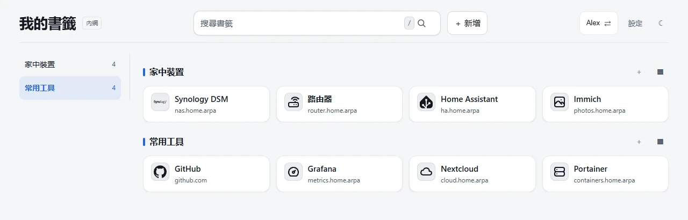

# launchbay

> 一開啟主頁，書籤就都在一頁上；跑在自己機器上，不用註冊，斷網也能用。

[](../../LICENSE) [](https://github.com/rockbenben/365opensource)

[▶ 快速開始](#快速開始) · [GHCR](https://github.com/rockbenben/launchbay/pkgs/container/launchbay) · [docker-compose.yml](https://raw.githubusercontent.com/rockbenben/launchbay/refs/heads/main/docker-compose.yml)

[English](../../README.md) · [简体中文](../../README.zh.md) · **繁體中文** · [日本語](README.ja.md) · [한국어](README.ko.md) · [Español](README.es.md) · [Português](README.pt.md) · [Français](README.fr.md) · [Deutsch](README.de.md) · [Italiano](README.it.md) · [Русский](README.ru.md) · [العربية](README.ar.md) · [हिन्दी](README.hi.md) · [বাংলা](README.bn.md) · [ไทย](README.th.md) · [Türkçe](README.tr.md) · [Tiếng Việt](README.vi.md) · [Bahasa Indonesia](README.id.md)



把記不住的那些地址放進一頁：NAS 管理後臺、路由後臺、公司 OA、監控面板。把它設成瀏覽器主頁，之後每次點開就是它，**一點就到，不用等轉圈**。

跑在你自己那臺機器上——家裡 NAS、樹莓派、軟路由，或公司內網的一臺伺服器——書籤不經過別人的伺服器。

## 支援範圍

| 方面 | 認不認你的 |
|---|---|
| 怎麼跑 | `docker compose up -d`，或直接跑靜態二進位制（amd64 / arm64） |
| 跑在哪 | 家裡 NAS、樹莓派、軟路由，或公司內網的一臺機器 |
| 誰在用 | 一個人、一家人，或一個不想裝一堆東西的小團隊；每人一份，管理員管賬號不管內容 |
| 瀏覽器 | 任意現代瀏覽器；關掉 JavaScript，全部書籤照樣看得見、點得動 |
| 要裝什麼 | 只要 Docker：零第三方庫、零資料庫、構建期不需要 Node |
| 資料在哪 | 一個普通目錄 `data/`，備份就是整目錄拷走 |
| 介面語言 | 18 種介面語言，見上方的語言連結。每個檔案可個別設定。 |

## 它能做什麼

**存進來與整理**

- **拖進來就存**：從書籤欄、位址列或另一個標籤頁把連結拖到某一組上，不彈窗——落點就是答案。
- **拖著排**：組內換位、跨組搬、拖到組標題追加。長按或快捷鍵進多選，一次打標籤、移動或刪除。
- **看到就存**：把 bookmarklet 拖進書籤欄，任何網頁一點就把地址帶回來，再按一次儲存才落庫。
- **從瀏覽器匯入**：傳 Chrome / Edge / Firefox 匯出的 HTML，給你逐條對賬報告——進了哪些、沒進哪些、為什麼。網頁上可以直接匯入，也可以先看報告；命令列同一趟就寫，加 `--dry-run` 只停在報告。
- **整份搬走**：一個檔案裝下書籤**和**這一頁的樣子（主題、排法、檢視、第二行、頁面名、語言、地址模式）。PIN、檔案身份、背景圖刻意不放進去。

**找得到**

- **分組與搜尋**：頂欄搜名字、地址、說明、標籤，回車由服務端出結果，不需要 JavaScript；開著指令碼時按 `/` 或 `⌘/Ctrl K`。
- **常用大卡**：把高頻分組設為「大卡」，在頁面頂部聚合成大卡片。
- **一萬多個圖示，離線可用**：Tabler 與 Simple Icons 壓縮後嵌進二進位制；favicon 抓一次，之後從本機快取出圖。

**在家與外出**

- **一條書籤，兩套地址**：填主地址和選填的外網地址。「自動」按你開啟導航臺的地址選；「設定 → 書籤地址」可以按當前瀏覽器手動覆蓋。搜尋與複製用當前生效的地址；沒填外網地址的繼續用主地址。反向代理要保留原始 `Host`。

**這一頁本身**

- **一個面板**：頂欄「設定」裡集中了這一頁的樣子與語言、分組列表、備份與歷史，以及「我的 PIN」——給自己上鎖或撤鎖，不用找管理員。
- **斷網也能點**：最近一頁快取在瀏覽器裡；離線時，或機器連不上時，加的書籤先排隊，瀏覽器恢復聯網後自動重放，機器本身沒起來就點「補進去」。
- **指令碼和 AI 有自己的鑰匙**：REST 介面加按檔案作用域的令牌，擴充套件、命令列、自動化各用各的；越界寫別人的檔案一律 403。
- 在「設定 → 備份與歷史」中還原先前的書籤版本。

## 快速開始

```bash
git clone https://github.com/rockbenben/launchbay
cd launchbay
```

> [!IMPORTANT]
> 啟動前，請在 `docker-compose.yml` 中設定自己的 `LAUNCHBAY_ADMIN_TOKEN`。

在 Linux 或 NAS 上部署時，請先準備資料目錄。

```bash
mkdir -p ./data
sudo chown 65534:65534 ./data
```

```bash
docker compose up -d
```

不需要 `.env`，不需要裝 Go，映象直接拉。

在區域網裡**任何一臺裝置**上開啟 **http://<這臺機器的內網地址>:7600**——別用 `localhost`，它指的是「這臺裝置」，在手機上輸它開啟的是那部手機。人就在機器跟前時，`http://localhost:7600` 可用。

映象是 `:latest`，首次 `up` 拉最新一次釋出；已經跑著的機器本機已有映象，要先 `docker compose pull` 才更新。

開啟它會進入一次性建檔頁：給第一份檔案起名、設 4–6 位 PIN。沒有預設賬號密碼；磁碟上建出任何一份檔案之後，這一頁就永久關閉。 進入檔案後，按「新增」儲存第一筆書籤。

**「不設 PIN」是一個單獨的勾，不是空著不填。** PIN 空著會被拒；勾上「不設 PIN」才建出一份對區域網敞開的檔案。這是故意的——最容易出的錯是少敲一位就回車，把一個人的書籤悄悄公開給全家。不設 PIN 的檔案在選擇頁上連 PIN 框都不畫。之後可以在「我的 PIN」裡補上或撤掉；撤掉時只有本來就有 PIN 才要舊 PIN。

第一份檔案**不是管理員**。管這臺機器的是 `LAUNCHBAY_ADMIN_TOKEN`：開啟 `/admin` 輸一次，拿到一條只屬於管理身份的 cookie（30 天）。

**後來的人不用等管理員。** 選擇頁上有一枚摺疊的「建立檔案」：展開、填名字與 PIN 就建好（`POST /new`；機器那條是 `POST /api/v1/profiles/new`）。它不要任何憑證，區域網裡任何裝置都能建，選擇頁會多一張卡，管理員隨時能刪。建出來的是**空的**檔案，只屬於它自己的 PIN，不給人看別人的書籤。名字最多 60 個字；跟別人重名，兩張卡就分不清。

**刪檔是唯一找不回來的動作**，所以要多問一次：確認頁寫明會刪掉多少書籤、多少快照，再輸一次 `LAUNCHBAY_ADMIN_TOKEN` 才真的刪。機器那條（`DELETE /api/v1/profiles`）只認這把 key，只帶管理 cookie 是 403。快照和私有背景圖跟著檔案一起沒了，回退救不了。

同一頁還有**介面語言**下拉框，裝的時候順手選。它定的是**全機預設**；之後每個人可以在自己的面板裡選，管理員改的隻影響還沒選過的人。

### 管理金鑰與令牌

| 變數 | 要不要填 | 管到哪 |
|---|---|---|
| `LAUNCHBAY_ADMIN_TOKEN` | **必填**，一把裸 key | 只管賬號：建檔、刪檔、給任意檔案設 PIN、停用/啟用、跨檔案狀態與歷史。所有內容端點（`/api/v1/data`、`/batch`、`/export` 等）一律 403——讀不到書籤 |
| `LAUNCHBAY_WRITE_TOKENS` | 選填，預設留空 | 檔案作用域寫令牌 `name:secret:profile`（名字:金鑰:檔案）。只有瀏覽器擴充套件、命令列（`revert` / `import-bookmarks` / `backup` / `restore` / `profile fix-names`）與 AI 或指令碼要它 |

> **為什麼預設留空？** 書籤頁、管理頁、回退、匯入全走會話 cookie，一個令牌都不需要；需要令牌的那三樣本來就要人主動去裝。留一個預設值，等於給每臺機器白送一把能寫 `dad` 那一份的鑰匙（`dad` 是最常見的檔案 id）。

檔案本身沒有「是不是管理員」這個屬性。管理頁顯示賬號層面的動作，以及每份檔案的條目數、版本、最近改動、有沒有設 PIN。

> **檔案 id 從名字派生，不一定叫 `dad`。** 名字裡的 ASCII 字母數字會變成 slug（`Dad` → `dad`、`nas box` → `nas-box`）；中文名轉不出可用的 slug，一律落到 `home` / `home-2` 序列。作用域寫 `…:dad` 的令牌於是對不上任何檔案，打過去是 403——把令牌作用域改成實際 id（推薦），或第一份檔案就用 ASCII 名字。

宿主埠預設 7600。有些 Windows 機器上 Hyper-V 佔著一塊埠（實測 7532–7631）；`up` 報埠被佔時，換一個塊外的空閒埠：`LAUNCHBAY_HOST_PORT=8901 docker compose up -d`（容器內埠不動）。專案名與容器名都寫死成 `launchbay`，所以 `docker logs launchbay`、`docker exec launchbay …` 跟 clone 到哪個目錄無關。

### 瀏覽器擴充套件（可選）

`extension/` 是一個 Chrome / Edge 擴充套件（Manifest V3）：右鍵把當前頁面存進指定檔案，或一次收藏當前視窗的所有標籤頁。它不在映象裡，要自己裝。

擴充套件讀不到會話 cookie，所以需要一個檔案作用域的令牌。先填 `LAUNCHBAY_WRITE_TOKENS`、重啟，然後：

1. 開啟 `chrome://extensions`，右上角開**開發者模式**
2. 點**載入已解壓的擴充套件程式**，選 `extension/`
3. 開啟擴充套件的選項頁，填這臺機器的地址（不帶結尾斜槓）、預設檔案 id、令牌裡那段金鑰
4. 點**測試連線**

「試一下」答 403 不是網路壞了，是令牌與檔案 id 對不上。改 `LAUNCHBAY_WRITE_TOKENS` 裡的作用域，重啟再試。

裝好之後：任意網頁右鍵就能存；選項頁還能把整棵瀏覽器書籤樹導進來，第一次用才問「讀書籤」許可權。三條匯入通路（網頁、擴充套件、命令列）都**只進空檔案**——匯入是整份替換，不是往上疊加。Chrome 會警告「讀取和更改您在所有網站上的資料」，那來自擴充套件響應右鍵所需的 `http://*/*` 與 `https://*/*`；令牌只存在 `chrome.storage.local`，不進同步。Firefox 未驗證。

### 資料目錄的許可權

資料預設落在 `docker-compose.yml` 同目錄的 `./data`，容器裡永遠是 `/data`。想放別處就改 `volumes`：

```yaml
    volumes:
      - /volume1/docker/launchbay:/data
```

Windows 上寫絕對路徑，`D:` 的冒號會和分隔符打架，改用長語法：

```yaml
    volumes:
      - type: bind
        source: D:/launchbay-data
        target: /data
```

容器以 **uid 65534** 執行，而宿主機上那個目錄通常歸 root——建檔、匯入、寫書籤會全部失敗。在宿主機上把它交給這個使用者：

```bash
sudo chown -R 65534:65534 ./data
```

別用 `--user root` 繞過：那等於讓服務以 root 身份寫你家每一個檔案。體檢每次都會在資料目錄裡建刪一個探針檔案，許可權不對時 `docker ps` 直接顯示 **unhealthy**，日誌裡也會打出同一句 chown。建檔頁說的是同一句話（容器裡是 `uid 65534`；直接跑二進位制就換成你自己的系統使用者）。

## 怎麼用

| 你要做 | 去哪 |
|---|---|
| 改這一頁的樣子、檢視、分組、背景、地址模式與點開方式 | 頂欄「設定」，或 `POST /prefs`、`/prefs/background`、`/prefs/group`、`/prefs/tabs` |
| 改自己這一份的 PIN | 自己面板的「我的 PIN」，或 `POST /prefs/pin` / `POST /api/v1/profiles/self/pin` |
| 建檔、刪檔、給別人設 PIN、停用某個人 | `/admin`（或選擇頁底部的管理連結）。刪檔會再要一次 key；賬號層面命令列只有 `profile create` 與 `profile rebuild` 兩條 |
| 給自己再建一份 | 選單頁摺疊的「建立檔案」，或 `POST /api/v1/profiles/new`（免憑證） |
| 收拾「名字就是地址」的條目 | `launchbay profile fix-names --profile <id>`（先加 `--dry-run`） |
| 讓 AI 或指令碼改書籤 | `POST /api/v1/batch`，帶 `expectedRev` |
| 救壞檔 | `POST /api/v1/profiles/rebuild`，或 `launchbay profile rebuild` |
| 看改動都發生過什麼 | `GET /api/v1/history`（只記動作與路徑，不記內容） |
| 匯出或匯入一整份檔案 | `GET /api/v1/backup` / `POST /api/v1/restore`、`launchbay backup` / `restore`，或設定裡的「備份與歷史」 |

其他機器通路：`POST /api/v1/usage` 記點選，`POST /api/v1/resolve` 把 URL 變成標題與圖示，`GET /api/v1/status` 是管理員的跨檔案彙總。

備份不含 PIN、檔案身份與背景圖。帶書籤的備份只進空檔案；只帶設定的隨時能導。匯入在檔案鎖核心對版本號，撞上併發就回 409 `[rev-conflict]` 與 `currentRev`。這樣寫進去的設定不碰版本號，也不進「回退」。

**完整的端點、請求體與錯誤碼見 [AGENTS.md](../../AGENTS.md)**——給 AI 讀的權威契約，欄位名逐個對過路由表，改一處會有測試紅。這裡不復述第二份。

**命令列的習慣**：結果走 stdout，失敗走 stderr，失敗資訊帶著服務端錯誤碼（`[rev-conflict]`、`[ops-invalid]`）。`import-bookmarks` 的檔案是位置引數，打報告和寫入是同一趟（`--dry-run` 只停在報告）；備份與匯出直接流式讀完整響應，超過 4 MiB 也沒問題。`--help` 與 `-h` 退 0，用法錯誤退 2，其餘失敗退 1。`revert --to 0` 會被當用法錯誤拒掉，並列印那條能用的 `curl`。

**零 JavaScript 是底線，不是上限。** 搜尋是表單，建檔與設 PIN 是原生表單提交，關掉指令碼全部書籤照樣看得見、點得動，站內還有「跳到正文」的跳鏈。在此之上只有一層增強：新增浮層、就地編輯、拖拽排序、⌘K 面板與離線支援；增強層壞了，零 JS 那條路一直在。

## 限制

- **只在區域網內用，沒有 HTTPS。** 書籤內容是明文 JSON 躺在磁碟上；放到公網前，自己加一層 TLS 反代。
- **一個檔案的壞 `profile.json` 會鎖住那一份。** `revert` 救不了它；`POST /api/v1/profiles/rebuild`（或 `launchbay profile rebuild`）只重寫那一個檔案，書籤、快照、歷史一個位元組都不碰。
- **抓圖示有冷卻**：同一個 origin 失敗後 24 小時內不再抓。24 小時冷卻讓失敗的站點不被反覆探測。
- **沒有共享清單**：不能把一條書籤共享給全家，也不能公開一頁。各存各的就是各存各的。
- **還沒在 NAS 真機上驗收過。** 三輪驗收都跑在 Windows + Docker Desktop；區域網 LCP 目標、真機冷啟動、1,000 條書籤的滾動幀率、離線快取命中延遲，都還沒測。
- **不內建天氣、時鐘這類掛件。** 它們不在這一頁的定位裡。頁尾文字與書籤內容都走 `POST /api/v1/batch`；盤上的檔案歸服務端管。
- **介面語言只覆蓋介面，不覆蓋給指令碼讀的句子。** API 的 `detail`、欄位校驗原因、給指令碼讀的匯入報告仍是中文（網頁上那一屏跟頁面語言走）。呼叫方要的是穩定可對照的文字；書籤標題、分組名、網址是內容，同樣不翻。
- **令牌預設空著**，所以擴充套件與命令列預設不可用，要用了再加；管理員那把 `LAUNCHBAY_ADMIN_TOKEN` 反過來是必填的，缺了服務起不來。

## 映象從哪來

compose 只管拉已釋出的映象，構建是 CI 的事。打一個 `v*`（或手動 dispatch），`.github/workflows/docker.yml` 會構建 amd64 與 arm64，推到 Docker Hub 與 GHCR。釋出標籤是 `<version>`、`<major>.<minor>`、`<major>`，加上 `latest` 與 commit 短 sha；映象版本只來自 git tag。

不想 clone 也行，直接拉映象：

```bash
docker run -d --name launchbay -p 7600:7600 \
  -v launchbay-data:/data -e LAUNCHBAY_DATA_DIR=/data \
  -e LAUNCHBAY_ADMIN_TOKEN="換成你自己的管理金鑰" \
  --health-cmd "/launchbay healthcheck" --health-interval 30s \
  ghcr.io/rockbenben/launchbay:latest
```

## 關於 365 開源計畫

[365 開源計畫](https://github.com/rockbenben/365opensource) 的第 **#042** 個專案——一人 + AI，一年 300+ 個開源專案。

[提交你的需求 →](https://365.aishort.top/) · [Discord](https://discord.gg/PZTQfJ4GjX) · [Telegram](https://t.me/aishort_top)
